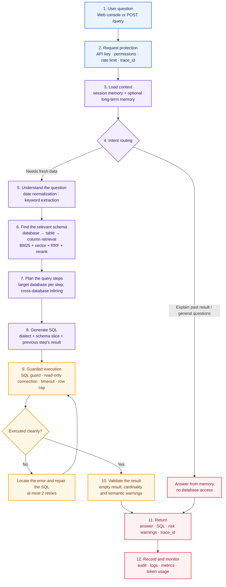
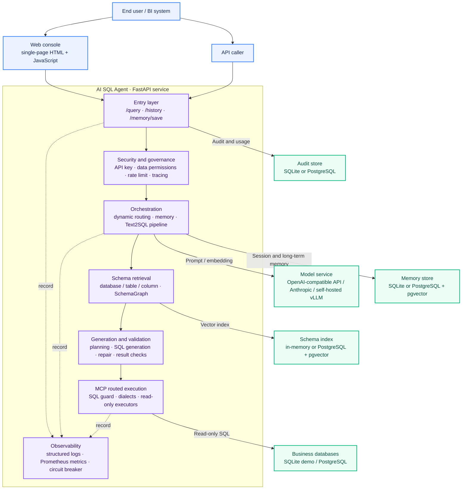

# AI SQL Agent

**English** | [简体中文](README.zh-CN.md)

> Let non-technical users query business data in plain language: the system understands the question, generates read-only SQL, executes it and returns the result.

AI SQL Agent is a Text2SQL service that runs locally or on an internal network. It handles multi-database queries, conversational memory, data permissions, failure repair and end-to-end auditing. With no model key configured it falls back to mocks, so the demo and the full test suite run offline.

## What it does

| Capability | Details |
| --- | --- |
| Natural-language querying | For example: `list suppliers whose on-time rate is below 0.9` |
| Multi-database queries | Splits cross-database questions automatically; each step's result becomes the next step's filter |
| Conversation and memory | Distinguishes "fetch new data" from "explain the last result"; short-term sessions plus per-user long-term memory |
| Safety and control | API keys, table/column permissions, read-only SQL, row and timeout caps, rate limits and quotas |
| Reliability and traceability | Failed SQL is repaired automatically; every request carries a `trace_id`, an audit record and metrics |

## Where it stands

Measured on 2026-09-09 against the release gate in `benchmark/`, with
`claude-sonnet-5` as the model, three full runs of the 150-case set, and the
built-in demo metadata. The gate is **not yet passed**; the numbers are here so
the README says the same thing the benchmark does.

| Metric | Threshold | 2026-09-08 | 2026-09-09 |
| --- | --- | --- | --- |
| Single-database execution accuracy | ≥ 85% | 89.6% | **93.3%** ✅ |
| Cross-database execution accuracy | ≥ 90% | 73.3% | **85.3%** ❌ |
| Silent-error rate | ≤ 3% | 10.0% | **5.3%** ❌ |
| Risk-warning false-alarm rate (guardrail) | ≤ 20% | 5.9% | 5.6% ✅ |
| Overall execution accuracy | — | 86.9% | **92.0%** |

The jump between the two dates comes from one change: the schema graph now
labels each JOIN as one-to-one, one-to-many or many-to-many, and the SQL prompt
asks for `DISTINCT` after a one-to-many JOIN and for the table's own primary key
in listings and group-bys. Missed de-duplication fell from about eight failures
per run to one, with no correct answers lost. Read the caveats in
[the measurement record](benchmark/baseline/2026-09-09/README.md) before quoting
these numbers: the demo metadata is not the deployment semantic layer, and the
current wording of the primary-key rule has only one full run behind it.

Run it yourself with `make gate` (needs model credentials) or `make gate-smoke`
(offline subset).

## How a request flows



Notes: when the model is unavailable, routing falls back to rules. The main SQL path prefers replaying a previously successful statement for the same question from the same user, re-checking permissions before execution. When it cannot degrade safely, the API returns the reason for the degradation explicitly.

## Architecture



## Quickstart

### 1. Run locally, no model key required

```bash
pip install -e ".[dev]"          # or: make install

# End-to-end examples: single-database and cross-database
python examples/end_to_end.py    # or: make demo

# Full offline test suite
python -m pytest tests -q        # or: make test
```

### 2. Start the API and web console

```bash
./scripts/run_api.sh             # or: make run
```

Open [http://localhost:8000](http://localhost:8000) and ask a question, or call the endpoint directly:

```bash
curl -X POST http://localhost:8000/query \
  -H 'Content-Type: application/json' \
  -d '{
    "user_id": "u1",
    "session_id": "s1",
    "query": "list suppliers whose on-time rate is below 0.9"
  }'
```

API key checks are off by default for local runs. In production, set `AI_SQL_AUTH_MODE=api_key` and provide a permissions file.

### 3. Point it at your own databases

The demo ships with four sample databases. To use your own, describe them in a
semantic metadata directory: what each table and column means, what people call
them, and how the databases relate. Retrieval, planning and metric explanations
all read from it.

```bash
python -m ai_sql_agent.semantic export semantic/     # export the demo metadata as a template
# edit semantic/*.yaml: real table and column names, business wording, connections
python -m ai_sql_agent.semantic validate semantic/   # checks it against the real databases
```

`validate` compares the metadata with the live schema and reports both directions:
tables you documented that do not exist (the model will write SQL against them and
fail), and tables that exist but are undocumented (invisible to the model, so those
questions can never be answered). Point the service at it with
`AI_SQL_SEMANTIC_DIR=semantic/`. Without it, retrieval falls back to literal column
name matching and everyday phrasing stops working.

### 4. Connect a real model (optional)

```bash
cp .env.example .env
```

Fill in at least one of the following in `.env`:

```bash
# OpenAI, or any OpenAI-compatible service
AI_SQL_MODEL_PROVIDER=openai
OPENAI_API_KEY=sk-xxx
OPENAI_BASE_URL=https://api.openai.com/v1

# Or switch to the Anthropic protocol
# AI_SQL_MODEL_PROVIDER=anthropic
# ANTHROPIC_API_KEY=sk-ant-xxx
```

Self-hosted vLLM, Ollama and other OpenAI-compatible endpoints work too; see the [deployment guide](docs/deployment.md) for the full configuration.

## Key design decisions

| Topic | Approach |
| --- | --- |
| Business semantics | Table and column meanings, aliases, cross-database join keys and metric definitions live in editable per-database YAML, not in code. This is what the model knows about the business; with real databases it is the main accuracy lever |
| Getting better with use | Users mark answers right or wrong. Wrong ones become eval cases, confirmed ones become reference queries injected into later prompts for similar questions |
| Schema retrieval | Locate the database first, then tables and columns; hybrid retrieval feeds a SchemaGraph, which is trimmed to a token budget. Each relation in the graph carries its JOIN cardinality, inferred from primary keys and defaulting to many-to-many when unsure |
| SQL generation | The prompt gets the dialect, the schema slice and the previous step's result, plus two rules that closed half of the cross-database failures: output the table's own primary key when listing or grouping, and add `DISTINCT` after a one-to-many JOIN when only the "one" side is projected |
| Cross-database queries | The plan names a target database per step; each result is converted into filter literals for the next step |
| SQL safety | Only `SELECT` / `WITH` are allowed; multiple statements and writes are rejected; the connection layer adds a read-only transaction or connection as a backstop |
| Execution reliability | Every statement has a row cap and a timeout; failures are traced to the offending clause and repaired locally |
| Result trustworthiness | Empty results, unexpected result sizes and question/SQL semantic mismatches surface as visible warnings |
| Permissions | Unauthorized tables and columns never enter the model context; the actual SQL is re-checked against them before execution |
| Observability | `X-Trace-Id` spans the request; audit records capture the SQL, the databases and tables hit, latency, repairs and token usage |

## Endpoints

| Endpoint | Purpose |
| --- | --- |
| `GET /` | Built-in query console |
| `POST /query` | Natural-language query entry point |
| `GET /history` | Query history (own records only by default) |
| `POST /memory/save` | Save a result into personal long-term memory |
| `POST /feedback` | Mark an answer right or wrong (feeds the eval set and certified queries) |
| `GET /feedback/stats` | Live accuracy and silent-error rate from real usage (admin) |
| `GET /health` | Liveness check |
| `GET /readyz` | Readiness check (storage and vector backend) |
| `GET /metrics` | Prometheus metrics |
| `POST /admin/schema/reload` | Admin-triggered schema index rebuild |

The `POST /query` response carries `answer`, the SQL and result of each step, `has_risk`, `degraded` and `trace_id`, so a frontend can display and debug a query without extra calls.

## Module map

```text
src/ai_sql_agent/         Application package (installed with `pip install -e .`)
  api/                    FastAPI service and built-in web console
  a2a/                    Agent-to-agent streaming endpoint (a2a-contract)
  mcp_server/             MCP server exposing the read-only query tool
  pipeline/               Dynamic routing and end-to-end orchestration
  normalization/          Question normalization: dates and coreference
  retrieval/              Three-stage schema retrieval and SchemaGraph
  indexing/               Schema index building: embeddings and pgvector
  planning/               Multi-step and cross-database query planning
  generation/             SQL generation
  execution/              SQL guard, dialects and read-only executors (MCP routed)
  repair/                 Repair loop for failed SQL
  validation/             Result risk checks
  memory/                 Short-term sessions and long-term memory
  auth/                   API keys, identity, table and column permissions
  audit/                  Audit records
  semantic/               Business semantics per database: meanings, aliases, join keys, metrics
  feedback/               User verdicts: wrong answers to the eval set, right ones to certified queries
  ops/                    Read-only database roles and least-privilege grants
  core/                   Settings, model transport, logging, metrics, circuit breaker
  resources/demo_sql/     DDL and seed data for the four demo databases
tests/                    Offline test suite, pgvector integration and cross-repo contract cases
benchmark/                Evaluation set, thresholds, baselines and the release gate
examples/                 Runnable demos, one per pipeline stage
scripts/                  Dev helpers: run_api.sh, check_env.py
tools/sim_erp/            Simulated multi-database ERP for realistic-scale testing
deploy/                   Dockerfile, Docker Compose stacks, API key template
docs/                     Walkthrough, deployment and operations guides, module docs
```

## Further reading

- [Project walkthrough (Chinese)](docs/walkthrough.zh-CN.md): a module-by-module deep dive, the five design threads, and a talk track for explaining the system
- [Deployment and operations](docs/deployment.md): Docker Compose, permissions, model integration, monitoring and troubleshooting
- [End-to-end orchestration](docs/modules/pipeline.md): dynamic routing and memory examples
- [Schema retrieval](docs/modules/retrieval.md): hybrid recall and SchemaGraph
- [MCP execution](docs/modules/execution.md): read-only SQL, dialects and executors
- [Benchmark](benchmark/README.md): dataset, accuracy and the release gate
- [Latest measurement](benchmark/baseline/2026-09-09/README.md): before/after of the JOIN-cardinality change, with its limitations (Chinese)
- [Authorization model](docs/authz-model.md): row scopes and impersonation in the policy model (Chinese)
- [Least-privilege runbook](docs/least-privilege-runbook.md): creating read-only database roles for real business databases (Chinese)
- [Contract feedback](docs/contract-feedback.md): issues handed back to the `a2a-contract` repository (Chinese)
