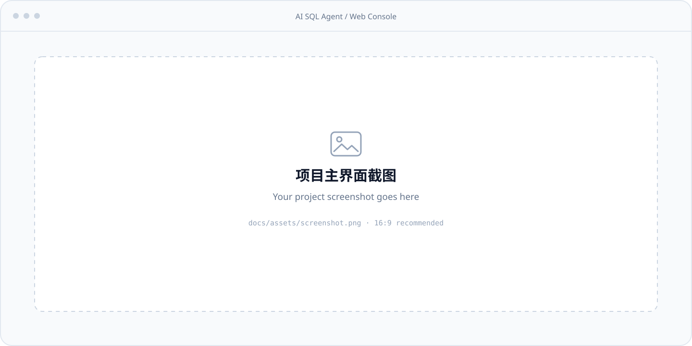

<div align="center">

# AI SQL Agent

**Ask business questions in plain language. Keep every SQL query controlled and traceable.**

A Text2SQL service for SQLite and PostgreSQL, with cross-database planning, business semantics, conversational memory, and result validation.

[](pyproject.toml)
[](src/ai_sql_agent/api)
[](deploy/docker-compose.pgvector.yml)
[](https://github.com/heyemlee/ai-sql-agent/actions/workflows/ci.yml)

**English** · [简体中文](README.zh-CN.md)

[Quickstart](#quickstart) · [Architecture](#architecture) · [Tech stack](#tech-stack) · [Design decisions](#design-decisions) · [Evaluation](#evaluation-and-current-limits)

</div>

## Preview

<!-- When ready, add docs/assets/screenshot.png and replace the src below with docs/assets/screenshot.png. -->
<p align="center">
  
</p>

> **“List suppliers whose on-time rate is below 0.9”** → retrieve the business schema → generate and execute read-only SQL → return results, SQL, and risk warnings.

- **Cross-database queries** — split a question into steps and pass intermediate results as filters to the next database.
- **Conversational context** — distinguish fresh queries from explanations of previous results, with optional personal long-term memory.
- **Controlled execution** — table/column permissions (views checked against their base tables), read-only connections, timeouts, and row and result-size caps; separate SQL repair from result risk checks.
- **Reproducible evaluation** — four demo databases, offline mocks, a benchmark, and a release gate; run locally or on an internal network.

## Architecture


Created with [Archify](https://github.com/tt-a1i/archify) · [Interactive HTML](docs/diagrams/architecture.html) (download and open in a browser) · [Editable JSON](docs/diagrams/architecture.json)

The diagram shows logical modules, primarily within one Python service. Model calls are shared across retrieval, planning, and generation. Session, memory, and audit storage use SQLite or PostgreSQL according to configuration; vector indexing can use pgvector.

A fresh query follows **normalization → database / table / column retrieval → planning → SQL generation → guarded execution → result validation**. Questions about past results use the memory-based answer path; simple single-database queries can skip a separate planning call. Executors run in-process by default, with an optional MCP stdio execution path.

## Tech stack

| Layer | Technology | Role |
| --- | --- | --- |
| Runtime & API | Python 3.11+ · FastAPI · Uvicorn · Pydantic v2 | Typed requests/responses, service endpoints, configuration validation |
| Web console | Vanilla HTML · CSS · ES modules (no build step) | Ask in plain language, browse the data catalog, review history; served by FastAPI |
| Model transport | HTTPX · OpenAI-compatible protocol · Anthropic protocol | Planning, SQL generation, and answers; compatible endpoints include vLLM / Ollama |
| Schema retrieval | Custom BM25 · NumPy vector index · RRF · Rerank client | Fuse lexical and semantic recall across databases, tables, and columns |
| Business semantics | PyYAML · SchemaGraph | Field meanings, aliases, metrics, join keys, and JOIN cardinality |
| SQL & storage | SQLite · PostgreSQL · psycopg · pgvector | Business queries, persistent state, and optional vector search |
| Authorization & integration | SQLGlot · MCP Python SDK · A2A / SSE | SQL AST authorization, read-only tools, and agent streaming endpoints |
| Engineering & operations | pytest / unittest · GitHub Actions · Docker Compose | Automated verification and image builds; structured logs and Prometheus-format metrics |

Pinned dependencies live in [pyproject.toml](pyproject.toml). A vector database is optional. Without model credentials, mocks exercise the pipeline; real natural-language querying requires a model.

## Design decisions

| Engineering problem | Implementation | Source |
| --- | --- | --- |
| Business language differs from column names | Editable YAML descriptions, aliases, and metric definitions shared by retrieval, planning, and metric explanations | [semantic](src/ai_sql_agent/semantic) |
| Large schemas exceed prompt budgets | Database → table → column retrieval; BM25 + vectors, RRF fusion, and reranking; trim SchemaGraph by relevance while prioritizing join keys | [retrieval](src/ai_sql_agent/retrieval) · [schema budget](src/ai_sql_agent/pipeline/schema_budget.py) |
| One SQL JOIN cannot span independent databases | Bind each step to a database, inline intermediate results as filters, check plan/database consistency, and reject references outside the step's database | [pipeline](src/ai_sql_agent/pipeline/text2sql_pipeline.py) |
| Valid SQL can return the wrong answer | Annotate JOIN cardinality, prompt for de-duplication and primary-key projection, then check empty results, cardinality, and semantic consistency | [graph_builder](src/ai_sql_agent/retrieval/graph_builder.py) · [validation](src/ai_sql_agent/validation) |
| Generated SQL exceeds the user's permissions | Filter model-visible schema; analyze tables/columns/scopes with SQLGlot, expand views to their base tables, and deny unparseable SQL; then a read-only guard on the SQLGlot AST, a default-deny SQLite authorizer, and read-only connections | [AST analysis](src/ai_sql_agent/auth/sql_analysis.py) · [views](src/ai_sql_agent/auth/views.py) · [execution](src/ai_sql_agent/execution) |
| SQL execution or model calls fail | Localized SQL repair, at most 2 attempts by default; on model failure, try the same user's previously successful SQL for the same question, reauthorize it, and explicitly report degradation | [repair](src/ai_sql_agent/repair) · [fallback logic](src/ai_sql_agent/pipeline/text2sql_pipeline.py) |
| Failures are hard to reproduce | Link SQL, databases/tables, latency, repairs, and token usage through `trace_id`; export user feedback as eval cases and use confirmed queries as generation examples | [audit](src/ai_sql_agent/audit) · [feedback](src/ai_sql_agent/feedback) |

Default execution limits are **1,000 rows, 10 seconds, and 8 MiB per result** (SQLite also caps a single value at 8 MiB), configurable through [PipelineConfig](src/ai_sql_agent/pipeline/objects.py) and the `AI_SQL_MAX_*` variables; see [Execution limits](docs/deployment.md#execution-limits). Result checks surface risk; they do not guarantee business correctness.

## Quickstart

Requires **Python 3.11+**. Start in a fresh directory:

```bash
git clone https://github.com/heyemlee/ai-sql-agent.git
cd ai-sql-agent
python3 -m venv .venv
source .venv/bin/activate
pip install -e ".[dev]"

# Mocks are used when model credentials are absent
python examples/end_to_end.py
./scripts/run_api.sh
```

Open [http://localhost:8000](http://localhost:8000), or call the API:

```bash
curl -X POST http://localhost:8000/query \
  -H 'Content-Type: application/json' \
  -d '{"user_id":"u1","session_id":"s1","query":"list suppliers whose on-time rate is below 0.9"}'
```

### Connect a model

For first-time setup, copy `.env.example` to `.env` and fill in your provider's credentials, endpoint, and model names. Edit an existing `.env` directly.

```dotenv
AI_SQL_MODEL_PROVIDER=openai
OPENAI_API_KEY=your-api-key
OPENAI_BASE_URL=https://api.openai.com/v1
AI_SQL_CHAT_MODEL=your-chat-model
AI_SQL_CODER_MODEL=your-coder-model
```

For Anthropic, use `AI_SQL_MODEL_PROVIDER=anthropic` and `ANTHROPIC_API_KEY`. Embedding and reranking have separate credential/endpoint settings; see [.env.example](.env.example) and the [deployment guide](docs/deployment.md). Restart after editing `.env`.

The connection can also be changed in the console without a restart: **Settings → Advanced settings → Model connection** (admin key required; on an instance without sign-in, only from the machine it runs on). Test it there, save, and it applies to the next question. A connection saved this way outranks `.env` until you restore the server configuration — see [Changing the model connection from the console](docs/deployment.md#changing-the-model-connection-from-the-console).

Schema retrieval uses local hash vectors unless you configure a real embedding model, either with `AI_SQL_EMBEDDING_BACKEND=remote` in `.env` or under **Settings → Advanced settings → Embedding**. Saving there tests the endpoint, rebuilds the retrieval index with the new model and only then switches to it. With OpenAI reasoning models (gpt-5 and later) requests carry `reasoning_effort` (`AI_SQL_REASONING_EFFORT`, default `low`) and `max_completion_tokens` instead of a temperature, and intent routing uses a strict JSON schema.

### Connect your databases

```bash
python -m ai_sql_agent.semantic export semantic/
# Edit semantic/*.yaml: connections, tables/columns, aliases, join keys, and metrics
python -m ai_sql_agent.semantic validate semantic/
```

Set `AI_SQL_SEMANTIC_DIR=semantic/` and restart. Validation compares metadata with the live database schema. Without a configured directory, the built-in demo semantic layer is used.

The simplified cabinet-shop example uses four databases, nine tables, and 60 columns linked by order number.
Generate its data and set `AI_SQL_SEMANTIC_DIR=tools/simple_erp/semantic`; see the [simplified database guide](tools/simple_erp/README.md).

For shared deployments, enable `AI_SQL_AUTH_MODE=api_key` and configure permissions and read-only database accounts. See the [deployment guide](docs/deployment.md) for Docker Compose, pgvector, and private vLLM setups.

## Evaluation and current limits

**Historical baseline, 2026-09-09:** 150 demo cases, three-run aggregate, model identifier `claude-sonnet-5`, built-in demo metadata. **The release gate has not passed.**

| Metric | Result | Gate |
| --- | --- | --- |
| Single-database execution accuracy | **93.3%** | ≥ 85% |
| Cross-database execution accuracy | **85.3%** | ≥ 90%; below target |
| Silent-error rate | **5.3%** | ≤ 3%; above target |
| Risk-warning false-alarm rate | **5.6%** | ≤ 20% |
| Overall execution accuracy | **92.0%** | — |

These numbers do not establish current-commit accuracy on real business databases. The three-run record used an earlier primary-key prompt rule; the current expanded rule has only one full run. Demo metadata also differs from a deployment's semantic layer. See the [measurement record](benchmark/baseline/2026-09-09/README.md) for conditions, artifacts, and attribution.

```bash
python -m pytest tests -q   # Some integration cases need services / the contract repo
make gate-smoke            # Offline smoke coverage, not full release acceptance
make gate                  # Full release gate; requires model credentials
```

CI is configured for unit tests, pgvector integration, a pinned A2A contract, demos, and container smoke tests. See the [workflow](.github/workflows/ci.yml) and [benchmark guide](benchmark/README.md).

### Known limits and unfinished verification (updated 2026-10-14)

- **Conversation-summary input limits are verified offline only.** The model reads bounded per-message excerpts while stored results remain complete. There is no total prompt budget, and the explicit save-to-knowledge-base summary path remains unbounded. Real multi-turn summary quality has not been verified. See [memory verification and limits](docs/modules/memory.md#verification-and-remaining-limits-2026-10-06).
- **Model regression for the English adaptation is incomplete.** Two full gate rounds per side plus a partial third were run before the model key was disabled; the gate fails on the same three metrics before and after, and no full gate has been run on the final code. Record: [benchmark/baseline/2026-10-04](benchmark/baseline/2026-10-04/README.md). Do not cite those numbers as a baseline.
- **PostgreSQL is not verified on a real database** for anything added here: the identifier-case rules in authorization, the preview SQL (not schema-qualified; structure is read from `public`, names resolve through `search_path`), and the least-privilege binding; and, from the 2026-10-14 authorization fixes, the view catalog scan and view expansion, whole-row references (`e.*`), and the refusal of functions that run a string as SQL (`query_to_xml`, `dblink`, `set_config`, …). Unit tests only.
- **`AI_SQL_MAX_ROWS`, `AI_SQL_MAX_EXECUTION_SECONDS`, `AI_SQL_MAX_RESULT_BYTES` and `AI_SQL_MAX_VALUE_BYTES` are applied only to the API's in-process executors** (defaults 1000 rows / 10 s / 8 MiB / 8 MiB; the first two are the limits that were already in force while the variables were ignored). That is verified on SQLite; the PostgreSQL branch has unit tests against a stubbed driver only. On PostgreSQL the byte budget bounds what is returned, not what the driver has already received, and there is no per-value limit. The MCP stdio server keeps a fixed 1000 rows / 10 s / 8 MiB. Preview pages shrink to the row cap when it is lower than the page size.
- **Views under a restricted policy:** for a role with any deny rule, reading a view counts as reading all its base tables, so it is refused if a base table is denied, has column restrictions, or the view definition cannot be parsed. A table or view created after the last scan is refused until the next schema poll or `POST /admin/schema/reload`; while a database's scan is failing, such roles are refused everything in that database. An output alias that matches a denied column (`1 AS salary … ORDER BY salary`) is refused too. See [authorization model §3.1–3.2 (中文)](docs/authz-model.md).
- **The catalog reads table structure before checking the caller's policy** (cached, single-flight); nothing is returned to a caller who may not see it.
- **Handling of a rejected model credential is verified with mock transports only.** The wording lists that recognise "quota exhausted", "key disabled" and "model not permitted" are heuristics; state is per process; requests already in flight when the first rejection arrives cannot be recalled.
- **English UI:** dictionary text is shown as written when the semantic metadata has no English keys, and server-side free text (routing reason, validator notes, error messages) is Chinese.
- **Routing fallback:** when the routing model is unavailable, the rule-based fallback sends most colloquial Chinese questions (30 of the 40 hold-out phrasings) to conversation instead of a query.
- **Joint integration with the Helpdesk over A2A has not been run** for this change set.

<details>
<summary><strong>API reference</strong></summary>

| Endpoint | Purpose |
| --- | --- |
| `POST /query` | Answer, per-step SQL/results, risk flags, and trace information |
| `GET /history` | Query history; own records by default |
| `GET /whoami` | The identity this request resolves to (same resolution as `/query`) and what the service supports |
| `GET /catalog` | Data catalog the caller may see: domains, tables, fields, units, business terms |
| `POST /catalog/{database}/{table}/rows` | Read-only, paginated preview with search / filter / sort; no SQL accepted |
| `POST /catalog/{database}/{table}/profile` | Aggregates only, never rows: record count, how many values each field has, value breakdowns, records per month; same filters as the preview |
| `POST /memory/save` | Save personal long-term memory |
| `POST /feedback` · `GET /feedback/stats` | Answer feedback and administrator statistics |
| `GET /health` · `GET /readyz` | Liveness and readiness |
| `GET /metrics` | Prometheus-format metrics |
| `POST /admin/schema/reload` | Administrator-triggered schema index rebuild |

`POST /query` includes `answer`, `has_risk`, `degraded`, `trace_id`, and per-step execution information.

The catalog endpoints reuse the caller identity and table/column policy of `/query`. A preview is built server-side from an allowlist of real, visible columns, binds every value as a parameter, and runs through the same read-only executor and authorization gate as generated SQL. What it fetches is bounded in the database, not afterwards: long text is cut at 2,000 characters and binary fields return only their size. The profile behind the Data page's charts follows the same rules and returns aggregates only; a field's breakdown ignores that field's own filter, so a chosen value can be swapped for another.

</details>

<details>
<summary><strong>Repository map</strong></summary>

```text
src/ai_sql_agent/
  api/ · a2a/ · mcp_server/       Web console, HTTP API, and agent interfaces
  pipeline/ · normalization/     Routing, question normalization, orchestration
  semantic/ · retrieval/         Business semantics and SchemaGraph retrieval
  indexing/ · memory/            Vector indexes, sessions, long-term memory
  planning/ · generation/        Cross-database plans and SQL generation
  execution/ · repair/           Guarded execution and SQL repair
  validation/ · feedback/        Result checks and feedback loop
  auth/ · audit/ · core/ · ops/   Permissions, audit, runtime, read-only role tools
tests/ · benchmark/              Tests, datasets, baselines, release gate
examples/ · tools/sim_erp/        Runnable examples and simulated multi-database ERP
deploy/                         Docker image and Compose stacks
docs/                           Deep dives, architecture, and screenshot assets
```

</details>

## Further reading

[Project walkthrough (中文)](docs/walkthrough.zh-CN.md) · [Deployment](docs/deployment.md) · [Authorization model (中文)](docs/authz-model.md) · [Least privilege (中文)](docs/least-privilege-runbook.md) · [Schema retrieval](docs/modules/retrieval.md) · [Execution](docs/modules/execution.md) · [A2A contract feedback (中文)](docs/contract-feedback.md)
