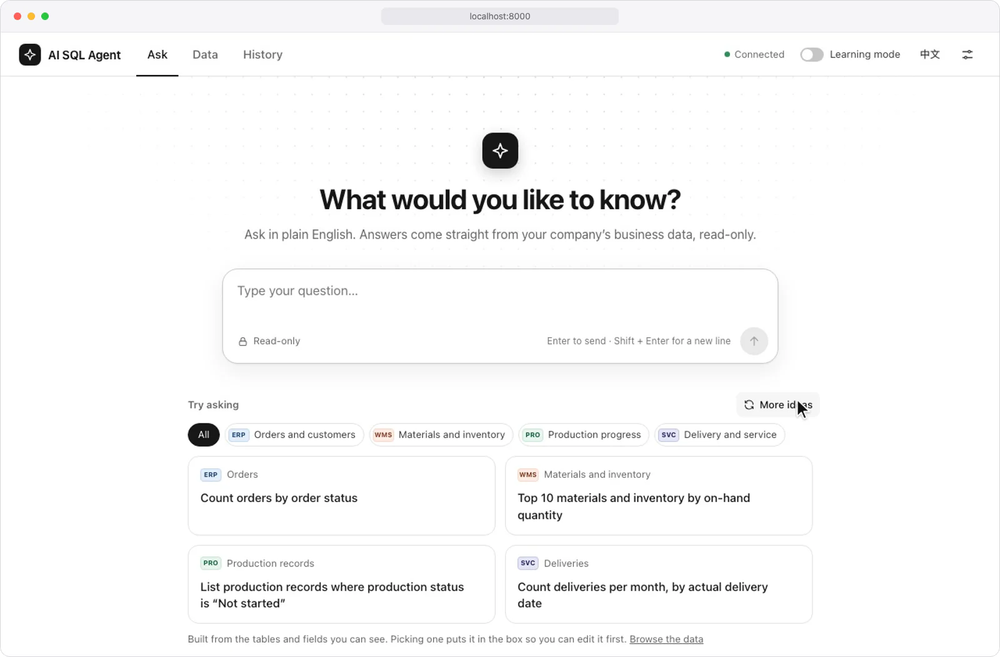
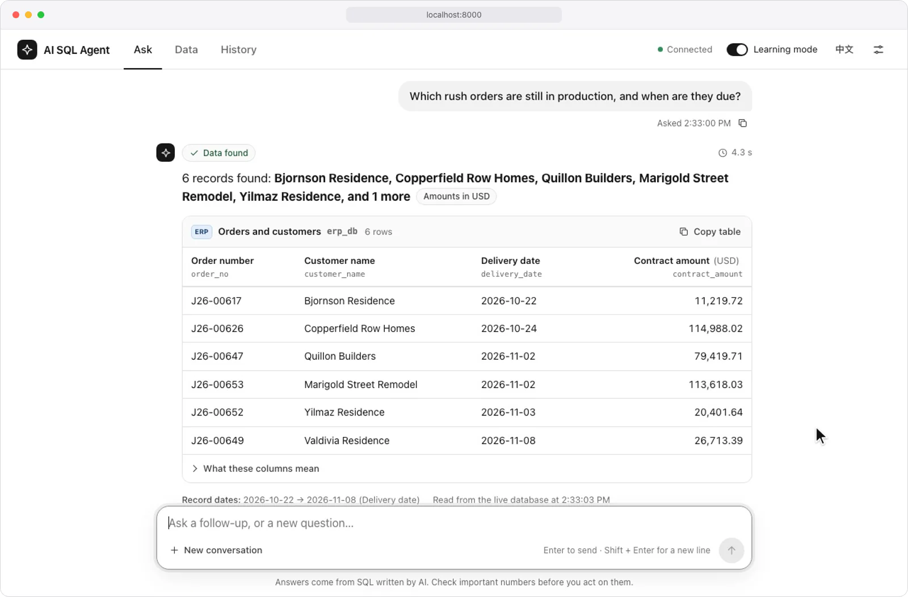

<div align="center">


# AI SQL Agent

**An LLM agent that routes, plans, acts through a guarded tool, repairs and checks its own work, and works with other agents.**

Its one tool is read-only SQL over SQLite and PostgreSQL. Around it: model routing with structured output, multi-step
planning, self-repair, self-verification, hybrid retrieval, short- and long-term memory, A2A and MCP interfaces, live
model management, cancellable runs with an event log, evals and tracing, in one FastAPI service.

[](pyproject.toml)
[](src/ai_sql_agent/api)
[](src/ai_sql_agent/a2a)
[](deploy/docker-compose.prod.yml)
[](https://github.com/heyemlee/ai-sql-agent/actions/workflows/ci.yml)

**English** · [简体中文](README.zh-CN.md)

[Highlights](#highlights) · [Architecture](#architecture) · [Tech stack](#tech-stack) · [Features](#features) · [Develop](#develop)

</div>

<p align="center">
  
</p>

<p align="center"><sub>Made-up data in four SQLite databases. The plan and SQL are replayed for the recording; the rows come from running that SQL.</sub></p>

## Highlights

- **Routes and plans.** A model router with JSON-schema output decides between the tool and memory; a planner splits
  the rest into steps and hands each step's results to the next. Cross-database accuracy: 94.7% over the latest three
  gate rounds (gate: ≥ 90%).
- **One tool, behind one gate.** The agent acts only through read-only SQL. An SQLGlot AST gate checks every table and
  column against the caller's permissions and refuses what it can't parse, within 1,000 rows, 10 s and 8 MiB per call;
  213 tests cover it.
- **Repairs and checks its own work.** A log-driven loop repairs failed calls, at most twice, and results pass rule
  checks and a model self-check before they are returned. Wrong answers without a warning: 0.9% over the same rounds
  (gate: ≤ 3%).
- **Context that keeps itself current.** Database → table → column retrieval fuses BM25 with local or remote embeddings
  through RRF and re-ranks; the column budget follows the embedding in use, and a schema watcher rebuilds the index
  when a database changes. 99.2% recall on 40 held-out phrasings with 36.8% of the schema sent, on remote embeddings.
- **Interoperable and operable.** Other agents call it over A2A with the same keys, limits and audit as the HTTP API,
  an MCP server offers its SQL as tools, and model and embedding connections switch without a restart. Every request
  is a run with a numbered event log of its stages, model calls and SQL, and can be cancelled while it runs.

## Architecture

<p align="center">
  
</p>

One FastAPI process hosts the agent, its HTTP, A2A and admin endpoints and the console. A question enters through the
API; the agent loop has the model route it, retrieves the tables, has the model plan and write SQL, runs it through the
gate and has the model check the answer, and each card lights up while the request is in it. Orange marks model calls,
blue the request and its data, teal run records, memory, audit and metrics. State lives in SQLite; with a PostgreSQL
DSN, audit, feedback, run records and both vector indexes move to PostgreSQL + pgvector.

- **The model decides, code orchestrates.** The model routes, plans, writes and repairs SQL and judges results; code
  fixes the step order, the permission gate and the limits (one data source per step, two repairs at most), so every
  run is bounded, leaves a numbered event log and stops at the next checkpoint when cancelled.
- **One tool, one gate, fail closed.** Answers, previews and the MCP server all pass the same authorization gate.
  Unparseable SQL is refused, and so is all SQL without SQLGlot; when the model is down, the user's last successful SQL
  for the question is rerun, authorized again and marked degraded.

## Tech stack

| Layer               | Technology                                                                                                                        | Role                                                                                                                                |
| ------------------- | --------------------------------------------------------------------------------------------------------------------------------- | ----------------------------------------------------------------------------------------------------------------------------------- |
| Runtime             | Python 3.11 · FastAPI · Uvicorn · Pydantic v2                                                                                     | Hosts the agent, its HTTP, A2A and admin endpoints and the console                                                                  |
| Models              | HTTPX · OpenAI-compatible and Anthropic APIs · vLLM · Ollama                                                                      | Routing, planning, SQL, repair and self-check, with a circuit breaker per model role                                                |
| Orchestration       | Model router with JSON-schema output · step planner · short path                                                                  | Picks the next action and its order; simple requests skip planning                                                                  |
| Tool and guardrails | SQLGlot AST gate · SQLite authorizer · read-only connections · read-only role tooling                                             | The only action, authorized per caller and capped                                                                                   |
| Retrieval           | BM25 · local hash or OpenAI-compatible remote embeddings · RRF · reranker (qwen3-rerank when configured) · adaptive column budget | Three tiers; 10 columns per database with remote embeddings, 20 with local ones, which also stand in when the remote service fails  |
| Knowledge           | YAML semantic layer · `semantic` CLI (export, validate, show)                                                                     | Meanings, aliases, join keys and metrics, checked against the live schema                                                           |
| Memory              | SQLite conversation store · long-term memory on local hash vectors · summarizer                                                   | Context across turns and sessions; the console's embedding setting does not apply here                                              |
| Storage             | SQLite by default · PostgreSQL + pgvector with a DSN                                                                              | With a DSN, audit, feedback, run records and the vector indexes move to PostgreSQL; conversations and memory records stay in SQLite |
| Interop             | A2A (JSON-RPC 2.0 + SSE) · MCP Python SDK                                                                                         | Serves other agents; SQL as MCP tools over stdio                                                                                    |
| Operations          | Model admin API · schema watcher · per-key rate limits and token quotas                                                           | Live model and embedding switch; index rebuilt when a schema changes                                                                |
| Evals and tracing   | Release gate (150 + 40 cases, eight thresholds) · run event log · `trace_id` audit · Prometheus · JSON logs                       | Measured quality; every stage, model call and SQL of a run on record                                                                |
| Console             | HTML · CSS · ES modules, no build step                                                                                            | Ask, Data, History and settings; learning mode shows each step; stopping a request stops its run too                                |
| Delivery            | pytest · GitHub Actions · Docker Compose                                                                                          | Tests, CI, image smoke test, deployment                                                                                             |

## Features

### The agent loop

<p align="center">
  
</p>

<p align="center"><sub>Made-up data, with learning mode on. The plan, SQL and follow-up answer are replayed; the repair is the project's own repair loop run on that data, on its rule-based path.</sub></p>

- **Understand.** The router picks between querying and answering from the conversation; pronouns and phrases like
  "last quarter" are resolved before retrieval.
- **Plan.** One step per data source, kept to the columns and rows asked for. Each step gets the previous step's first
  50 rows as ready-made `IN` lists, which bounds the prompt and caps a hand-off at 50 rows.
- **Act and repair.** The tool gate authorizes and runs each statement; a failure is parsed from the execution log and
  the failing clause is rewritten, by the model or a nearest-name rule, at most twice.
- **Check.** Empty results, row counts far from the plan, unrequested totals and impossible shapes are flagged, then
  the model checks the result against the question; findings travel with the answer as risk flags.
- **Remember and learn.** Sessions and optional long-term memory carry context; answers marked right become examples,
  wrong ones evaluation cases.
- **Record and stop.** Each request is a run with an event log numbered from 1: stage starts and ends, every model call
  with its tokens and every SQL statement with its rows and time; prompts, model output and rows are not kept. The stop
  button, `POST /runs/{id}/cancel` or a caller that disconnects cancels it at the next checkpoint: running SQL stops at
  once, and a model call already under way is let finish and its result dropped.

Execution accuracy on the 150-task benchmark with the built-in demo databases: three runs on 2026-09-09 with
`claude-sonnet-5`, and three gate rounds on 2026-10-16 with `gpt-6.1-sol` and remote embeddings.

| Metric                                 | 3 runs, 2026-09-09 | 3 rounds, 2026-10-16 |  Gate |
| -------------------------------------- | -----------------: | -------------------: | ----: |
| Single-database accuracy               | 93.3% [92.8, 93.6] |      100% [100, 100] | ≥ 85% |
| Cross-database accuracy                | 85.3% [84.0, 88.0] |   94.7% [92.0, 96.0] | ≥ 90% |
| Silent errors (wrong, with no warning) |    5.3% [5.3, 5.3] |      0.9% [0.7, 1.3] |  ≤ 3% |
| Correct answers flagged as risky       |    5.6% [4.3, 6.6] |      2.2% [2.0, 2.7] | ≤ 20% |
| Column recall, 40 held-out phrasings   |    100% [100, 100] |    99.2% [97.5, 100] | ≥ 85% |
| Share of columns sent to the model     | 43.6% [43.6, 43.8] |   36.8% [36.7, 36.8] | ≤ 40% |

The 2026-09-09 runs miss three lines. The 2026-10-16 rounds ran on commit 5897af9 and met all eight lines in each
round, with 149, 148 and 149 of 150 correct; every wrong answer was q108 or q110, a silent error in which columns a
cross-database step returns. Two of the rounds come from a three-round run whose third round the model service cut off
after question 50, the third from a single round run after it. The columns differ in model and code and are not a
before/after pair. Sources, in Chinese: the [2026-09-09 record](benchmark/baseline/2026-09-09/README.md), the
[retrieval baseline](benchmark/baseline/2026-09-08/README.md) and the
[2026-10-16 record](benchmark/baseline/2026-10-16/README.md); see also [the thresholds](benchmark/README.md) and
[known limits](docs/limitations.md).

### Operations

- **Live model management.** Administrators list a provider's models, test a connection and switch to it without a
  restart; without sign-in, only the service's own machine may change it.
- **Embedding swaps without a gap.** A new embedding model rebuilds the schema index first and is switched in only if
  that succeeds; otherwise the running index stays.
- **Schema changes picked up.** A watcher compares structure fingerprints (every 300 s in the Compose files, off by
  default) and swaps in a rebuilt index; with pgvector, only the changed parts are embedded again.

### Interfaces

- **Console.** Ask, Data and History pages and settings, in English and Chinese, with no build step; learning mode
  explains each request from its stage events, and stopping a request stops its run on the server too.
- **A2A.** On by default at `POST /a2a`: `message/send` returns a finished task and `message/stream` sends stage events
  over SSE first. The task id is the run id: `POST /runs/{id}/cancel` ends a task as `canceled`, and a caller that
  disconnects stops it too. `AI_SQL_A2A_STREAMING=false` turns streaming off and the agent card says so; contract cases
  run in CI.
- **MCP and HTTP.** An MCP stdio server offers `list_databases` and `execute_sql` over the demo databases with the
  same caps; HTTP serves `/query`, `/catalog`, `/history`, `/runs` and `/metrics` ([API](docs/api.md)).

## Develop

```bash
python3 -m venv .venv && source .venv/bin/activate  # a virtual environment for Python 3.11+
pip install -e ".[dev]"                             # the service, its pinned dependencies and test tools
python examples/end_to_end.py                       # single- and cross-database questions, mock model
./scripts/run_api.sh                                # console and API on http://localhost:8000, demo data
cp .env.example .env                                # then set the model provider, key and model names
python -m ai_sql_agent.semantic export semantic/    # a semantic-layer template for your databases
python -m ai_sql_agent.semantic validate semantic/  # check it against the live schema
```

Without model credentials the service answers from a mock model. Point `AI_SQL_SEMANTIC_DIR` at the semantic directory
to query your own databases; models, embeddings, rerank and storage are set up in
[docs/deployment.md](docs/deployment.md#2-configuration), and another semantic layer with sample data is in
[tools/simple_erp](tools/simple_erp/README.md) (in Chinese).

## Test

```bash
make test        # 1,266 tests with pytest; the 27 that need PostgreSQL skip without AI_SQL_PGVECTOR_DSN
make test-ci     # the unittest entry point CI uses
make gate-smoke  # the release gate on its offline smoke sample
make gate        # the full gate: 150 + 40 tasks, three runs; needs a model and spends tokens
```

CI runs the tests against a PostgreSQL 16 + pgvector service, the A2A contract cases at the pinned tag, the demos, the
offline gate and its negative check, the read-only role tool both ways, and a Docker image smoke test with API keys on.

## Deploy

```bash
cp deploy/api_keys.example.json deploy/api_keys.json  # API keys, roles and table and column policies
make up                                               # the app and PostgreSQL + pgvector, in Docker Compose
make vllm-up                                          # the same with a self-hosted vLLM model server
```

Model credentials, read-only database roles, metrics and backups are in [docs/deployment.md](docs/deployment.md).
Design decisions: [docs/design.md](docs/design.md) · API: [docs/api.md](docs/api.md) · Known limits:
[docs/limitations.md](docs/limitations.md) · Walkthrough: [docs/walkthrough.zh-CN.md](docs/walkthrough.zh-CN.md) (in
Chinese).
