<div align="center">


# AI SQL Agent

**一个会路由、会规划、通过受控工具行动、能修复和检查自己的结果，还能与其他 agent 协作的 LLM agent。**

它唯一的工具是对 SQLite 和 PostgreSQL 执行只读 SQL。围绕这个工具的有：结构化输出的模型路由、多步规划、自我修复、自我校验、混合检索、短期与长期记忆、A2A 与 MCP 接口、在线模型管理、可取消并带事件日志的运行记录、评测和全链路追踪，全部在一个 FastAPI 服务里。

[](pyproject.toml)
[](src/ai_sql_agent/api)
[](src/ai_sql_agent/a2a)
[](deploy/docker-compose.prod.yml)
[](https://github.com/heyemlee/ai-sql-agent/actions/workflows/ci.yml)

[English](README.md) · **简体中文**

[技术亮点](#技术亮点) · [系统架构](#系统架构) · [技术栈](#技术栈) · [功能](#功能) · [本地开发](#本地开发)

</div>

<p align="center">
  
</p>

<p align="center"><sub>虚构数据，放在四个 SQLite 库里。规划和 SQL 是为录屏回放的，结果行是实际执行这些 SQL 得到的。</sub></p>

## 技术亮点

- **会路由，会规划。** 模型路由器用 JSON Schema 输出，在调用工具和用记忆回答之间做选择；需要查数的请求由规划器拆成多步，每一步的结果交给下一步。跨库准确率：最近三轮门禁 94.7%（门禁线 ≥ 90%）。
- **一个工具，一道关卡。** agent 只能通过只读 SQL 行动。SQLGlot AST 关卡按调用方权限检查每一张表、每一个字段，解析不了的一律拒绝；每次调用上限 1,000 行、10 秒、8 MiB。这部分有 213 个测试。
- **自己修复，自己检查。** 执行失败的调用由基于日志的修复循环处理，最多两次；结果返回之前要经过规则检查和模型自检。答错且没有提示的答案：同样这三轮 0.9%（门禁线 ≤ 3%）。
- **上下文自己保持最新。** 按库 → 表 → 字段三级检索，BM25 与本地或远端 Embedding 用 RRF 融合后重排；字段预算随实际在用的 Embedding 调整，库结构一变，Schema 监听器就重建索引。用远端 Embedding 时，在 40 条留出问法上字段召回率 99.2%，只送出 36.8% 的 Schema。
- **能互联，好运维。** 其他 agent 通过 A2A 调用它，与 HTTP API 共用同一套 Key、限流和审计；MCP 服务把 SQL 作为工具提供出去；模型和 Embedding 连接不用重启就能切换。每次请求都是一次运行，带编号的事件日志记下它的阶段、模型调用和 SQL，跑到一半也能取消。

## 系统架构

<p align="center">
  
</p>

一个 FastAPI 进程同时承载 agent、它的 HTTP、A2A 与管理接口和控制台。问题从 API 进来，agent 循环先让模型判断类型，再检索相关的表，让模型规划并写 SQL，经工具关卡执行，最后让模型检查答案；请求走到哪个组件，哪张卡片就亮起来。橙色是模型调用，蓝色是请求和数据，青色是运行记录、记忆、审计和指标。状态默认存在 SQLite；配置 PostgreSQL DSN 后，审计、反馈、运行记录和两个向量索引改存 PostgreSQL + pgvector。

- **模型做决定，代码管流程。** 路由、规划、写 SQL、修复和判断结果由模型完成；步骤顺序、权限关卡和各项上限由代码固定（每步只查一个数据源，最多修复两次），所以每次运行都有边界，留下编号的事件日志，取消时在下一个检查点停下。
- **一个工具，一道关卡，出错就拒绝。** 回答、预览和 MCP 服务都经过同一道授权关卡。解析不了的 SQL 一律拒绝，没装 SQLGlot 时所有 SQL 都被拒绝；模型不可用时，重新执行该用户同一问题上次成功的 SQL，重新授权并标为降级。

## 技术栈

| 层         | 技术                                                                                                  | 作用                                                                                  |
| ---------- | ----------------------------------------------------------------------------------------------------- | ------------------------------------------------------------------------------------- |
| 运⁠行⁠时     | Python 3.11 · FastAPI · Uvicorn · Pydantic v2                                                         | 承载 agent、HTTP、A2A 与管理接口和控制台                                              |
| 模型       | HTTPX · OpenAI 兼容与 Anthropic API · vLLM · Ollama                                                   | 路由、规划、写 SQL、修复和自检，按模型角色分别熔断                                    |
| 编排       | JSON Schema 输出的模型路由 · 分步规划器 · 短路径                                                      | 决定下一步做什么、按什么顺序；简单请求跳过规划                                        |
| 工⁠具⁠与⁠护⁠栏 | SQLGlot AST 关卡 · SQLite authorizer · 只读连接 · 只读账号工具                                        | 唯一的行动方式，按调用方授权并设上限                                                  |
| 检索       | BM25 · 本地哈希或 OpenAI 兼容的远端 Embedding · RRF · Rerank（配置后用 qwen3-rerank）· 自适应字段预算 | 三级检索；远端 Embedding 时每库 10 列，本地向量时 20 列，远端服务失败时由本地向量顶上 |
| 业⁠务⁠知⁠识   | YAML 语义层 · `semantic` 命令行（导出、校验、查看）                                                   | 业务含义、别名、关联键和指标口径，与真实库结构比对                                    |
| 记忆       | SQLite 对话存储 · 基于本地哈希向量的长期记忆 · 摘要                                                   | 在多轮对话和多次会话之间延续上下文；页面上的 Embedding 设置不作用于这里               |
| 存储       | 默认 SQLite · 配置 DSN 后用 PostgreSQL + pgvector                                                     | 配置 DSN 后，审计、反馈、运行记录和向量索引改存 PostgreSQL；对话和记忆记录仍在 SQLite |
| 互联       | A2A（JSON-RPC 2.0 + SSE）· MCP Python SDK                                                             | 为其他 agent 提供服务；通过 stdio 以 MCP 工具提供 SQL                                 |
| 运维       | 模型管理接口 · Schema 监听器 · 按 Key 限流和 token 配额                                               | 在线切换模型和 Embedding；库结构变化时重建索引                                        |
| 评⁠测⁠与⁠追⁠踪 | 发布门禁（150 + 40 题，八条阈值）· 运行事件日志 · `trace_id` 审计 · Prometheus · JSON 日志            | 质量可度量，每次运行的阶段、模型调用和 SQL 都有记录                                   |
| 控⁠制⁠台     | HTML · CSS · ES Module，无构建步骤                                                                    | 提问、数据、历史和设置；学习模式展示每一步；点停止时服务端的运行也会停下              |
| 交付       | pytest · GitHub Actions · Docker Compose                                                              | 测试、CI、镜像冒烟、部署                                                              |

## 功能

### Agent 循环

<p align="center">
  
</p>

<p align="center"><sub>虚构数据，开着学习模式。规划、SQL 和追问的回答是回放的；修复是项目自己的修复循环在这份数据上实际跑出来的，走的是不调模型的规则分支。</sub></p>

- **理解。** 路由器在「重新查库」和「用对话记忆回答」之间做选择；检索之前，先把代词和「上季度」这类说法换成具体的对象和日期。
- **规划。** 每个数据源一步，输出只保留问题要的字段和行。每一步拿到上一步的前 50 行，按列整理成现成的 `IN` 列表，这让 Prompt 长度有上限，一次交接最多 50 行。
- **行动与修复。** 工具关卡授权并执行每一条语句；执行失败时，从执行日志里解析出错误，由模型或按最近的字段名改写出错的子句，最多两次。
- **检查。** 空结果、行数远离计划、没人要的汇总、计划给不出的结果形状都会被标出来，然后由模型对照问题检查结果；发现的问题作为风险提示随答案返回。
- **记忆与学习。** 会话记忆和可选的长期记忆延续上下文；标为正确的答案成为范例，标为错误的导出成评测用例。
- **记录与取消。** 每次请求都是一次运行，事件日志从 1 开始编号：阶段的开始和结束、每次模型调用和它用的 token、每条 SQL 和它的行数与耗时；Prompt、模型输出和结果行都不保存。控制台的停止按钮、`POST /runs/{id}/cancel` 或调用方断开连接，都会在下一个检查点取消它：正在跑的 SQL 立即中断，已经发出的模型调用等它返回，结果丢弃。

用内置演示库在 150 题评测集上的执行准确率：2026-09-09 用 `claude-sonnet-5` 跑了三轮，2026-10-16 用 `gpt-6.1-sol` 加远端 Embedding 跑了三轮门禁。

| 指标                        |   三轮，2026-09-09 |   三轮，2026-10-16 | 门禁线 |
| --------------------------- | -----------------: | -----------------: | -----: |
| 单库准确率                  | 93.3% [92.8, 93.6] |    100% [100, 100] |  ≥ 85% |
| 跨库准确率                  | 85.3% [84.0, 88.0] | 94.7% [92.0, 96.0] |  ≥ 90% |
| 静默错误（答错且没有提示）  |    5.3% [5.3, 5.3] |    0.9% [0.7, 1.3] |   ≤ 3% |
| 正确答案被标为有风险        |    5.6% [4.3, 6.6] |    2.2% [2.0, 2.7] |  ≤ 20% |
| 字段召回率（40 条留出问法） |    100% [100, 100] |  99.2% [97.5, 100] |  ≥ 85% |
| 送进模型的字段占比          | 43.6% [43.6, 43.8] | 36.8% [36.7, 36.8] |  ≤ 40% |

2026-09-09 那三轮有三条线没过。2026-10-16 的三轮跑在提交 5897af9 上，每一轮八条线都过，150 题分别答对 149、148、149 题；答错的只有 q108 和 q110，都是静默错误，错在跨库最后一步输出了哪些列。其中两轮来自一次三轮运行（它的第三轮在第 50 题之后被模型服务打断，不计入），另一轮是之后单独补跑的。两列的模型和代码都不同，不能当作改动前后的对比。出处：[2026-09-09 记录](benchmark/baseline/2026-09-09/README.md)、[检索基线](benchmark/baseline/2026-09-08/README.md)和 [2026-10-16 记录](benchmark/baseline/2026-10-16/README.md)；另见[门禁线是怎么定的](benchmark/README.zh-CN.md)和[已知限制](docs/limitations.zh-CN.md)。

### 运维

- **在线管理模型。** 管理员可以列出服务商提供的模型、测试连接，再不重启直接换上；没开鉴权的实例只接受服务所在那台机器的修改。
- **换 Embedding 不留空档。** 新的 Embedding 模型先把整个 Schema 索引建好，建成了才换上；任何一步失败，正在用的索引都不动。
- **库结构变化自动跟上。** 监听器定时比对结构指纹（Compose 配置里每 300 秒一次，默认关闭），发现变化就换上重建的索引；配了 pgvector 时只重新计算变动部分的向量。

### 接口

- **控制台。** 提问、数据、历史三个页面和设置，中英双语，无构建步骤；学习模式根据阶段事件讲解每次请求；点停止时，服务端的运行也会停下。
- **A2A。** 默认开启，地址是 `POST /a2a`：`message/send` 返回一个已完成的任务，`message/stream` 先通过 SSE 推送阶段事件。任务 ID 就是运行 ID：用 `POST /runs/{id}/cancel` 取消的任务以 `canceled` 结束，调用方断开连接也会让它停下。设置 `AI_SQL_A2A_STREAMING=false` 可以关掉流式，Agent Card 会同步说明；契约用例在 CI 里跑。
- **MCP 与 HTTP。** MCP stdio 服务在演示库上提供 `list_databases` 和 `execute_sql` 两个工具，上限相同；其余由 HTTP 接口 `/query`、`/catalog`、`/history`、`/runs`、`/metrics` 提供（[接口文档](docs/api.zh-CN.md)）。

## 本地开发

```bash
python3 -m venv .venv && source .venv/bin/activate  # 建一个 Python 3.11+ 的虚拟环境
pip install -e ".[dev]"                             # 安装服务、固定版本的依赖和测试工具
python examples/end_to_end.py                       # 离线跑一个单库问题和一个跨库问题，模型用 Mock
./scripts/run_api.sh                                # 控制台和 API 在 http://localhost:8000，用内置演示数据
cp .env.example .env                                # 然后填模型服务商、Key 和模型名
python -m ai_sql_agent.semantic export semantic/    # 导出语义层模板，用来描述你自己的库
python -m ai_sql_agent.semantic validate semantic/  # 和真实库结构比对
```

没有模型凭证时服务用 Mock 模型作答。把 `AI_SQL_SEMANTIC_DIR` 指向语义层目录，就能查你自己的库；模型、Embedding、Rerank 和存储的配置见 [docs/deployment.zh-CN.md](docs/deployment.zh-CN.md#二配置项)，另一套带示例数据的语义层见 [tools/simple_erp](tools/simple_erp/README.md)。

## 测试

```bash
make test        # 用 pytest 跑 1,266 个测试；需要 PostgreSQL 的 27 个在没有 AI_SQL_PGVECTOR_DSN 时跳过
make test-ci     # CI 用的 unittest 入口
make gate-smoke  # 发布门禁的离线冒烟样本
make gate        # 完整门禁：150 + 40 题，跑三轮；需要模型，会消耗 token
```

CI 在 PostgreSQL 16 + pgvector 服务上跑测试，还跑固定 tag 的 A2A 契约用例、演示脚本、离线门禁及其反例检查、只读账号工具的正反两面，以及开启 API Key 的 Docker 镜像冒烟。

## 部署

```bash
cp deploy/api_keys.example.json deploy/api_keys.json  # API Key、角色和表列权限
make up                                               # 用 Docker Compose 起应用和带 pgvector 的 PostgreSQL
make vllm-up                                          # 同上，外加内网自建的 vLLM 模型服务
```

模型凭证、业务库只读账号、监控指标和备份见 [docs/deployment.zh-CN.md](docs/deployment.zh-CN.md)。关键设计见 [docs/design.zh-CN.md](docs/design.zh-CN.md) · 接口见 [docs/api.zh-CN.md](docs/api.zh-CN.md) · 已知限制见 [docs/limitations.zh-CN.md](docs/limitations.zh-CN.md) · [项目详解](docs/walkthrough.zh-CN.md)。
