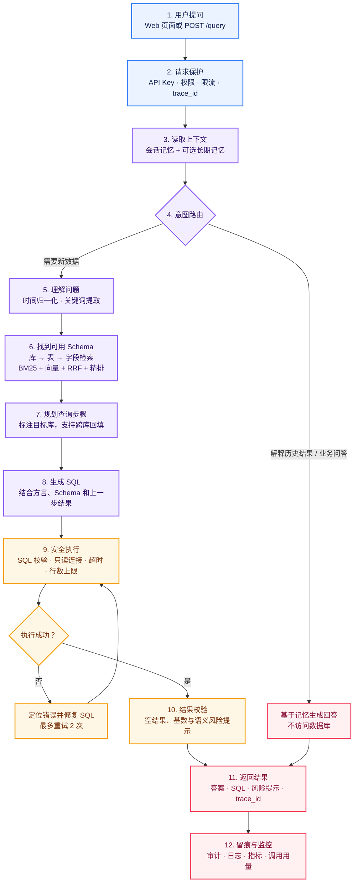
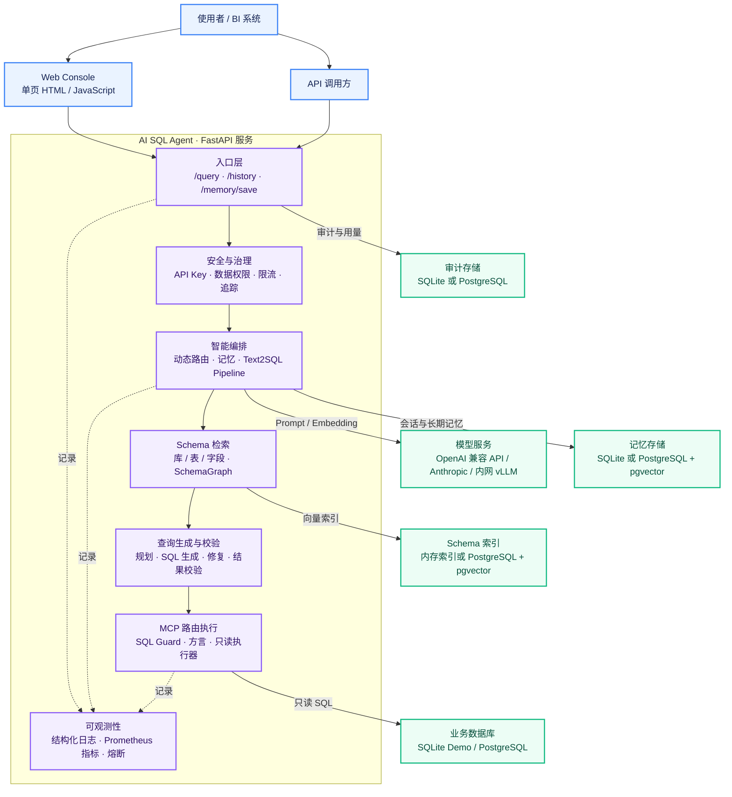

# AI SQL Agent

[English](README.md) | **简体中文**

> 让非技术用户用自然语言查询业务数据：系统理解问题、生成只读 SQL、执行并返回结果。

AI SQL Agent 是一个可本地运行、也可部署到内网的 Text2SQL 服务。它支持多库查询、上下文记忆、数据权限、失败修复和全链路审计；没有模型 Key 时会自动使用 Mock，方便离线体验和测试。

## 它能做什么

| 能力 | 说明 |
| --- | --- |
| 自然语言查数 | 例如：`查询准时率低于 0.9 的供应商名称` |
| 多库查询 | 自动拆分跨库问题；上一步结果会作为下一步的筛选条件 |
| 对话与记忆 | 区分“查新数据”和“解释上次结果”，支持短期会话与个人长期记忆 |
| 安全可控 | API Key、表/列权限、只读 SQL、行数与超时限制、限流与配额 |
| 稳定可追踪 | SQL 失败自动修复；每次请求都有 `trace_id`、审计记录和指标 |

## 一次请求如何流转



说明：模型不可用时，路由会退回规则判断；SQL 主链路会优先重放该用户此前成功的同题 SQL，并在执行前重新检查权限。无法安全降级时，接口会明确返回降级原因。

## 技术架构



## 快速开始

### 1. 本地体验（无需模型 Key）

```bash
pip install -r requirements.txt

# 运行端到端示例（单库和跨库）
python -m ai_sql_pipeline.end_to_end_demo

# 运行全部离线测试
python -m unittest discover -s tests -v
```

### 2. 启动网页和 API

```bash
./run_api.sh
```

打开 [http://localhost:8000](http://localhost:8000) 即可提问。也可以直接调用接口：

```bash
curl -X POST http://localhost:8000/query \
  -H 'Content-Type: application/json' \
  -d '{
    "user_id": "u1",
    "session_id": "s1",
    "query": "查询准时率低于 0.9 的供应商名称"
  }'
```

本地默认关闭 API Key 校验。生产环境请开启 `AI_SQL_AUTH_MODE=api_key`，并配置权限文件。

### 3. 接入真实模型（可选）

```bash
cp .env.example .env
```

在 `.env` 中至少填写以下内容之一：

```bash
# OpenAI 或任意 OpenAI 兼容服务
AI_SQL_MODEL_PROVIDER=openai
OPENAI_API_KEY=sk-xxx
OPENAI_BASE_URL=https://api.openai.com/v1

# 也可改为 Anthropic 协议
# AI_SQL_MODEL_PROVIDER=anthropic
# ANTHROPIC_API_KEY=sk-ant-xxx
```

服务也支持内网 vLLM、Ollama 等 OpenAI 兼容接口；完整配置见 [部署说明](deploy/README.md)。

## 关键设计

| 主题 | 实现方式 |
| --- | --- |
| Schema 检索 | 先定位数据库，再找表和字段；混合检索后构建 SchemaGraph，并按 Token 预算裁剪 |
| 跨库查询 | 规划阶段明确每步目标库；上一条查询结果会被转为筛选条件回填到下一步 |
| SQL 安全 | 仅允许 `SELECT` / `WITH`；拒绝多语句和写操作；连接层再使用只读事务或只读连接兜底 |
| 执行可靠性 | 每条 SQL 有行数上限和超时；失败会定位错误子句并局部修复 |
| 结果可信度 | 对空结果、结果规模异常、问题与 SQL 语义不一致给出可见提示 |
| 权限控制 | 无权表/列不会进入模型上下文；执行前还会再次校验真实 SQL 引用 |
| 可观测性 | `X-Trace-Id` 贯穿请求；审计记录 SQL、命中库表、耗时、修复与 Token 用量 |

## 接口一览

| 接口 | 用途 |
| --- | --- |
| `GET /` | 内置查询页面 |
| `POST /query` | 自然语言查询入口 |
| `GET /history` | 查询历史（默认只返回自己的记录） |
| `POST /memory/save` | 将结果保存到个人长期记忆 |
| `GET /health` | 存活检查 |
| `GET /readyz` | 就绪检查（存储与向量后端） |
| `GET /metrics` | Prometheus 指标 |
| `POST /admin/schema/reload` | 管理员手动重建 Schema 索引 |

`POST /query` 的响应包含 `answer`、每一步 SQL 与结果、`has_risk`、`degraded` 和 `trace_id`，方便前端展示与排查。

## 模块地图

```text
ai_sql_api/          API 与内置网页
ai_sql_pipeline/     动态路由和端到端编排
schema_retrieval/    三层 Schema 检索与 SchemaGraph
cot_planning/        多步 / 跨库查询规划
sql_generation/      SQL 生成
sql_repair/          SQL 失败修复
result_validation/   结果风险校验
mcp_router/          SQL 安全校验与多方言执行
ai_sql_memory/       短期会话与长期记忆
ai_sql_auth/         API Key、身份与表列权限
ai_sql_audit/        审计记录
ai_sql_core/         配置、模型传输、日志、指标、熔断
benchmark/           评测集与发布门禁
deploy/              生产部署和运维文档
```

## 部署与深入阅读

- [部署与运维](deploy/README.zh-CN.md)：Docker Compose、权限、模型接入、监控和排障
- [评测说明](benchmark/README.zh-CN.md)：数据集、准确率与发布门禁
- [端到端编排](ai_sql_pipeline/README.md)：动态路由与记忆示例（英文）
- [Schema 检索](schema_retrieval/README.md)：混合召回与 SchemaGraph（英文）
- [MCP 执行](mcp_router/README.md)：只读 SQL、方言与执行器（英文）
