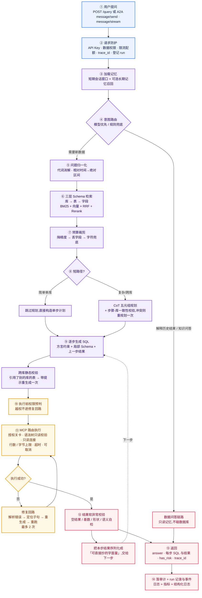
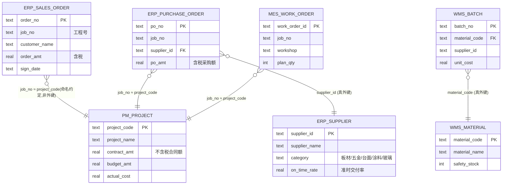
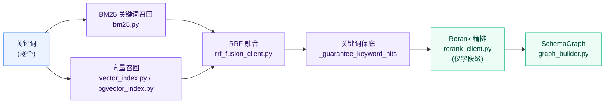
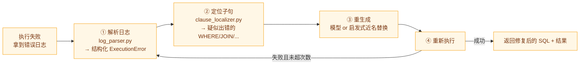
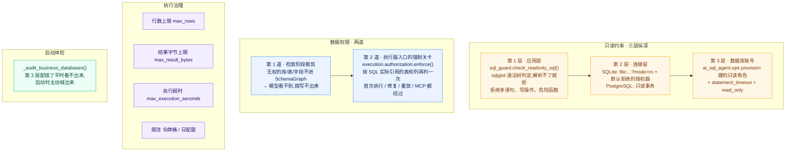
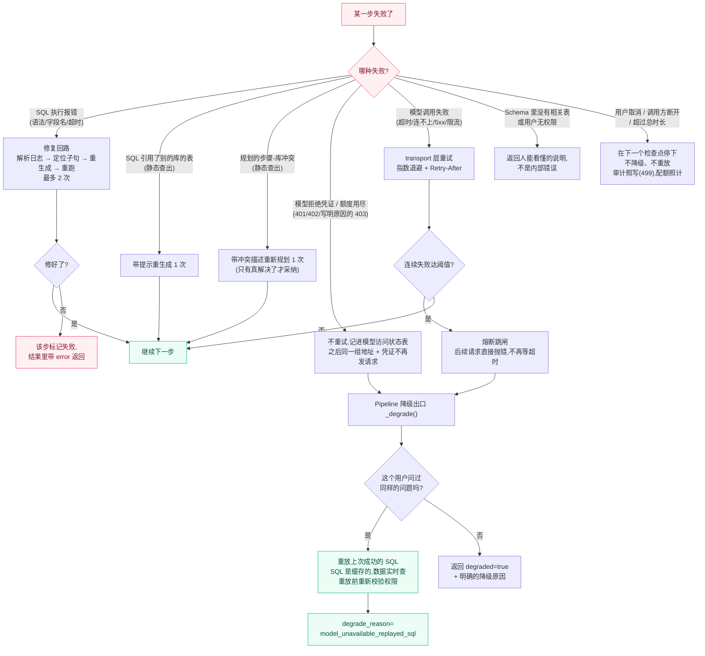

# AI SQL Agent · 项目详解手册

> 这份文档的目标只有一个:**让你从 0 把这个项目吃透,并且能对着它给别人讲 30 分钟。**
>
> 和 [README.md](../README.md) 的区别:README 回答「这是什么、怎么跑」,这份文档回答
> 「**为什么这么设计、每一行代码在防什么坑、讲的时候该怎么串**」。

| 项目速览 | |
| --- | --- |
| 代码量 | Python ≈ 58.2k 行(源码 34.5k + 测试 23.7k) |
| 模块数 | `src/ai_sql_agent/` 下 21 个子包(另有放演示建库脚本的 `resources/`) |
| 测试 | 1266 个用例(没配 `AI_SQL_PGVECTOR_DSN` 时跳过其中 27 个 PostgreSQL 用例) |
| 评测 | 150 条评测集 + 40 条留出集 + 8 条线的发布门禁 |
| 演示数据 | 4 个互不相干的业务库,15 张表,86 个字段,**无外键跨库** |
| 外部依赖 | FastAPI / uvicorn / pydantic / httpx / numpy / PyYAML / sqlglot / psycopg+pgvector / mcp(共 12 个直接依赖) |
| 对外接口 | HTTP(`/query` 等)、A2A(`/a2a`,给别的 Agent 用)、MCP stdio(单独进程) |
| 离线可跑 | 是。没有模型 Key 时全链路走 Mock,Demo 和测试都能跑通 |

> 表里和附录里的行数对应提交 `3de63cb`(2026-10-16),是 `src/`、`tests/` 下 `*.py` 的 `wc -l`;
> 用例数是 main 从 `cae39a8` 起的数(到 `6b2ed93` 没变),在一个干净的临时目录里跑
> `pytest --collect-only` 得到,本文各处的用例数都用这一版。

---

## 目录

**第一部分 · 先跑起来**
1. [这个项目在解决什么问题](#1-这个项目在解决什么问题)
2. [30 分钟上手路线](#2-30-分钟上手路线)
3. [一次请求的完整生命周期](#3-一次请求的完整生命周期)
4. [演示数据模型:四个业务库](#4-演示数据模型四个业务库)

**第二部分 · 逐模块拆解**
5. [ai_sql_agent.core — 地基](#5-ai_sql_agentcore--地基)
6. [ai_sql_agent.normalization — 问题归一化](#6-ai_sql_agentnormalization--问题归一化)
7. [ai_sql_agent.retrieval — 三层 Schema 检索](#7-ai_sql_agentretrieval--三层-schema-检索)
8. [token_budget / schema_budget — 预算裁剪](#8-token_budget--schema_budget--预算裁剪)
9. [routing / short_path — 两个路由决策](#9-routing--short_path--两个路由决策)
10. [ai_sql_agent.planning — 五元组规划](#10-ai_sql_agentplanning--五元组规划)
11. [ai_sql_agent.generation — SQL 生成](#11-ai_sql_agentgeneration--sql-生成)
12. [ai_sql_agent.execution — 只读执行](#12-ai_sql_agentexecution--只读执行)
13. [ai_sql_agent.repair — 失败修复回路](#13-ai_sql_agentrepair--失败修复回路)
14. [ai_sql_agent.validation — 软异常校验](#14-ai_sql_agentvalidation--软异常校验)
15. [ai_sql_agent.memory — 长短期记忆](#15-ai_sql_agentmemory--长短期记忆)
16. [ai_sql_agent.auth / audit / limits — 身份、审计、配额](#16-ai_sql_agentauth--audit--limits--身份审计配额)
17. [ai_sql_agent.api — 服务入口](#17-ai_sql_agentapi--服务入口)
18. [benchmark — 评测与发布门禁](#18-benchmark--评测与发布门禁)
19. [ai_sql_agent.ops / ai_sql_agent.mcp_server — 运维与对外工具](#19-ai_sql_agentops--ai_sql_agentmcp_server--运维与对外工具)

**第三部分 · 五条主线(讲解用)**
20. [主线 A:一个字段怎么走进 Prompt](#20-主线-a一个字段怎么走进-prompt)
21. [主线 B:跨库查询为什么难,项目用了 6 道防线](#21-主线-b跨库查询为什么难项目用了-6-道防线)
22. [主线 C:安全 —— 只读三层 + 权限两道](#22-主线-c安全--只读三层--权限两道)
23. [主线 D:可靠性 —— 失败了怎么办](#23-主线-d可靠性--失败了怎么办)
24. [主线 E:正确性 —— 「跑通」不等于「对」](#24-主线-e正确性--跑通不等于对)

**第四部分 · 讲解与自测**
25. [技术栈清单](#25-技术栈清单)
26. [30 分钟讲解脚本](#26-30-分钟讲解脚本)
27. [常见问题 Q&A](#27-常见问题-qa)
28. [动手练习](#28-动手练习)
29. [已知短板与踩坑记录](#29-已知短板与踩坑记录)

---

# 第一部分 · 先跑起来

## 1. 这个项目在解决什么问题

### 一句话

> 让不会写 SQL 的业务人员用大白话问数据,系统自己找表、写 SQL、跑出结果,
> **并且在结果可能是错的时候明确说出来**。

### 为什么这件事不是「把问题丢给 GPT 就行」

把 Text2SQL 当作「一次模型调用」来做,会撞上五堵墙。这个项目的每个模块,
基本都能对应到其中一堵:

| # | 墙 | 具体表现 | 本项目的应对 |
| --- | --- | --- | --- |
| 1 | **Schema 塞不进 Prompt** | 真实企业库几百张表、几千个字段,全塞进去既超上下文又稀释注意力 | 三层检索(库→表→字段)+ 预算感知裁剪 |
| 2 | **跨系统没有外键** | ERP 叫 `job_no`、项目系统叫 `project_code`,是同一个工程但库之间不能 JOIN | 显式声明跨库关联键 + CoT 拆步 + 字面量回填 |
| 3 | **模型会写错 SQL** | 字段名拼错、语法方言不对、聚合误用 | 日志驱动的修复回路(解析错误→定位子句→重生成→重跑) |
| 4 | **SQL 跑通了结果还是错的** | join 扇出导致重复计数、该出明细却聚合成一个数 | 结果软异常校验(空结果 / 基数 / 形状 / 语义自检) |
| 5 | **不能让 Agent 乱动生产库** | 模型某天生成一条 DELETE | 三层只读(应用层校验 / 连接层只读 / 数据库只读账号) |

**讲解要点**:第 4 堵墙是最值钱的一条。前三堵墙业界都在做,第 4 堵——
「静默错误」——才是这类工具在企业里被弃用的真正原因:一个错误的数字被
抄进周报,一次就够了。这个项目专门为它建了 `ai_sql_agent.validation` 模块,
并在评测里把「静默错误率」列为四大指标之一。

---

## 2. 30 分钟上手路线

### 2.1 环境准备

```bash
pip install -e ".[dev]"
```

直接依赖 12 个,清单在 `pyproject.toml`。依赖段第一行注释是「只列项目真正 import 的包,
传递依赖交给 pip 解析」。这句话有来历:换成 `pyproject.toml` 之前的 `requirements.txt`
里写着,原先是 `pip freeze` 全量导出,混进了一整套用不到的 GPU/训练栈
(`git show 2be4869^:requirements.txt` 能看到)。这本身就是个可以拿来讲的细节。

`sqlglot` 那一行的注释也值得读:它是**运行时硬依赖**,装不上时授权会拒绝一切 SQL——
服务能起来,但查不了任何东西,这是有意选的失败方向(见第 12、22 节)。

### 2.2 第一步:看端到端 Demo(最重要的一步)

```bash
python examples/end_to_end.py
```

**不用配任何 API Key。** 没有 Key 时模型层自动走 Mock,链路照样完整跑通。

这个 Demo 会把整条链路的中间产物全部打印出来,顺序正好就是本文档第 3 节的流程:

```
Demo 1:单库查询「查询准时率低于0.9的供应商名称」
  1. 用户 Query
  2. Schema 检索关键词 / 三层检索结果   ← 看它选了哪些库、哪些表
  3. Schema 图                          ← 看进 Prompt 的字段长什么样
     + 跨库约束段落                     ← 命中多库时才出现
  4. CoT 四元组                          ← 看规划模型拆了几步(标题沿用旧名,
                                            每步其实有五个字段,见第 10 节)
  5.1 步骤 1 SQL                         ← 看生成的 SQL
  6.1 步骤 1 MCP 执行结果                ← 看真实执行结果

Demo 2:跨库两步查询(上一步结果回填)
  ... 同样的结构,但有 步骤1 / 步骤2,并且步骤 2 会用到步骤 1 的结果
```

> **建议**:把这段输出重定向到文件,对着它读第 3 节。这是理解本项目最快的路径——
> 所有抽象概念在这份输出里都有对应的、看得见的实体。
>
> ```bash
> python examples/end_to_end.py > /tmp/demo.txt 2>&1
> ```

### 2.3 第二步:跑测试,确认环境没问题

```bash
make test        # 即 python -m pytest tests -q
```

预期最后一行是 `1239 passed, 27 skipped`(共 1266 个用例,后面还会跟 warnings 和
subtests 的计数)。跳过的 27 个都要 `AI_SQL_PGVECTOR_DSN`:pgvector 集成 14 个、
PostgreSQL 授权 7 个、只读账号 3 个、PostgreSQL 取消 2 个、PostgreSQL 运行记录存储 1 个。
本地没起 PostgreSQL 就自动跳过;CI 里有 pgvector 服务容器,这些都会真跑。

CI 用的是另一个入口:`make test-ci`,即 `python -m unittest discover -s tests`,
预期 `Ran 1260 tests ... OK (skipped=27)`。少的 6 个是 `tests/test_simple_erp.py` 里
pytest 风格的函数,unittest 收不到,CI 另起一步用 pytest 单独跑它。

> ⚠️ **本地坑**:`tests/conftest.py` 会在测试期屏蔽三样本机配置——项目根目录的 `.env`、
> shell 里导出的模型凭证、页面上保存的模型连接(`runtime_data/model_settings.json`)。
> 但 conftest 只对 pytest 生效:在本机用 `unittest discover` 跑,这三样都会漏进测试,
> 断言就变成了「你的 `.env` 配了什么」。本机请用 `make test`,详见第 29 节。

### 2.4 第三步:起服务,用网页问一句

```bash
./scripts/run_api.sh
```

打开 http://localhost:8000 (端口取 `AI_SQL_PORT`,默认 8000),内置查询界面有三个入口:业务查数、数据浏览、历史查询(原生 HTML/CSS/ES Module,无构建步骤)。页面上有三处和后面的章节直接对应:

- **学习模式**(设置里打开):按每次请求实际发生的步骤讲解。传输方式默认是「自动」:学习模式开着时走 A2A 流式接口(`POST /a2a` 的 `message/stream`),这样才拿得到真实的阶段事件;关着时走 `POST /query`。见 17.6。
- **停止按钮**:走流式时,它先用首帧里的任务编号调 `POST /runs/{id}/cancel` 让服务端停下,再断开请求。见 3.4。
- **设置 → 高级设置 → 模型连接 / Embedding**:管理员不重启就能换模型和向量模型。见 17.7。

或者直接打接口:

```bash
curl -X POST http://localhost:8000/query -H 'Content-Type: application/json' -d '{"user_id":"u1","session_id":"s1","query":"查询准时率低于0.9的供应商名称"}'
```

留意返回体里的 `trace_id` / `has_risk` / `degraded` 三个字段,它们分别对应
本文档的主线 D(可靠性)和主线 E(正确性)。响应头里还有一个 `X-Run-Id`:
这次请求的运行记录编号,拿它可以查这次请求的完整事件日志(见 3.4)。

### 2.5 第四步:读代码的推荐顺序

不要照 `src/ai_sql_agent/` 的目录按字母序读。按**数据流**读:

```
1. src/ai_sql_agent/api/app.py          ── 入口,先看 query()(约 940 行起)和它调的 _answer_query()
2. src/ai_sql_agent/pipeline/dynamic_service.py ── 路由分叉:查库 还是 聊天
3. src/ai_sql_agent/pipeline/text2sql_pipeline.py ── 核心!先读 run() 和 _run()(285–362 行)
4. 再按 _run() 调用的顺序读 _prepare → _plan → _run_steps → _run_step → _finish,
   从这几个方法跳进各个子模块
```

`text2sql_pipeline.py` 的 `_run()` 是整个项目的**主干**,但它本身只有 40 行左右:
准备(归一化 → 抽词 → 检索)→ 规划 → 逐步(生成 → 执行 → 修复 → 校验)→ 收尾,
每一段是一个方法;规划、生成、修复时模型不可用,统一走降级出口 `_degrade()`。
这几个方法原来是一个 484 行的 `_run`,2026-10-15 拆开(提交 88440d4)——拆之前先给
所有发给模型的输入录了快照(`tests/test_prompt_snapshot.py`),拆完逐条比对,一字不差。
读懂这几个方法,项目就读懂 70% 了。

---

## 3. 一次请求的完整生命周期

### 3.1 全景图



### 3.2 每一步对应的代码位置

| 阶段 | 代码位置 | 关键函数 |
| --- | --- | --- |
| ① 入口 | `src/ai_sql_agent/api/app.py`;A2A 走 `src/ai_sql_agent/a2a/server.py` | `query()` → `_answer_query()` |
| ② 防护 | `src/ai_sql_agent/api/security.py`、`limits.py` | `AuthGuard.authenticate` / `RequestLimiter.check` |
| ② 登记 run | `src/ai_sql_agent/runs/manager.py` | `RunManager.start` / `RunManager.running` |
| ③ 记忆 | `src/ai_sql_agent/memory/conversation.py` | `begin_user_turn()` |
| ④ 意图路由 | `src/ai_sql_agent/pipeline/routing.py` | `DynamicIntentRouter.route` |
| ⑤ 归一化 | `src/ai_sql_agent/normalization/normalizer.py` | `QueryNormalizer.normalize` |
| ⑥ 检索 | `src/ai_sql_agent/retrieval/hierarchical_service.py` | `ThreeTierSchemaRetrievalService.retrieve` |
| ⑦ 预算 | `src/ai_sql_agent/pipeline/schema_budget.py` | `fit_graphs_to_budget` |
| ⑧ 短路径 | `src/ai_sql_agent/pipeline/short_path.py` | `decide_short_path` |
| ⑧ 规划 | `src/ai_sql_agent/planning/cot_planner.py` | `CotPlanner.plan` |
| ⑨ 生成 | `src/ai_sql_agent/generation/sql_generator.py` | `SqlGenerator.generate` |
| ⑩ 权限预判 | `src/ai_sql_agent/pipeline/text2sql_pipeline.py` | `_check_table_access` |
| ⑪ 执行 | `src/ai_sql_agent/execution/router.py`、`sqlite_executor.py` | `MCPRouter.execute` |
| ⑪ 授权关卡 | `src/ai_sql_agent/execution/authorization.py`(判据在 `auth/enforcement.py`) | `enforce` |
| ⑫ 修复 | `src/ai_sql_agent/repair/repairer.py` | `SqlRepairService.repair` |
| ⑬ 校验 | `src/ai_sql_agent/validation/validator.py` | `ResultValidator.validate` |
| ⑭ 审计 | `src/ai_sql_agent/audit/store.py` | `SQLiteAuditStore.record` |
| ⑭ 运行记录 | `src/ai_sql_agent/runs/manager.py`、`store.py` | `RunManager.finish` |

### 3.3 一个关键设计:阶段之间用 `stage()` 上下文管理器串起来

打开 `text2sql_pipeline.py` 你会看到大量:

```python
with stage("retrieval", _logger, keywords=resolved_keywords) as retrieval_stage:
    ...
    retrieval_stage.set(databases=[...], tables={...})
```

`stage()` 来自 `src/ai_sql_agent/core/trace.py`。它做五件事:
1. 自动计时,记录到 `STAGE_DURATION` 指标(按 `ok` / `error` / `cancelled` 分开);
2. 结束时打一条 `stage.<name>` 日志:正常是 `status=ok`,出错是 `status=error`,
   被取消是 `status=cancelled`——取消不算故障;
3. `set()` 把这一阶段的关键产物挂进日志字段;
4. 阶段**进入时**推一条进度给 A2A 流式接口(`use_stage_sink()`),所以进度里只有进入时
   就已经知道的字段(步骤号、库、方言等);
5. 在一次 run 里(见 3.4):进入前先检查取消,已经取消就不进这个阶段;进入和退出各往
   运行记录里写一条 `stage.started` / `stage.finished`。不在 run 里时这一条是空操作。

**讲解要点**:这不是「加了点日志」,而是**把可观测性做成了链路的骨架**。
排查一次线上问题时,拿 `trace_id` 一搜,就能看到「检索选了哪几张表 →
规划拆了几步 → 每步 SQL 是什么 → 哪步失败了 → 修复了几次」的完整时间线。
后来的 A2A 进度、运行记录、取消检查点都挂在这一个上下文管理器上——所有阶段本来就都
穿过它,pipeline 本身一行没改。

### 3.4 一次请求 = 一个 run:运行记录、事件日志与取消

`/query`、A2A `message/send`、`message/stream` 三个入口在准入通过之后、调用 service
之前都会登记一个 **run**(`src/ai_sql_agent/runs/`,2026-10-15 加入)。一个 run 有三样东西:

| | 是什么 | 存在哪 |
| --- | --- | --- |
| 记录 | 状态、入口、起止时间、用量、业务结论(`degraded`、`execution_status`……) | 表 `ai_sql_runs` |
| 事件日志 | 从 1 开始编号的事件 | 表 `ai_sql_run_events` |
| 取消令牌 | 线程安全的取消标记 | `core/run_context.py` 的 `CancelToken` |

pipeline 本身不知道 run 的存在。事件由它本来就会穿过的三层发出:`trace.stage()`、
模型传输层、SQL 路由器。benchmark、脚本、单测直接调 pipeline 时没有 run,这些钩子全是空操作。

**七种事件**(`runs/events.py`):

| 类型 | 谁发 | 带什么 |
| --- | --- | --- |
| `run.started` | 入口 | 入口名(`http_query` / `a2a_send` / `a2a_stream`)、调用方、用户、会话、问题长度 |
| `stage.started` / `stage.finished` | `trace.stage()` | 阶段字段;结束时带状态与耗时 |
| `model.call` | 模型传输层,每次尝试一条 | 组件、模型、第几次、状态、耗时、token |
| `tool.sql` | SQL 路由器,每次执行一条 | 库、状态、行数、是否截断、耗时、SQL |
| `run.cancel_requested` | 取消入口 | 原因:`api` / `client_disconnected` / `deadline` / `shutdown` |
| `run.finished` | 入口 | 终态 `completed` / `failed` / `cancelled` / `interrupted`、用量、业务结论 |

几个刻意的取舍:

- **不存 Prompt、模型输出和结果行**。字符串截到 1 KiB(SQL 留 8 KiB),一条事件的字段最多
  16 KiB(`AI_SQL_RUN_EVENT_ATTR_MAX_BYTES`),截掉了哪些字段记在 `_dropped` 里。
- **每个事件带它所在的最内层阶段和步骤号**,所以一条 `tool.sql` 看得出是首次执行、修复还是降级重放。
- **攒着写**:阶段结束、收到取消、run 结束时才落库,进程崩溃最多丢当前阶段的事件。
- **落库失败不影响查询**:这次 run 停止持久化,`ai_sql_run_events_dropped_total` 计数。
- **存在哪**:没配 `AI_SQL_PGVECTOR_DSN` 时是 `runtime_data/runs.db`,配了就进同一个
  PostgreSQL;run 结束 7 天后连同事件删掉(`AI_SQL_RUNS_RETENTION_DAYS`)。服务关停时还在跑的
  run,以及启动时发现所属进程已经不在的 run,都标成 `interrupted`。
- **A2A 的进度帧不从这里来**,仍然来自 `trace.stage()` 的 sink,契约里的线上格式没变。

查询接口是 `GET /runs/{id}` 和 `GET /runs/{id}/events?after=&limit=`(`api/runs.py`)。
只看得到自己的 run(同一个 caller、同一个 user_id),管理员例外;**不是本人的一律 404**,
不区分「不存在」和「没权限」,免得有人拿它枚举别人的 run——事件里有问题原文和 SQL。

**取消**是这一层的另一半。`POST /runs/{id}/cancel` 置取消令牌,各层在下一个检查点停下:

| 检查点 | 在哪 | 停得多快 |
| --- | --- | --- |
| 进入每个阶段前 | `trace.stage()` | 当前阶段结束时 |
| 每次模型尝试前、重试退避中 | `core/transport.py` | 立刻 |
| 已经发出的那次模型调用 | — | 打断不了:最多等到 HTTP 超时,结果丢弃,不再发新调用 |
| SQL 执行中 | SQLite 的进度回调;PostgreSQL 的 `cancel_safe()` | 立刻 |
| 每次修复尝试、每步降级重放之前 | `repair/repairer.py`、`_replay_history` | 立刻 |

取消有五个来源:控制台的停止按钮、`POST /runs/{id}/cancel`、调用方断开(`AI_SQL_CANCEL_ON_DISCONNECT`,
默认开)、总时长上限(`AI_SQL_RUN_DEADLINE_SECONDS`,默认 0 = 不限)、服务关停。
被取消的请求照样写审计(状态码 499)、照样计日配额(契约 §5.5)。在 A2A 上,调用方还连着时被取消
(服务端取消接口、运维、关停),流的终态帧和 `message/send` 返回的 Task 都是 `canceled`
(契约 v1.13 §4.4;以前是 `failed` 加一句「cancelled: …」);调用方自己断开时,这份响应已经发不出去了。

**一个值得讲的细节**:「断开即取消」2026-10-15 就写好了,但默认关着——当时的 A2A 契约 v1.12 §5.4
写的是「断开后不中止」,服务端单方面改就是违约。契约出了 v1.13(「调用方断开后,我方在下一个检查点
停止」),才在提交 3de63cb 里把默认值翻过来;设成 `false` 就回到 v1.12 的行为:断开后照样跑完,
只是没人接收结果。

**讲解要点**:`RunCancelled` **直接继承 `Exception`**,这一行是整套取消能成立的前提
(`core/run_context.py` 的注释):如果它是 `RuntimeError`,路由会把它当成模型失败,退回规则版
接着跑;如果它是 `ModelCallError`,pipeline 会转去重放历史 SQL。取消之后谁都不该再干活,
所以它必须不像任何一种「可以兜底的失败」。同样的原因,三处原来会吞掉异常的地方
(关键词抽取器、远端 Embedding 客户端、语义自检)现在都会先让取消过去。

---

## 4. 演示数据模型:四个业务库

讲解时这一节非常重要——**跨库能力的全部难点,都藏在这四个库的设计里**。



### 4.1 四个库分别是什么

| 库 | 业务域 | 表 |
| --- | --- | --- |
| `erp_db` | 订单与采购 | `sales_order` / `supplier` / `purchase_order` / `payment` |
| `pm_db` | 项目与工期 | `project` / `milestone` / `change_order` / `acceptance` |
| `mes_db` | 生产与工时 | `work_order` / `labor_hour` / `capacity_stat` / `quality_check` |
| `wms_db` | 库存与物料 | `material` / `batch` / `stock_snapshot` |

建库脚本在 `src/ai_sql_agent/resources/demo_sql/create_*.sql`,由
`src/ai_sql_agent/pipeline/demo_data.py` 建库并附上业务元数据。

这份元数据现在被包成**语义层**的内置版本(`ai_sql_agent.semantic` 的 `demo_semantic_layer()`)。
接真实业务库时不改代码,而是一个库写一份 YAML、用 `AI_SQL_SEMANTIC_DIR` 指过去——
「有哪些库、怎么连、字段什么意思」都由它决定。`tools/` 下有两套按这个方式生成的部署配置:
`sim_erp`(模拟 ERP)和 `simple_erp`(精简业务库,4 个库 9 张表)。

### 4.2 三个刻意埋下的「坑」(这是设计,不是疏忽)

打开 `src/ai_sql_agent/resources/demo_sql/create_erp_demo.sql` 第一行注释就写着这件事:

**坑 1 · 同一实体、不同命名、无外键**

`pm_db.project.project_code` 和 `erp_db.sales_order.job_no` 指的是同一个工程,
但两个库之间**没有外键约束,连字段名都不一样**。这是真实企业的常态(ERP、
项目系统、MES 是三套采购来的系统)。

应对:`demo_data.get_cross_database_links()` 把关联关系**显式声明出来**注入 Prompt,
并标注 `confidence: "naming_convention"` —— 明确告诉模型「这是靠命名约定推断的,
不是数据库外键」。

**坑 2 · 同名近义指标,口径不同**

- 用户问「采购总金额」→ 正确答案是 `erp_db.purchase_order.po_amt`(含税)
- 模型很容易留在项目库用 `pm_db.project.contract_amt`(合同额、不含税)

两个字段名都合理,单看 Schema 无从判断。应对:`get_metric_disambiguation()`
把口径**写死**成 `term / correct / wrong` 三元组注入 Prompt。

**坑 3 · ERP 遗留缩写命名**

`job_no`、`po_amt` 这类字面无业务语义的缩写,**向量检索对它们表现很差**
(不是自然语言 token)。应对:业务元数据里为每个字段单独维护
`keyword_text`(给 BM25 用)、`vector_text`(给向量用)、`rerank_text`(给精排用)
三份不同的索引文本。

看一眼 `demo_data.py` 里 `job_no` 的元数据,这个设计一目了然:

```python
"job_no": {
    "description": "工程号,ERP 内部编码。与项目管理域的 project_code 指同一工程,但两库无外键约束。",
    "aliases": ["工程号", "工程编号", "项目号", "job号"],
    "semantic_role": "join_key",
    "keyword_text": "job_no 工程号 工程编号 项目号 job号 跨库关联 ERP编码",
    "vector_text": "字段名:job_no。所属表:sales_order。该字段是 ERP 的工程号编码,对应项目管理系统中的项目编号。",
    "rerank_text": "字段:sales_order.job_no。含义:工程号(ERP 缩写码)。角色:join_key,跨库关联到 project.project_code。",
}
```

> **讲解金句**:「**三路召回,就该有三份文本。** BM25 要的是关键词堆砌,
> 向量要的是通顺的自然语言句子,Rerank 要的是紧凑的结构化描述。
> 用同一份文本喂三路,等于三路都不好使。」

---

# 第二部分 · 逐模块拆解

每个模块按同一个模板讲:**干什么 → 关键文件 → 核心设计 → 讲解金句**。

---

## 5. ai_sql_agent.core — 地基

**干什么**:配置、模型传输、熔断、指标、日志、链路追踪、错误分类。所有模块都依赖它。

**关键文件**(13 个文件,4348 行)

| 文件 | 职责 |
| --- | --- |
| `settings.py` | 全局配置单例,统一收口原先散落各处的 `os.getenv` |
| `transport.py` | 模型调用统一传输层(**最值得读**) |
| `circuit.py` | 熔断器 |
| `model_access.py` | 记住哪组「服务地址 + 凭证」已被模型服务拒绝,之后不再发请求 |
| `model_settings.py` | 管理员在页面上保存的模型连接(压过环境变量和 `.env`) |
| `model_client.py` | 规划、SQL 生成、抽词三个模型 Client 共用的连接参数,页面换了连接之后跟着换 |
| `model_text.py` | 解析模型输出之前先去掉 Markdown 记号(GPT 系模型爱给标签加 `**`) |
| `run_context.py` | 一次请求的运行上下文:run_id、取消令牌、取消检查点、事件发射(见 3.4) |
| `metrics.py` | Prometheus 指标注册表(自己实现的,无第三方依赖) |
| `trace.py` | `trace_id` 上下文 + `stage()` 计时器 |
| `logging_setup.py` | 结构化日志(text / json 双格式) |
| `errors.py` | 错误分类(决定「能不能重试」「跳不跳闸」) |

### 5.1 settings.py:一个变量切换整个模型厂商

```python
model_provider: Provider = "openai"   # 或 "anthropic"
```

- `openai` → OpenAI 兼容协议(`/v1/chat/completions` + `Bearer`)。
  OpenAI 官方、中转站、阿里云百炼、vLLM、Ollama 全是这一套。
- `anthropic` → Anthropic Messages 协议(`/v1/messages` + `x-api-key`)。

**只改这一个变量,代码一行不用动。**

两个细节值得讲:

1. `AliasChoices` 让每个配置项同时认 `AI_SQL_OPENAI_API_KEY` 和通用的
   `OPENAI_API_KEY`,兼顾「项目专属」和「行业惯例」;
2. `build_endpoint()` 容忍 BASE_URL 带不带 `/v1` —— 因为 OpenAI 的
   BASE_URL 惯例带,Anthropic 的惯例不带,两种都得能用。

**Embedding 和 Rerank 的凭证是单独配置项**,原因写在注释里:主链路走 Anthropic 时,
Embedding 只能另找一家(Anthropic 不提供 embedding 接口)。Schema 检索用哪种向量也是一个
配置项:`embedding_backend` 默认 `local`(本地哈希向量,不调任何服务),设成 `remote` 才去调
OpenAI 兼容的 `/embeddings`(见 7.5)。

**还有一份比环境变量优先级更高的配置**:管理员在页面「设置 → 高级设置 → 模型连接」里保存的那一份
(默认存在 `runtime_data/model_settings.json`,和 `.env` 一样是明文 Key,文件权限 0600)。
保存后立刻生效,不用重启,直到有人在页面上点「恢复为服务端配置」。多副本部署时每个副本各存各的
文件,应当关掉它(`AI_SQL_MODEL_SETTINGS_ENABLED=false`),继续用环境变量或密钥管理来配。接口见 17.7。

### 5.2 transport.py:模型调用的事都在这一层收口

```
ModelTransport
  ├─ 协议差异     openai / anthropic 两种请求体与响应体格式
  ├─ 重试与退避   指数退避 + 尊重服务端的 Retry-After 头(退避中也能被取消)
  ├─ 熔断保护     请求前先查熔断器,断开就直接抛错不发请求
  ├─ 访问状态     请求前先查模型访问状态表,被拒过的凭证不再发请求
  └─ 用量记账     每次调用记 prompt_tokens / completion_tokens,并发一条 model.call 运行事件
```

**错误分类是关键**(`_classify_status`):

| 类别 | 例子 | 重试? | 跳闸? |
| --- | --- | --- | --- |
| `ModelTimeoutError` | 超时(含 408) | ✅ | ✅ |
| `ModelConnectionError` | 连不上 | ✅ | ✅ |
| `ModelServerError` | 5xx | ✅ | ✅ |
| `ModelRateLimitError` | 429 | ✅ | ✅ |
| `ModelAuthError` | 401;403 | ❌ | ❌ |
| `ModelQuotaExhaustedError` | 402,或响应写明额度 / 余额用尽 | ❌ | ❌ |
| `ModelBadRequestError` | 其他 4xx | ❌ | ❌ |
| `ModelResponseError` | 返回不是合法 JSON | ❌ | ❌ |

**为什么鉴权失败不跳闸**:Key 配错了,重试一万次也还是错,而且它本来就是
立即返回的,不占用超时预算。跳闸只该保护「慢失败」。

**但光是「不重试」还不够**。`core/model_access.py` 的注释记着 2026-10-04 实际发生的事:
一把 Key 被停用之后,每个请求照样先让路由调一次、抽词调一次、规划再调一次,Key 停用后的两分半里
又发出了约 650 次注定被拒的请求。熔断器管不了这件事:它只数基础设施类失败,而且当时把鉴权失败
记成了「成功」。

于是加了一张进程内的**模型访问状态表**:401、402、写明凭证无效或额度用尽的 403,按
「服务地址 + 协议 + 凭证指纹」记下来,之后同一组的请求**在发出之前**就被拦住;写明「无权用这个模型」
的 403 只封这个模型;带了等不起的 Retry-After 的 429、没说原因的 403 只是暂缓(最长 300 秒)。
永久性的拒绝只由重启、`POST /admin/circuit/reset`、或在页面上换一份模型连接解除——它不会自己发请求
去试凭证好了没有。凭证只以加盐的 BLAKE2 指纹参与比较,不存、不输出明文。
鉴权和额度失败对熔断器记「不确定」:既不清失败计数,也不合上熔断器(`transport.py` 的
`_record_circuit_outcome`)。

### 5.3 circuit.py:熔断器解决的是什么问题

注释里写得很清楚:

> 模型服务整体挂掉时,每个请求都要等满超时(默认 60s)再重试两次,
> 一个人问一句话要卡三分钟,还把连接池占满。

状态机:

```
closed ──连续失败达阈值(默认5)──> open ──冷却结束(默认30s)──> half_open
   ↑                                                              │
   └────────────────── 试探成功 ────────────────────────────────────┘
                       试探失败 → 回到 open
```

跳闸后的行为不是「返回 500」,而是**让上层走降级链路**(见主线 D)。

### 5.4 metrics.py:自己实现的 Prometheus 注册表

没有引 `prometheus_client`。24 个指标,几个值得注意:

| 指标 | 为什么要它 |
| --- | --- |
| `CROSS_DB_VIOLATIONS` | 模型把两个库压进一条 SQL 的次数 |
| `PLAN_DB_CONFLICTS` | 规划阶段步骤-库冲突次数 |
| `SCHEMA_COLUMNS_DROPPED` | **被 Token 预算丢掉的字段数** |
| `RESULT_ANOMALIES` | 按异常类型 × 严重度分桶 |
| `DEGRADED_RESPONSES` | 按降级原因 × 失败阶段分桶 |
| `RUN_CANCEL_LATENCY` | 从收到取消到真正停下用了多久——取消检查点放得对不对,看它 |
| `RUN_EVENTS_DROPPED` | 运行记录没写进去的事件数(见 3.4) |

**讲解金句**:「指标不是给运维看的,是给**改进模型效果**用的。
`SCHEMA_COLUMNS_DROPPED` 一涨,就知道是预算太紧导致的召回损失,
而不是检索本身不行——这两件事的修法完全不同。」

---

## 6. ai_sql_agent.normalization — 问题归一化

**干什么**:链路的第一步。把口语化的问题变成确定的、可复现的问题。

**两件事**(共 344 行,除了 137 行的 `mcp_server`,是最小的包,但位置极其关键):

### 6.1 代词消解(`coreference.py`)

```
上一轮:查询实际成本超过预算的项目名称
这一轮:它们的采购金额呢
        ↓
     实际成本超过预算的项目的采购金额呢
```

不消解会怎样?关键词抽取只会抽到「采购金额」,**上一轮的筛选条件整个丢了**,
检索方向完全跑偏。

实现是**规则式**的(正则抽取上一轮的「被查询对象」短语)。注释里明确写了取舍:

> 规则覆盖不到时保持原样——宁可不改,也不要改错,改错比不改危害大得多。

### 6.2 相对时间解析(`time_parser.py`)

```
上季度  →  上季度(2026-04-01 至 2026-06-30)
近三个月 →  近三个月(2026-06-01 至 2026-08-30)
```

注意它是**追加**而不是替换,保留原文 + 补上绝对区间。

**为什么必须做**(注释原文):

> 模型直接看到「上季度」会自己猜一个区间,猜得对不对不可控,而且同一个问题
> 在不同时间问会得到不同结果却无从察觉。

支持财年配置(`fiscal_year_start_month`),因为很多制造业企业财年不是自然年。

**讲解金句**:「这是整个项目里投入产出比最高的 344 行。它不调模型、不花钱、
不增加延迟,但直接决定了后面几千行代码在处理**哪个问题**。」

---

## 7. ai_sql_agent.retrieval — 三层 Schema 检索

**这个模块 4030 行(全项目第三大,仅次于 pipeline 和 core),是技术含量最高的部分。**

### 7.1 为什么要三层

一个企业库有 300 张表、3000 个字段。全塞进 Prompt:
- 超上下文;
- 就算不超,无关字段会成为**干扰项**——字段越多,模型选错的概率越高
  (这在 benchmark 里是有实测数据的)。

所以要**逐层收窄**:

```
Tier 1 库级   4 个库  →  最多 3 个
Tier 2 表级   15 张表 →  最多 8 张
Tier 3 字段级 86 个字段 → 每个库融合后留 10 个(远端 Embedding)/ 20 个(本地哈希向量),
                         再加上关键词保底和关联键
```

### 7.2 每一层内部:三路召回 + 融合 + 精排



**RRF(Reciprocal Rank Fusion)** 的公式极简单:

```python
score_delta = route_weight / (rrf_k + rank)     # rrf_k 默认 60
```

融合的是**排名**不是分数。这一点很重要:BM25 分数和余弦相似度量纲完全不同,
直接加权求和没有意义;换成排名就可比了。

### 7.3 库级检索的一个特殊防护:关键词证据裁剪

`ThreeTierRetrievalConfig.database_keyword_guard`,注释写得很好:

> 分词器为提升字段级召回保留了中文单字 Token,副作用是几乎所有文档在 BM25 路
> 都会有弱命中。库级候选很少,单字噪声足以把无关库带进后续检索。

所以库级要求**更强的证据**:至少有一个关键词以 **bigram 及以上**长度字面命中。

**讲解金句**:「同一个分词策略,在字段级是优点(提高召回),在库级是缺点
(引入噪声)。**检索的每一层都该有自己的参数**,一套配置打天下必然在某一层吃亏。」

### 7.4 进图字段的预算跟着向量走

字段级有两个数:每个库融合后留多少字段、每张表保底几个。它们不是常量,由
`column_budget_for()` 按 Schema 检索**实际在用**的向量决定(`text2sql_pipeline.py`):

| 向量 | 每库字段数 | 每表保底 |
| --- | --- | --- |
| 远端 Embedding | 10 | 3 |
| 本地哈希向量 | 20 | 4 |

注释把两组数的来历都写清了:

> 每表保底字段是为了多表关联时不让一张表占满配额、另一张表只剩 join key;当初用本地哈希向量时
> 设 4 把 multi_join 召回从 14/25 拉到 17/25。换成远端 Embedding 后召回已经是 100%,
> 这两个数反倒成了进图字段占比超线(44%,门禁线 40%)的主因。

接着是 2026-10-14 只跑检索的扫参:远端每库 10 个、保底 3 个,评测集和留出集召回仍是 100%,
进图占比降到 37%;再少到每库 8 个,留出集开始漏字段。本地向量把保底从 4 降到 3(每库 10–15 个时),
留出集召回从 55% 掉到 47.5%。所以**只在真用上远端时收紧**——配了远端、启动时调不通会退回本地向量,
预算也跟着回到宽的一档。

**这是全项目注释风格的典型代表**:每个魔法数字背后都有一句「为什么是这个数,
不是更大或更小」。讲解时可以专门提这一点。

### 7.5 向量:本地 / 远端 × 内存 / pgvector

两个互相独立的选择。

**用什么算向量**(`embedding_backend`,`pipeline/embedding.py`):

- `local`(默认)→ `LocalHashEmbeddingClient`,把 token 哈希到固定维度上。不调任何服务,
  但没有语义——「多少钱」和「金额」对不上,口语问法主要靠关键词召回和抽词时的术语映射;
- `remote` → 调 OpenAI 兼容的 `/embeddings`,启动和 Schema 重建时把全部表、字段说明算一遍向量。
  **调不通或缺 Key 时退回本地哈希向量,服务照常起**(日志 `schema.embedding_fallback`,
  原因在 `/admin/model` 里看得到)。理由写在 `_build_schema_retrieval_service` 的注释里:
  Schema 检索建不起来整个服务就起不来,而少了语义召回只是口语问法召回得差一些。

**向量存在哪**(`vector_backend.py` 是个工厂):

- 配了 `AI_SQL_PGVECTOR_DSN` → 用 `PgVectorIndex`;
- 没配 / 依赖缺失 / 连不上 → **回退内存索引**,保证离线开发能跑。

本地哈希向量**当然不如真 embedding**,但它让整个项目在没有任何 Key 的情况下可跑、可测。
在页面上换 Embedding 不是改个配置就完:新旧模型的向量不在一个空间里,检索索引要整个重算。
所以先用新模型把整份索引建好,建成了才换上;中途任何一步失败,正在用的索引一点不动(见 17.7)。

### 7.6 权限在三层里都会生效

```python
def retrieve(self, query, keywords=None, access=None):
    # 库级:一张有权限的表都没有 → 这个库对当前用户不存在
    # 表级:access.allows_table 过滤
    # 字段级:filter_schema_graph(result.schema_graph, access) 兜底再裁一次
```

**核心思想**:模型看不到的东西,就写不出来。这是权限的第一道防线
(第二道在执行器入口,见主线 C)。

### 7.7 表在 Schema 里的先后顺序也会影响答案

同一个库里几张表按什么顺序写进 Prompt,看起来无关紧要。2026-10 的两次修复说明不是:

- **先是「每次重启顺序都变」**(提交 6ef8810):`build_schema_graph` 用 set 给表名去重,
  顺序跟着 `PYTHONHASHSEED` 走,同一个问题重启之后,规划 Prompt 里的表顺序就变了——
  结果不可复现,Prompt 也没有稳定的前缀可以做缓存。改成按检索结果排。
- **再是「按什么排」**(提交 5897af9):按每张表最靠前的那个字段命中排,会被本地精排带偏——
  每个字段的精排文本里都带着所属表的描述,问「在库数量」时 `stock_snapshot` 的五个字段全排在
  `material` 前面,规划就拿 `stock_snapshot.material_code` 当行标识,而不是 `material` 的编码和名称。
  改成按**表级检索的排名**(`stage.retrieval` 日志里的 `tables` 字段)。

提交说明里有一组对照(远端 Embedding,q049 / q050 / q068 各跑 5 次,共 15 次):按字段命中排
8/15、6 条静默错误;按表级排名 14/15、没有静默错误;按表名字母序 15/15。选中哪些表和字段、
库的顺序、表内字段的顺序都没变,变的只有表的先后。`tests/test_schema_graph_order.py`
在两个不同的 hash seed 下渲染 q049,检查渲染出来的顺序就是表级排名。

**讲解金句**:「同样的表、同样的字段,只换了先后,15 次里答对的从 8 次变成 14 次。
顺序也是 Prompt 的内容,不能交给一个 set 去决定。」

---

## 8. token_budget / schema_budget — 预算裁剪

**干什么**:让 Schema 上下文装进 Token 预算,并且**丢得聪明**。

### 8.1 预算怎么分

`PromptBudgetConfig`(单次查询约 8k):

| 项 | 预算 |
| --- | --- |
| 记忆上下文 | 2000 |
| Schema 上下文 | 3200 |
| CoT 规划 | 1400 |
| 生成预留 | 1400 |
| **合计** | **8000** |

### 8.2 三档降级(这是个精彩的设计)

`schema_budget.py` 的模块 docstring 值得整段读:

> 为什么需要这一层:`fit_schema` 是对渲染好的整段文本做**字符级截断**的。
> 超预算时它砍掉的是「排在后面的字符」,而不是「最不相关的字段」——
> 一张表可能被从中间切断,规划模型随后写出「Schema 未提供完整表结构」,
> 再生成 `SELECT project_code FROM project WHERE 0`。
>
> 实测这条路径造成的损失是可测的:5 条召回缺失里 4 条的 gold 字段是被预算切掉的
> (`retrieval_recall_hit=True` 而 `recall_hit=False`),不是检索没找到。

于是设计成三档:

```
1. 完整渲染装得下           →  原样用
2. 装不下                   →  切精简渲染(丢别名/语义角色/业务用途,
                               保留名称/类型/含义/取值域)
3. 还装不下                 →  按相关性从末尾丢字段
                               · 每张表保底 2 个字段
                               · join key 永不丢弃
4. 极端情况仍超预算          →  按库分配字符级裁剪(而不是整段头部截断,
                               否则会优先砍掉最后一个库,而跨库查询正依赖它)
```

### 8.3 相关性怎么算(没有分数时的巧思)

```python
def _relevance(column, position):
    """SchemaGraph 里的 ColumnSchema 不带检索分数(分数在 RetrievalHit 上),
    但**列表顺序就是检索排序**,所以位置本身是可用的相关性代理。"""
    score = getattr(column, "rerank_score", None)
    if score is None:
        score = getattr(column, "rrf_score", None)
    return (float(score) if score is not None else 0.0, -position)
```

### 8.4 跨库约束段落是在裁剪**之后**才追加的

```python
schema_context = self.prompt_budget.fit_schema_sections(sections)
# 跨库约束在预算裁剪**之后**追加:它比任何单个字段说明都重要,
# 不能因为 Schema 太长就被裁掉。
if retrieval_result.cross_database_notes:
    schema_context = f"{schema_context}\n\n{retrieval_result.cross_database_notes}"
```

**讲解金句**:「Prompt 里的内容**不是等价的**。字段说明少一条,可能只是少个备选;
跨库约束少一条,整条查询直接错。所以裁剪必须知道自己在裁什么。」

---

## 9. routing / short_path — 两个路由决策

项目里有**两个不同的路由**,别搞混:

| | 意图路由 `routing.py` | 短路径路由 `short_path.py` |
| --- | --- | --- |
| 决定什么 | 要不要查数据库 | 要不要调规划模型 |
| 在哪一步 | 最前面(进 pipeline 之前) | 检索之后、规划之前 |
| 怎么判 | 模型分类优先,规则兜底 | 纯规则,不调模型 |
| 省什么 | 省掉整条 Text2SQL 链路 | 省一次推理调用(约 -1.5k tokens、-2~3s) |

### 9.1 意图路由:两个路由目标

```
database_query  → 需要查实时业务数据
data_qa         → 解释历史结果 / 指标口径 / 业务知识,不该重复查库
```

`RuleBasedIntentClassifier` 用一组信号词表打分,优先级从高到低:

```
1. 时效词 + 查询词        → database_query (0.98)  「重新统计本月的...」
2. 有历史结果 + 结果指代   → data_qa       (0.97)  「这个结果什么意思」
3. 知识型问句             → data_qa       (0.96)  「什么是准时交付率」
4. 解释词 且 无查询词      → data_qa       (0.92)
5. 有查询词               → database_query (0.90)
6. 有历史结果 + 解释词     → data_qa       (0.90)
7. 兜底                   → data_qa       (0.65)  「未发现必须访问数据库的明确意图」
```

每组信号词都有中文词表和一份英文正则,英文问句也能走规则兜底。

**兜底选 data_qa 而不是 database_query**,理由是「默认使用低成本对话问答」——
不确定时选便宜的那条路。

`ModelIntentClassifier` 用模型做同样的二分类(输出用 JSON Schema 约束),
`DynamicIntentRouter` 是门面:**模型优先,JSON 解析失败、字段缺失、模型调用失败
(`ModelCallError` 是 `RuntimeError` 的子类)一律回落规则**。只有取消不回落——
`RunCancelled` 刻意不继承 `RuntimeError`(见 3.4)。

对话问答这条路自己也会用到模型。模型不可用时回答会标 `degraded=true`
(`dynamic_service.py`)——不标的话,调用方拿到一句固定话术加 `degraded=false`,
看起来就像模型认真答过。

### 9.2 短路径:一个刻意保守的优化

```python
if any(signal in query for signal in _MULTI_STEP_SIGNALS):   # 跨库/对比/超过平均/占比/同比...
    return RoutingDecision(False, "命中多步信号,需要完整规划")
if len(databases) > 1:
    return RoutingDecision(False, f"检索命中 {len(databases)} 个库,需要跨库规划")
if total_tables > 3:
    return RoutingDecision(False, f"候选表 {total_tables} 张,关联关系复杂,走完整规划")
...
return RoutingDecision(False, "无法确认为简单查询,保守走完整规划")   # 默认退回
```

注释把取舍写死了:

> 判定是**保守**的——只有明确像单步查询才走短路径,任何多步信号或跨库迹象
> 都退回完整链路。**宁可多花一次调用,也不要答错。**

**讲解金句**:「所有性能优化都要问一句『退化时的代价是什么』。这里退化的代价是
答错一个数字,而收益只是省 2 秒——所以判定条件必须写得比直觉更严。」

---

## 10. ai_sql_agent.planning — 五元组规划

**干什么**:把一个自然语言问题,拆成若干个「一步一个库」的结构化步骤。

### 10.1 五元组是什么

```
步骤N:
(
  数据库: pm_db,
  处理对象: project.project_code, project.actual_cost, project.budget_amt,
  操作指令: 先从 project 表筛选 actual_cost > budget_amt 的记录;再输出 project_code,
  输出目标: project_code,
  预期输出量级: 数条
)
```

| 字段 | 作用 |
| --- | --- |
| 数据库 | **执行路由用**。一个步骤只能对应一个库 |
| 处理对象 | 涉及的表和**字段**(必须到字段级) |
| 操作指令 | **链式**处理过程,不是条件列表 |
| 输出目标 | 相当于 SQL 的 SELECT 部分 |
| 预期输出量级 | **给执行后的基数校验用** |

### 10.2 第五个字段是后来加的,专门为了抓静默错误

Prompt 里的原话:

> 预期输出量级从「单条 / 数条 / 数十条 / 数百条 / 数千条」中选一个,或直接写「约N条」。
> **这是给执行后的基数校验用的:实际行数远超预期通常意味着关联扇出导致重复计数,
> SQL 能跑通但结果是错的。**

**讲解要点**:让模型**先声明自己的预期**,再拿实际结果去对——这是一个通用的
「让模型自证」技巧,成本几乎为零,但能抓到 join 扇出这类最隐蔽的错误。

### 10.3 跨库拆步规则是硬写进 Prompt 的

```
4. 每个步骤只处理一个数据库中的查询任务,但一个数据库步骤中可以处理多张表。
   跨库查询必须拆步:不同数据库之间没有外键、也不允许 JOIN,
   前一步要把关联键(如项目编号)作为「输出目标」显式输出,
   后一步再拿这些取值当字面量条件用。
```

但**光写规则不够**——所以还有 `few_shots.py`:

```python
few_shots=few_shots_for(len(retrieval_result.selected_databases))
```

命中多个库时给一个**完整走通的跨库范例**。代码注释解释了为什么:

> 跨库拆步的规则此前只以文字指令存在,模型读懂了规则仍写不对格式
> (两个库压进一步 / 第一步不输出关联键)。

**讲解金句**:「**模型跟随格式示例远强于跟随文字指令。**这句话在这个项目里出现了两次
——一次在 few-shot,一次在下一步结果的字面量回填。这是 Prompt 工程最实用的一条经验。」

### 10.4 步骤-库一致性校验 + 重规划一次

规划完不是直接用,还有一道静态校验(`_plan_database_conflicts`):

> 找出「步骤声明的数据库里没有它处理对象所引用的表」的步骤。
> 这是跨库失败里最隐蔽的一种:计划看起来是两步,但第二步把第一步的表也
> 写进了处理对象,SQL 生成必然引用不存在的表。执行时报 no such table 还算好的,
> **更糟的是模型改用同库的同名近义字段硬凑——SQL 跑通、结果是错的。**

有冲突就带着**具体冲突描述**重新规划一次。而且:

```python
# 只有重新规划确实解决了冲突才采纳,否则保留原计划:
# 换一版同样错的计划只是白烧一次调用。
if replanned.steps and not self._plan_database_conflicts(replanned):
    cot_result = replanned
```

### 10.5 规划规则 9–12:管住「输出什么」

2026-10-14、15 换用 GPT 系模型跑评测时,剩下的错误大多是**输出形状**问题,而且是规划阶段就写进去的:
没让汇总却汇总、自己补了问题里没有的筛选条件、把只用来筛选的那张表的编号和名称也输出了、
「每个 X 的合计」从 X 的主表 LEFT JOIN 出一堆补零的行。于是规划 Prompt 多了四条
(`planning/prompt_builder.py`):

```
9.  没要求汇总就出明细;「逐条」只是不汇总,不等于不去重
10. 只用问题里明说的筛选条件,不要从字面意思推出没写的条件
11. 输出目标只放问到的字段,再加一个让人认得出每一行的业务编号或名称;
    只用来筛选或关联的表,它的字段不输出(跨库拆步要交给下一步的关联键除外)
12. 「每个 X 的合计、数量、平均」只统计明细里出现过的 X,不从主表 LEFT JOIN
```

生成 Prompt 里有对应的规则 12–14(见 11.3)。规则里举的例子都不是评测题,有测试专门断言这一点。
提交说明也把代价写在了明处:这些规则是对着评测里看到的失败写的,所以评测数字拿来估计
「没见过的问题」会偏乐观(提交 091a7fd)。

---

## 11. ai_sql_agent.generation — SQL 生成

**干什么**:拿单个 CoT 步骤 + 局部 Schema + 方言约束 + 上一步结果,生成一条 SQL。

### 11.1 关键设计:局部 Schema

```python
local_schema = schema_store.extract_local_schema(sql_cot_step)
```

SQL 生成阶段**不给整个 SchemaGraph**,只给这一步「处理对象」里点到名的表和字段。
理由同前:字段越少,选错概率越低。

> ⚠️ 这也解释了为什么短路径的处理对象必须写到**字段级**:
> ```python
> # 处理对象必须写到**字段级**:SQL 生成阶段按它裁剪局部 Schema,
> # 只给表名会把字段全裁掉,模型看不到可用字段,必然生成不出正确 SQL。
> ```

### 11.2 方言约束是显式建模的

`src/ai_sql_agent/execution/dialects.py` 把 SQLite 和 PostgreSQL 的差异写成数据:

```python
SQLITE = SqlDialect(
    current_date_expr="DATE('now')",
    date_diff_hint="用 DATE(col, '-7 day') 做日期偏移,JULIANDAY(a) - JULIANDAY(b) 求天数差",
    extra_rules=("没有 RIGHT JOIN / FULL JOIN,需要时改写为 LEFT JOIN",
                 "布尔值用 1/0,不要写 TRUE/FALSE"),
)
POSTGRES = SqlDialect(
    current_date_expr="CURRENT_DATE",
    date_diff_hint="用 col - INTERVAL '7 day' 做日期偏移,日期相减直接得到天数",
    extra_rules=("整数相除结果为整数,求比例时先 CAST(x AS numeric)",
                 "字符串比较区分大小写,忽略大小写用 ILIKE"),
)
```

然后 `to_prompt_rules()` 生成注入 Prompt 的段落。注释说明了动机:

> 生产库是 PostgreSQL,本地 Demo 用 SQLite——同一句「取最近 7 天」两边写法就不一样。
> 这里把方言差异显式建模,避免模型按「标准SQL」瞎猜。

### 11.3 Prompt 里两条反直觉的规则

```
7. **表名前不要加数据库名前缀**。执行时已经连到目标库,
   写 `pm_db.project` 会报「no such table」,直接写 `project`。
```

以及 `SqlPromptBuilder` 类注释:

```
- Prompt 中不放数据库名称,数据库名称只用于后续执行路由。
```

**讲解要点**:因为库名在 CoT 里已经标了,是**路由信息**不是**SQL 信息**。
把路由信息塞进生成 Prompt,只会诱导模型写出 `db.table` 这种在 SQLite/单库连接下
必然报错的形式。

生成 Prompt 现在一共 14 条要求(`generation/prompt_builder.py`),第 8 条之后的几条也值得扫一眼:
9 要求用主键说清「哪一行是谁」,10 要求沿一对多 JOIN、输出列只来自「一」那侧时加 DISTINCT
(JOIN 的基数标在 Schema 的「表关联关系」里),11 要求计算列的别名用英文小写加下划线,
12–14 管输出形状,和规划规则 9–12 对应(见 10.5)。

### 11.4 上一步结果回填:把答案摆成「可直接抄的一行」

这是全项目我最喜欢的一个细节。`_serialize_step_result()`:

```python
sections = [f"共 {len(rows)} 行,字段:{', '.join(columns)}"]
sections.append("可直接用作本步骤的字面量筛选条件:")
sections.append("  project_code IN ('J24001', 'J24003', 'J24006')")   # ← 关键
sections.append("完整结果(JSON):")
sections.append(json.dumps({...}))
```

回填有上限:最多 50 行、每列最多 50 个取值(`_MAX_BACKFILL_ROWS`、`_MAX_BACKFILL_LITERALS`),
防止一个长结果集把下一步的 Prompt 撑爆。

注释解释了为什么不只给 JSON:

> 跨库查询的第二步失败样本里,相当一部分是模型看着一段 JSON 自己又去写跨库子查询或 JOIN。
> **把答案以「直接抄这一行」的形式摆出来,比多写几句「请改写为字面量」的指令有效得多**
> ——模型跟随格式示例远强于跟随文字指令。

配套的 Prompt 段落也很讲究:

```
# 上一步结果(已在另一个数据库执行完毕)
下面是上一步的结果。**上一步的筛选条件已经生效,本步骤不要重复实现它**,
只需要把结果里的取值当成已知常量用掉。

用法:直接抄下面「可直接用作本步骤的字面量筛选条件」那一行放进 WHERE。
禁止:跨库 JOIN、跨库子查询、在本步骤重新推导上一步的筛选逻辑——
另一个库的表在这里不存在,写了必定报 no such table。
```

**「用法 / 禁止」这种写法,比一段散文式的指令有效得多。**

### 11.5 生成后的跨库静态校验

```python
foreign = [t for t in extract_referenced_tables(sql) if t not in available]
if foreign:
    # 带着「哪张表不在这个库」的提示重生成一次
```

只重试一次,理由写在注释里:

> 这是格式性错误,模型拿到明确提示通常一次就能改对;重试更多次的收益远低于延迟与成本。
> 改不对就放行,交给执行与修复回路。

---

## 12. ai_sql_agent.execution — 只读执行

**干什么**:按步骤的目标库路由到对应执行器,并落实执行治理。

### 12.1 结构

```
MCPRouter                      按 request.database 找执行器
 ├─ SQLiteMCPExecutor          进程内 SQLite
 ├─ PostgresMCPExecutor        进程内 PostgreSQL
 └─ MCPProtocolExecutor        真实 MCP stdio 协议(use_mcp_protocol=True 时)
```

每个执行器的 `execute()` 第一件事是过授权关卡(`execution/authorization.py` 的 `enforce`,
见第 22 节);路由器执行完发一条 `tool.sql` 运行事件(见 3.4)。授权放在执行器而不是路由器,
是因为路由器只是几条执行路径里最常走的那一条,绕开它直接调执行器一样能打到库。

### 12.2 只读校验(`sql_guard.py`):看语法树,不看关键字

2026-10 之前这里是关键字扫描:正则去掉注释和单引号字符串,剩下的词和一张禁用词表求交集。
模块 docstring 写了它为什么两头都错——判断依据是「词」,而只读与否是**结构**问题:

> - 漏放:词法和数据库不一致的地方都能藏东西。`SELECT '--' AS x; DROP TABLE t`
>   ——正则先删 `--` 到行尾,把后半条语句当注释删掉了;PostgreSQL 的
>   `$$ ... $$` 字符串、嵌套注释同理。`set_config(...)`、`pg_sleep(...)` 这类
>   有副作用的函数也不在词表里。
> - 误杀:引号里的标识符(`"Last Update"`)、`replace()` 这样的普通函数,
>   只要撞上词表就拒。

现在的判定依据是 **sqlglot 按方言解析出来的语法树**(提交 1f43d0f,和授权关卡用同一个解析器、
同一套方言映射)。`check_readonly_sql()` 拒绝七类:

```
1. 空语句
2. 解析失败——「看不懂」不等于「没问题」(fail closed)
3. 一次提交多条语句
4. 不是查询语句(写操作、DDL、PRAGMA、ATTACH、SET、COPY、EXPLAIN……)
5. 查询里藏着写操作或会话控制(CTE 里的 INSERT/UPDATE/DELETE、SELECT INTO、FOR UPDATE……)
6. 调用读写文件、执行 SQL 文本、改会话状态的函数(load_extension、pg_read_file、set_config、dblink……)
7. 附加防线:裸关键字命中禁用词表,或用了 Unicode 转义写法
```

有两个实现细节值得讲:

**① 旧的关键字表没删,降成了附加防线**。它现在扫的是 sqlglot 按方言切出来的 token,
字符串、注释、带引号的标识符天然不在里面,所以不会再误伤引号里的词;语法树已经把某个词
认成列名、别名、表名时也不算命中——`copy`、`call`、`update` 在 PostgreSQL 里都是合法的
非保留字,业务库里真有这样的列。附加防线防的是解析器自身的盲区,**只能多拒,不能放行**
语法树已经拒掉的语句。

**② 不知道方言时两种都判**。调用方没说方言,就按 SQLite 和 PostgreSQL **各**解析一遍,
两种都判只读才放行:`$$…$$`、嵌套注释、反斜杠转义在两边是两种切法,同一段文字可能是一条
或两条语句——不知道目标库是哪种,就不能挑对自己有利的那种解读。两个执行器都会传自己的方言,
所以这条路只留给不知道目标库的调用方。

### 12.3 执行治理

```python
SQLiteMCPExecutor(readonly=True, max_rows=1000, max_execution_seconds=10.0,
                  max_result_bytes=8 * 1024 * 1024, max_value_bytes=8 * 1024 * 1024)
```

API 进程里这四个上限来自配置(`AI_SQL_MAX_ROWS`、`AI_SQL_MAX_EXECUTION_SECONDS`、
`AI_SQL_MAX_RESULT_BYTES`、`AI_SQL_MAX_VALUE_BYTES`),默认值就是上面这些。

| 治理项 | SQLite 执行器的实现 |
| --- | --- |
| 授权 | `execute()` 第一件事是过 `enforce()` 关卡(第 22 节) |
| 只读 | 语法树校验 **+** `file:...?mode=ro` 只读连接 **+** 数据库层授权器:默认拒绝,只放行读数据,`ATTACH`、`VACUUM INTO`、`PRAGMA`、`sqlite_*` 内部表在引擎里就被拒 |
| 行数上限 | 逐行取,取到第 `max_rows + 1` 行就停,**多取的那一行只用来证明「后面还有」** |
| 字节上限 | 返回的值加起来最多 `max_result_bytes`;第一行就超了直接报错,不返回「0 行、已截断」 |
| 单值上限 | `SQLITE_LIMIT_LENGTH`:单个字符串 / BLOB 超过 `max_value_bytes`,语句在分配前就报错中止 |
| 超时与取消 | `conn.set_progress_handler()` 每 10000 条虚拟机指令检查一次 deadline 和取消令牌 |

**多取一行这个细节值得单独讲**:如果只取 `max_rows` 行,返回正好 1000 行时你无法判断是
「真的只有 1000 行」还是「被截断了」。多取一行,取得到就是截断标志。返回体里的 `truncated`
字段就是这么来的;按字节截断时 `truncated_by` 是 `bytes`。

**字节上限是 2026-10-14 的安全审计加的**(`result_budget.py` 的注释):行数上限管不住体积——
`SELECT x, zeroblob(5000000)` 每行 5 MB,40 行就是 200 MB。这些字节先进执行器的内存,
再被序列化进 HTTP 响应、A2A 数据段、对话记忆库和下一步的提示词,每一环都按「行数不多」设计。
也是因此,取数从 `fetchmany(max_rows + 1)` 改成了逐行 `fetchone`:前者会先把一千零一行
全部取进内存,字节预算就只是事后的摆设。

**单值上限和进度回调是互补的**:进度回调打断不了**单次函数调用**,
`SELECT hex(randomblob(150000000))` 要靠长度上限才会在分配内存之前就报错。

PostgreSQL 执行器(`postgres_executor.py`)对齐同一套规则,每条落到 PostgreSQL 自己的机制上:
`SET TRANSACTION READ ONLY`、会话级 `statement_timeout`(由数据库负责中断,不靠应用轮询)、
服务端游标按需取数、同样的字节预算;取消时用 `conn.cancel_safe()` 让服务端中断语句。
PostgreSQL 没有「单值最大长度」这样的会话参数,单个大值要在 SQL 里用 `left()` / `substr()`
截,或者让只读账号看不到那些列。

---

## 13. ai_sql_agent.repair — 失败修复回路

**干什么**:SQL 执行失败后,不是直接报错,而是尝试修好再跑。

### 13.1 四步回路



最多 2 次(`max_repair_attempts`);每次尝试之前过一个取消检查点(见 3.4)——
取消之后不该再多发一次模型调用。

### 13.2 错误解析:七类模式

```python
("no_such_table",     r"no such table:\s*([\w.]+)"),
("no_such_column",    r"no such column:\s*([\w.]+)"),
("ambiguous_column",  r"ambiguous column name:\s*([\w.]+)"),
("syntax_error",      r'near "([^"]+)":\s*syntax error'),
("no_such_function",  r"no such function:\s*([\w.]+)"),
("timeout",           r"超时|interrupt"),
("misuse_aggregate",  r"misuse of aggregate..."),
```

解析出 `error_type` + `detail`(比如出错的具体字段名)。

### 13.3 子句定位

按顶层关键字(`SELECT/FROM/JOIN/WHERE/GROUP BY/HAVING/ORDER BY/LIMIT/WITH`)
切分 SQL 为带位置的子句序列,再根据错误类型定位。

一个细节:

```python
# text 保留原始切片(不 strip),保证 start/end 与 text 严格对应,
# 子句替换后可以按位置拼回原 SQL。
```

### 13.4 两条修复策略

| 策略 | 何时用 | 做法 |
| --- | --- | --- |
| 模型修复 | 配了模型 Key | 把错误 + 出错子句 + 局部 Schema + 方言约束一起给 Coder 模型 |
| 启发式修复 | 没有模型 | `difflib` 在 Schema 的表名/字段名里找**最近似**的名字替换 |

启发式那条保证了**离线环境下修复回路依然可测**——这是全项目的一致设计:
每个依赖模型的能力,都有一个不依赖模型的降级实现。

### 13.5 提前终止

```python
if not repaired_sql or repaired_sql.strip() == current_sql.strip():
    # 无法产生新的候选 SQL,提前终止
    break
```

生成不出**新的**候选就不要再重跑了,重跑同一条 SQL 只是浪费一次数据库往返。

---

## 14. ai_sql_agent.validation — 软异常校验

**这个模块是本项目最有辨识度的部分。讲解时应该重点讲。**

### 14.1 它解决什么问题

`ResultValidator` 的类 docstring(`validation/validator.py`)开门见山:

> 处理「SQL 跑通了但结果可能是错的」这一类软异常。
> 硬错误(语法、未知字段)由 ai_sql_agent.repair 的日志解析回路负责,不在这里。
>
> **设计原则:`执行成功` ≠ `答案正确`。** 只校验执行是否成功会漏掉最危险的一类错误
> ——join 扇出导致聚合重复计数、过滤条件写反导致空结果,这些 SQL 都能正常返回,
> 只有结果是错的。

### 14.2 四道检查

| # | 检查 | 调模型? | 抓什么 |
| --- | --- | --- | --- |
| 1 | 空结果 | ❌ | 返回 0 行:可能真没数据,也可能过滤条件写错 |
| 2 | 基数校验 | ❌ | 实际行数 vs 规划声明的「预期输出量级」 |
| 3 | **形状检查** | ❌ | 该出明细却聚合成一个数(最后一步);SQL 结构上的行数和计划声明的量级矛盾(每一步) |
| 4 | 语义自检 | ✅ | SQL 实际算的东西 vs 用户问的东西(带上语义层声明的字段单位当已知事实) |

还有一类提示不是「发现了问题」,而是「该做的核对没做成」:语义自检的模型调用失败、或者读不出
结论时,留一条 `self_check_not_run`。以前这种情况什么都不留,从响应上看和「核对过、没问题」
一模一样——没核对过不能当成核对过。反过来,模型走 Mock 时自检记「不适用」:Mock 不做语义判断,
记成「没做成」会让每条离线答案都带一条提示(提交 257104c)。

### 14.3 形状检查:静默错误的头号形态

`shape.py` 的 docstring:

> 实测静默错误的头号形态就是形状不符——问「台面类供应商的采购金额」,
> 模型答一个 `SUM(po_amt)`。数字本身算得没错,但用户以为看到的是每一单的金额,
> 拿到的是总额,而且全程没有任何迹象提示这一点。**21 条静默错误里 4 条是这一类。**
>
> 两条检查都是静态的(只看 SQL 的结构与计划文本),成本接近零,因此可以对每条查询都跑。

实现只有两个判断:

```python
def wants_aggregation(query):    # 问句里有没有「统计/合计/总额/平均/各/每个/占比...」
def is_structurally_single_row(sql):  # 最外层查询有聚合函数且没有 GROUP BY
```

用户没要求汇总 + SQL 结构上只返回一行 → 报 `aggregation_unrequested`。
「要不要汇总」的词表有中文和英文两份:只有中文词表时,「What is the total …」这种明明白白要合计的
英文问题也会被报成「没让汇总却汇总了」,一条每问必报的提示等于没有提示。

「结构上只返回一行」只看**最外层查询**(用 sqlglot 解析,解析不了才退回按全文搜)。
聚合出现在别处并不折叠结果:「每种物料取最新一张快照」写成
`WHERE snapshot_date = (SELECT MAX(snapshot_date) …)`,全文有 MAX、没有 GROUP BY,
外层却一行不少。按全文搜会把它报成「只能返回 1 行」,而结果表里明明是 8 行——
一条和眼前结果自相矛盾的提示,比不提示更伤信任。

### 14.4 语义自检:两步走,而不是直接问「这条 SQL 对不对」

```
第 1 步:只让模型**复述** SQL 字面行为
        —— 不给它看用户的问题,避免它顺着问题脑补
第 2 步:把「复述」和「原问题」一起给模型,判一致性
```

Prompt 里明确写着:

```
只描述SQL字面执行的内容,不要推测意图,不要评价对错,不要输出SQL。
```

**讲解金句**:「直接问模型『这条 SQL 对不对』,它会看着问题去解释 SQL,
容易自圆其说。**先蒙住问题让它复述,再拿复述去比对**——这是把一个
容易受暗示的判断,拆成了两个不受暗示的判断。」

### 14.5 多步查询的特殊 Prompt(踩坑修复)

跨库查询的最后一步,SQL 里只有一串看不出来历的字面量。用普通 Prompt 判,
必然被判成「漏掉了问题里的筛选条件」。所以有专门的 `_MULTI_STEP_COMPARE_PROMPT`:

```
前面的步骤已经执行完毕,它们的筛选结果已经以字面量(如 IN ('A','B'))的形式
写进了最后一步的 SQL 里。

因此:最后一步的 SQL **本来就不会**再出现前置步骤的筛选条件和表,
这是正确的设计,不是遗漏。
```

代码注释里记了这个坑的代价:

```python
# 中间步骤拿**该步骤的目标**去比,不能拿用户原问题——
# 第一步只做前半段,拿整个问题去比必然判成「漏掉了后半段」,
# 那正是之前跨库误报 100% 的成因。
```

**误报率 100%** —— 这就是为什么校验器本身也需要被评测(见第 18 节的「误报率」护栏)。

### 14.6 结果必须回传给调用方

`src/ai_sql_agent/api/result_summary.py` 里 `StepLogResponse.risk_findings` 的注释
(`/query`、A2A send、A2A stream 三处共用这一份响应结构):

> 必须回传给调用方:这些错误 SQL 跑得通、有结果,不提示的话用户看不出异常,
> 会把错的数字当成事实。指标口径上,「答错且没有任何提示」才算静默错误——
> **如果提示只写进服务端日志,那对用户来说它依然是静默的。**

---

## 15. ai_sql_agent.memory — 长短期记忆

**干什么**:让多轮对话有上下文,并且让用户能把有价值的结果存进个人知识库。

### 15.1 两套记忆,完全不同的定位

| | 短期记忆 | 长期记忆 |
| --- | --- | --- |
| 范围 | 单个 `session_id` | 单个 `user_id` |
| 写入 | **自动**,每轮消息 | **用户主动**保存(`POST /memory/save`) |
| 读取 | 每次请求都带 | **默认关闭**,`enable_long_term=true` 才召回 |
| 机制 | 滑动窗口(12 条 = 6 轮)+ 增量摘要 | 向量召回 + 可选 Rerank |
| 存储 | SQLite | SQLite,向量可选 pgvector |

**长期记忆默认关闭**是个重要决定:它要花 embedding 调用和检索时间,
而大多数查询并不需要。让调用方按需开启。

记忆库的位置取 `AI_SQL_MEMORY_DB_PATH`(默认 `runtime_data/memory.db`,相对进程的工作目录)。
同一台机器上跑两个实例时各配各的,对话历史就不会串在一起。

### 15.2 短期记忆:非阻塞增量摘要

超出窗口的消息不是丢掉,而是压成摘要。关键是**异步**:

```python
self._executor = ThreadPoolExecutor(max_workers=2, thread_name_prefix="memory-summary")
```

摘要要调模型,是个慢操作。放在请求主路径上会拖慢每一轮对话,所以扔进线程池后台做。
`ConversationMemoryContext.short_term.summary_pending` 会告诉你摘要还没做完。

服务关闭时会等摘要线程收尾(`memory.close(wait=True)`)。

摘要器从**一条消息**里读多少也有上限(`SummaryBudgetConfig`,提交 48f08ca):正文 4000 字符、
payload 摘录 3000 字符、一步 SQL 1200 字符、一个单元格 200 字符。原因写在注释里:查库回答把整份
结果存成消息的 payload,摘要提示词以前把它原样拼进去,一条顶到行数上限(1000 行)的结果就是
约 15 万字符。上限只管摘要器**读到**的内容,存下来的消息一个字不动——窗口内的追问还要从完整的
payload 里读结果行。

### 15.3 摘要器也有离线降级

```python
class ExtractiveMemorySummarizer:
    """无模型配置时的可运行降级实现,保留事实而非生成新结论。"""
```

**「保留事实而非生成新结论」** —— 抽取式摘要不会编造,这在记忆场景比生成式更安全。

### 15.4 向量后端三档选择

```python
vector_backend: str = "auto"
# "auto"    :配了 DSN 就用 pgvector,连不上则告警并回退 SQLite 全量打分
# "pgvector":强制使用,连不上直接失败(生产环境用,避免静默降级)
# "none"    :始终走 SQLite,用于离线开发与单测
```

**注意 `"pgvector"` 这一档的理由:「避免静默降级」。** 生产环境里,
向量库连不上却悄悄退回全表扫描,是个会一直没人发现的性能问题。

---

## 16. ai_sql_agent.auth / audit / limits — 身份、审计、配额

### 16.1 auth:表级 + 列级权限

`DataPolicy` 用 glob 匹配:

```python
allow_tables = ["erp_db.*", "mes_db.work_order"]
deny_tables  = ["hr_db.*"]
deny_columns = ["wms_db.batch.unit_cost", "*.*.id_card_no"]
# deny 优先于 allow
```

注释说明了场景定位:

> 内部自用场景下真正要拦的不是租户之间的越界,而是「**估价员不能看批次成本单价**」
> 这类表级/列级授权。

后来补上的三条规则(`auth/objects.py`):

- **大小写:拒绝从宽、放行从严**。拒绝规则在任何库上都不区分大小写;放行规则在 SQLite 上
  不区分,在 PostgreSQL 上必须和存储名一致(那里 `"Orders"` 与 `orders` 是两张表)。目录、
  检索裁剪、SQL 授权关卡都用 `for_dialect()` 绑定同一套规则,三处给出同一个答案——以前一条
  大小写写得不一样的 deny 规则,会在目录里藏住一张表,SQL 关卡却照样放行(提交 e46c29d)。
- **行范围**:`row_filters` 按声明顺序取第一条匹配。「没声明」和「声明了放行所有行」是两件事。
- **没匹配到任何策略时一律拒绝**。合并角色策略的地方原来写的是
  `if not matched: return full_access()`——配漏了的角色拿到全库权限,而且没有任何症状。
  安全默认值必须是拒绝:配漏了要表现为「查不到」,不是「都能查」。

`Principal` 是一次请求的身份,包含:

| 字段 | 用途 |
| --- | --- |
| `caller` | 调用方标识(应用名或人名) |
| `user_id` | 记忆与配额的归属人 |
| `roles` | 角色,数据权限按角色合并 |
| `policy` | 合并后的数据权限 |
| `can_impersonate` | 能否代其他 `user_id` 发请求(BI 门户需要,个人脚本不该开) |
| `is_admin` | 能否调运维接口 |
| `rate_limit_per_minute` / `daily_query_quota` / `daily_token_quota` | 限流与日配额(默认每分钟 60 次;配额 0 表示不限) |
| `anonymous` | 鉴权关闭时使用的占位身份 |

**API Key 重复会直接抛异常**:

```python
# 静默覆盖意味着有人会拿到别人的身份与权限,必须显式失败
raise ValueError(f"API Key 重复:{...}")
```

### 16.2 audit:审计表 = 排查依据 + 配额口径 + 降级重放数据源

一张 SQLite 表(配了 `AI_SQL_PGVECTOR_DSN` 就落 PostgreSQL),字段包括
`trace_id / run_id / caller / user_id / session_id / query / route / databases / tables /
sqls / denied_tables / success / degraded / has_risk / execution_status / status_code /
failed_steps / repaired_steps / duration_ms / prompt_tokens / completion_tokens / error /
created_at`。被取消的请求也写一条,状态码 499(见 3.4)。

**注意它有三个索引**:

```sql
idx_audit_user_time    (user_id, created_at)   -- 查历史 + 算日配额
idx_audit_trace        (trace_id)              -- 按链路 ID 排查
idx_audit_replay       (user_id, query, id)    -- 降级时重放上次成功的 SQL ★
```

第三个索引是为**降级重放**服务的(见主线 D)。这是个很好的例子:
审计表在这里不只是「记录」,它成了一个可用的能力来源。

**结果集不落审计**(`HistoryItem` 注释:「一条历史查询(不含结果集,结果不落审计)」)
—— 审计要记「谁查了什么」,不该把业务数据本身复制一份。

### 16.3 limits:令牌桶 + 日配额

```python
class TokenBucketLimiter:
    """内部单实例部署不引 Redis:一个 dict + 一把锁足够。"""
```

日配额从审计表算,缓存 15 秒:

```python
# 配额是成本控制不是安全边界,短暂的少量超发可以接受。
```

**讲解金句**:「工程决策要看**它到底在防什么**。配额防的是成本失控,
不是攻击,所以 15 秒缓存换掉每请求一次数据库查询是划算的。
如果它防的是攻击,这个取舍就是错的。」

---

## 17. ai_sql_agent.api — 服务入口

### 17.1 端点一览

一共 32 个路由:`app.py` 里 12 个,另外 20 个在四个路由模块里(`api/catalog.py`、
`api/runs.py`、`api/model_admin.py`、`a2a/server.py`)。完整的请求与响应格式见
[docs/api.zh-CN.md](api.zh-CN.md)。

| 端点 | 用途 | 鉴权 |
| --- | --- | --- |
| `GET /` | 内置查询界面(静态文件在 `/static` 下) | — |
| `GET /whoami` | 本次请求解析出的身份与服务能力(页面发问前靠它知道 user_id) | API Key |
| `GET /catalog` | 数据目录:当前身份可见的数据域、表、字段 | API Key |
| `GET /catalog/{库}/{表}` | 单张表的字段说明(表多的部署里 `/catalog` 不带字段,按表从这里取) | API Key |
| `POST /catalog/{库}/{表}/rows` | 只读分页预览(搜索/筛选/排序,不接受 SQL) | API Key |
| `POST /catalog/{库}/{表}/profile` | 表概况(只有聚合:行数、填充数、取值分布、按月的记录数) | API Key |
| `POST /query` | 自然语言查询入口(响应头带 `X-Run-Id`) | API Key |
| `GET /history` | 查询历史(默认只看自己的) | API Key |
| `POST /feedback` | 用户对一次回答的判定(对 / 错 / 说不准) | API Key |
| `POST /memory/save` | 保存结果到个人长期记忆 | API Key |
| `GET /runs/{id}`、`GET /runs/{id}/events` | 一次运行的记录与事件日志(只看得到自己的,见 3.4) | API Key |
| `POST /runs/{id}/cancel` | 取消一次正在跑的运行 | API Key |
| `POST /a2a` | A2A JSON-RPC:`message/send`、`message/stream`(见 17.6) | API Key |
| `GET /.well-known/agent.json` | A2A Agent Card | 无 |
| `GET /a2a/databases` | 生效中的业务库清单(和 Agent Card 里的同源) | 无 |
| `GET /health` | 存活探针 | 无 |
| `GET /readyz` | 就绪探针 | 无 |
| `GET /metrics` | Prometheus 抓取 | 无(按内网设计) |
| `GET /feedback/stats` | 线上反馈汇总:真实用户口径的准确率与静默错误率 | **Admin** |
| `POST /admin/schema/reload` | 手动重建 Schema 索引 | **Admin** |
| `POST /admin/circuit/reset` | 手动复位熔断器,并清掉记下的模型访问故障 | **Admin** |
| `GET /admin/schema/status` | 查看 Schema 指纹与待生效变更 | **Admin** |
| `/admin/model` 下 9 个 | 查看、测试、保存、恢复模型连接与 Embedding(见 17.7) | **Admin**(没开鉴权时只认本机) |

### 17.2 health vs readyz:一个经常被做错的区分

```python
@app.get("/health")
def health():
    """存活探针:只回答「进程还在不在」,不查任何外部依赖。

    依赖抖动不应该让编排系统重启进程,那是就绪探针的职责。"""
    return {"status": "ok"}
```

```python
@app.get("/readyz")
def readyz():
    """就绪探针:检查外部依赖,任一不可用就摘流量但不重启。"""
    # 检查:记忆库可读写、pgvector 可连、审计存储可写、模型凭证是否配置
```

**并且熔断状态刻意不算进 ready 判定**:

```python
# 熔断状态只做展示:模型挂了会走降级链路,服务本身仍然可用,
# 因此不把它算进 ready 判定,否则会被摘掉流量反而没法降级服务。
```

后来又加了两条:

- **生产模式下没有模型凭证,算不就绪**(`AI_SQL_APP_ENV=production`)。注释写得很直白:Mock
  会编出语法正确、内容错误的 SQL,而且从响应上看不出区别——把它算成 ready 等于把编造当成服务。
- **被模型服务拒过的凭证**显示在 `model_access` 里(见 5.2),但和熔断状态一样不算进 ready 判定:
  凭证被拒时服务仍然能重放历史 SQL、能浏览数据。

**讲解金句**:「探针设计的核心问题是『**这个失败该由谁修**』。
进程死了要重启(health);依赖挂了要摘流量等它自己好(readyz);
模型挂了我自己能降级,那就什么都不用做。」

### 17.3 启动时的只读账号体检

```python
def _audit_business_databases(pipeline):
    """启动时体检业务库账号是不是真的只读。

    只读约束有三层(应用层 SQL 校验、连接层只读事务、数据库账号权限),
    第三层配错了平时看不出来——直到某天模型生成了一条 DELETE。
    这里在启动时就把问题喊出来,而不是等出事。"""
```

**这是个非常好的设计**:纵深防御的最外层如果配错了,平时完全无感知
(因为内层挡住了),等到内层某天漏了才发现。所以要主动体检。

### 17.4 中间件:trace_id 贯穿

```python
@app.middleware("http")
async def trace_requests(request, call_next):
    incoming = request.headers.get("X-Trace-Id", "")
    with use_trace_id(incoming) as trace_id:
        ...
        response.headers["X-Trace-Id"] = trace_id
```

调用方可以透传上游链路 ID;响应头原样返回,前端能把用户看到的一次查询
和后端日志对上。

### 17.5 SchemaWatcher:业务库改了结构怎么办

`schema_watcher.py` 按 `AI_SQL_SCHEMA_REFRESH_SECONDS` 轮询,对比 **Schema 指纹**
(`src/ai_sql_agent/retrieval/schema_fingerprint.py`)判断有没有变化,变了就重建索引并原子替换。
默认是 0,即不开(本地开发与单测);Compose 编排里设成 300 秒(`deploy/docker-compose.prod.yml`)。
配了 pgvector 时,没变化的部分命中向量指纹缓存,真正重新 Embedding 的只有变动的那部分。
也可以通过 `POST /admin/schema/reload` 手动触发。

### 17.6 A2A:让别的 Agent 来问

除了给人用的 `/query`,同一个服务还按 A2A(Agent-to-Agent)协议开了一个 JSON-RPC 入口,
给别的 Agent 调——比如 ai-helpdesk 把订单、生产、库存这类业务问题转过来。
双方的约定写在单独的契约仓库 `a2a-contract` 里,CI 按固定 tag 把它拉下来跑契约用例
(`.github/workflows/ci.yml`,当前是 v1.13),拉不到就失败,不允许整组跳过。

| 入口 | 是什么 |
| --- | --- |
| `GET /.well-known/agent.json` | Agent Card:名字、能力(是否支持流式)、技能、生效中的业务库清单 |
| `POST /a2a` · `message/send` | 一次问完,返回一个完整的 Task |
| `POST /a2a` · `message/stream` | SSE 流:首帧是带 taskId 的 Task,然后是阶段进度帧,最后是结果和终态(`completed` / `failed` / `canceled`) |
| `tasks/get`、`tasks/cancel`、`tasks/resubscribe`、推送配置 | 契约 §7 暂不提供,返回 -32004(断开本身就会取消,控制台走服务端自己的 `POST /runs/{id}/cancel`) |

几个设计点:

- **和 `/query` 是同一套东西**:同样的 API Key、数据权限、限流配额和审计。鉴权和限流都发生在
  流打开之前,失败返回普通的 JSON-RPC 错误——调用方不该为了知道「我没通过鉴权」去解析一个事件流。
  一次 stream 就是一次 `/query`、一条审计(契约 §5.5),返回的数据段也和 `/query` 共用
  `api/result_summary.py`。
- **进度帧来自 `trace.stage()`**(见 3.3):阶段在**进入时**推出去;内部阶段名经过一张映射表
  才变成契约里的名字(`sql_generation` → `generation`),内部改名不影响契约,改这张表才是契约变更。
- **入口准入**:并发流最多 8 条(`AI_SQL_A2A_STREAM_MAX_CONCURRENT`),满了就在流打开之前回
  HTTP 429,不排队——注释的理由是,排队只会把「拒绝」变成「全都超时」。限流、日配额超限和这里
  用同一个 JSON-RPC 码 -32029(契约 v1.13 §3.2 / §5.5);v1.13 之前用的 -32001 在 A2A 规范里是
  TaskNotFoundError,将来支持 `tasks/*` 时同一个码就会有两种意思。
- **能关**:`AI_SQL_A2A_STREAMING=false` 时 Agent Card 里 `streaming` 为假,`message/stream`
  返回 -32004,调用方据此退回 `message/send`。
- **taskId 就是 run 编号**:流式入口在发首帧之前登记 run,调用方一拿到 taskId 就能
  `POST /runs/{taskId}/cancel`——控制台的停止按钮就是这么做的(见 3.4)。

**讲解要点**:A2A 让这个项目从「一个带网页的服务」变成了「别的 Agent 手里的一个工具」。
但它没有另起一条链路:鉴权、权限、配额、审计、取消全部复用,新增的只有协议适配这一层。

### 17.7 在线换模型:`/admin/model`

管理员可以在页面上(设置 → 高级设置 → 模型连接 / Embedding)查看、测试、保存、恢复模型连接,
保存后立刻对所有人生效,不用重启(`api/model_admin.py`):

```
GET    /admin/model                  现在用的模型连接(不含 Key),以及这个请求能不能改
POST   /admin/model/models           这个连接的接口提供哪些模型(给下拉框),不保存
POST   /admin/model/test             拿提交的连接各发一条极短的请求,不保存
PUT    /admin/model                  保存并立刻生效
DELETE /admin/model                  丢掉页面保存的那一份,回到环境变量和 .env
POST   /admin/model/embedding/models 这个 Embedding 接口提供哪些向量模型,不保存
POST   /admin/model/embedding/test   拿提交的 Embedding 连接算一段文本的向量,不保存
PUT    /admin/model/embedding        先用它把 Schema 检索索引整个建好,再保存、换上
DELETE /admin/model/embedding        回到服务端配置的 Embedding(同样先建好索引再换)
```

两个设计点值得讲:

- **门槛比别的运维接口高一档**。改模型连接等于决定「每一个问题、连同表结构和查出来的数据,
  发给谁」。开了鉴权的实例要管理员 Key;没开鉴权的实例(本地开发,匿名即管理员)只接受
  **本机直接发来**的请求——连接来自回环地址、`Host` 是本机名字、没有经过代理的痕迹、浏览器请求
  必须同源。这样局域网里的别人、被打开的恶意网页(DNS 重绑定 / 跨站请求)都改不了它。
  判断不出来的一律按「不是本机」处理,页面退成只读并说明原因。
- **Key 只进不出**。没有任何响应、日志、报错里带它,状态里只有「配没配」和末四位。请求体
  刻意不用 pydantic 模型接——校验失败时 FastAPI 会把提交的值原样放进 422 里。

在页面上保存新连接时,模型访问状态表(5.2)会自动清一遍,不用再去调 `/admin/circuit/reset`。

---

## 18. benchmark — 评测与发布门禁

**这一节是这个项目区别于「玩具 demo」的关键,讲解时值得花时间。**

### 18.1 四个头部指标,每个都对应一种「会被弃用」的失败模式

| # | 指标 | 门槛 | 护栏 | 不达标的代价 |
| --- | --- | --- | --- | --- |
| 1 | **字段召回率**(留出集 40 条) | ≥ 85% | 平均入图字段占比 ≤ 40% | 字段都没进 Schema 图,后面再准也答不出来 |
| 2 | **单库执行准确率** | ≥ 85% | — | 每条结果都要人工复核,复核时间吃掉省下的时间 |
| 3 | **跨库执行准确率** | ≥ 90% | — | 用户宁可自己查两次再拼,这个能力等于没有 |
| 4 | **静默错误率** | ≤ 3% | 风险提示误报率 ≤ 20% | 错数字被抄进周报,一次就够让工具被关掉 |

`benchmark/thresholds.json` 里一共 8 条线,任一不达标就阻断发布。除了上面四项主指标和两条护栏,
还有两条:**评测集字段召回率 ≥ 95%**(退化下限,不作为达标依据——评测集是调过参的)和
**检索召回与进 Prompt 召回的落差 ≤ 3pp**(预算护栏:检索捞到了、模型却没看到,说明是预算裁剪丢的,
这时加大召回只会更糟)。

### 18.2 「护栏」这个设计是精髓

每个指标都配一个**堵死作弊路径**的护栏:

- 想让召回率 100%?把全部 86 个字段塞进 Schema 图就行了 —— 所以配
  「平均入图字段占比 ≤ 40%」;
- 想让静默错误率降到 0?对每条查询都报风险就行了 —— 所以配
  「风险提示误报率 ≤ 20%」。

**讲解金句**:「**任何单一指标都能被作弊,除非你把作弊路径也变成指标。**
这是评测设计里最重要的一条,比选什么指标本身更重要。」

### 18.3 为什么用留出集而不是评测集

`benchmark/README.zh-CN.md` 里的原话:

> 门禁卡留出集而不是评测集:短语表、字段别名、枚举取值词表都是对着评测集补的,
> 那个 100% 里有多少是调出来的说不清;留出集用完全不同的口语问法、不参与任何调参,
> 才是「上线后遇到真实用户」的估计值。

**这是数据泄漏防护意识。** 讲解时可以特别提一句:很多项目的「95% 准确率」
就是这么来的——在自己调过参的集合上测。

### 18.4 单次运行的数字不算数

> 执行准确率类指标**单次跑分不作数**:同一份代码、同一批 25 条跨库题,
> 实测在 16%~36% 之间波动,一条题就是 4pp。

规则:

- 对外引用的数字必须是 `--repeat 3` 的均值,并附上范围;
- 判断一个改动有没有用,差异必须**超过范围的跨度**;
- 门禁跑 `python -m benchmark.gate --repeat 3`,单轮模式会警告;
- 均值过线但范围下界在线下 = 这一轮运气好,不是指标达标。

### 18.5 诚实地标注未达标项

仓库里最新的三轮全量记录是 `benchmark/baseline/2026-09-09`(`claude-sonnet-5`,150 条 × 3 轮)。
`benchmark/README.zh-CN.md` 第一张表上明确打了三个 ❌:

- 跨库执行准确率:85.3% [84.0, 88.0],距离 90% 门槛差 4.7pp;
- 静默错误率:5.3%,距离 3% 门槛差 2.3pp;
- 平均进图字段占比:43.6%(检索侧的数字引用 2026-09-08 那份三轮基线),超过 40% 的护栏线。

并且标注了数据的局限:

> ⚠️ **引用前两条前提。** 跑的是内置演示元数据,不是 `tools/sim_erp/semantic`
> 那套部署语义层,所以量的是 pipeline 在标准夹具上的表现,不是当前部署。
> 另外主键规则现在这版措辞只有一轮全量数据,三轮数字对应的是它的第一版措辞。

之后的测量都没有凑齐三轮,记录里也都照实写了:

- `benchmark/baseline/2026-10-04`:改动前后各只跑完 2 轮,第 3 轮被模型服务的 401 打断,
  记录开头就写着按项目口径「不能当作正式基线引用」;
- 加了自适应字段预算(7.4)和规划规则 9–12(10.5)之后,`gpt-6.1-sol` 跑出过一轮 148/150、
  每条线都达标,但第二轮跑到第 130 题被模型服务打断,门禁没有结论(提交 091a7fd 的说明);
- 最近两次调整 Schema 表顺序的提交(6ef8810、5897af9)说明里都写着:完整门禁还没跑。

**讲解要点**:这种「把自己没达标的指标写在第一屏」的做法,
在求职/汇报场景反而是加分项——它证明你知道什么叫可信的度量。

### 18.6 怎么跑

```bash
python -m benchmark.run_benchmark --smoke    # 冒烟(小样本)
python -m benchmark.gate --repeat 3 --smoke  # 门禁(冒烟样本)
```

`benchmark/thresholds.json` 是门槛的**唯一真相源**,`gate.py` 直接读它。

跑分时**遇到第一个降级答案(模型不可用)就停**:那一题不计分、不重试,已完成的部分标
`incomplete=true` 存下来,退出码 3(提交 b6cc4aa)。以前只在凭证被拒时停,中转站一直回 404 或 5xx
时剩下的题全走降级回复、全被算成答错——有一次跑分在第 65 题丢了模型,最后对 386 道从没被模型
回答过的题报了「不予发布」。CI 里还有一步负面用例:没有模型凭证却通过了完整门禁,CI 直接失败。

---

## 19. ai_sql_agent.ops / ai_sql_agent.mcp_server — 运维与对外工具

### 19.1 ai_sql_agent.ops:一键生成只读账号

```bash
python -m ai_sql_agent.ops sql --database ai_sql                # 只打印要执行的 SQL,不连库,先给 DBA 审
python -m ai_sql_agent.ops provision --admin-dsn ... --database ai_sql --host db   # 直接创建
python -m ai_sql_agent.ops audit --dsn "$AI_SQL_BUSINESS_DSN"    # 体检某个连接串是不是真的只读
```

`sql` 和 `provision` 用的是同一段 PostgreSQL DDL,建一个真正的只读角色。模板里有几处值得看:

```sql
-- 2. 明确收回写权限,避免继承 PUBLIC 上的历史授权
REVOKE ALL ON DATABASE {database} FROM {role};
REVOKE CREATE ON SCHEMA {schema} FROM PUBLIC;

-- 4. 以后新建的表也自动只给读(否则每加一张表都要再来一次)
ALTER DEFAULT PRIVILEGES IN SCHEMA {schema} GRANT SELECT ON TABLES TO {role};

-- 5. 兜底:单条语句超时由服务端强制,应用层配置失效时仍然生效
ALTER ROLE {role} SET statement_timeout = '{statement_timeout_ms}ms';
ALTER ROLE {role} SET default_transaction_read_only = on;
```

第 4 条和第 5 条是**运维经验的体现**:
- `ALTER DEFAULT PRIVILEGES` 省掉「每加一张表就要找 DBA」的循环;
- 数据库层的 `statement_timeout` 是应用层配置失效时的最后一道保险。

同模块的 `audit_business_databases()` 就是 API 启动时体检用的那个函数。

这个包还有更细的一层(`ops/least_privilege.py`):`least-privilege` 按 API Key 配置里的
`DataPolicy` 生成数据库侧的表级 / 列级 GRANT,`verify-privileges` 连上受限角色真查一次,
确认「该拒的真的拒了」。理由写在模块注释里:应用层的授权关卡是第二道防线,不能是唯一一道——
只读账号只挡写、不挡读密列,一个能连库的只读账号照样 `SELECT unit_cost`。

### 19.2 ai_sql_agent.mcp_server:把只读查询能力开放给外部 Agent

```bash
python -m ai_sql_agent.mcp_server.server   # stdio 协议
```

暴露两个 MCP 工具:

- `list_databases()` — 列出可查询的库
- `execute_sql(database, sql)` — 执行只读 SQL

**这是反向的:** 主链路里 `ai_sql_agent.execution` 是「我们去执行 SQL」;
`ai_sql_agent.mcp_server` 是「别的 Agent(比如 Claude Code)来用我们的只读执行能力」。
它和 A2A(17.6)的区别是:MCP 给出去的是**底层工具**,调用方自己写 SQL;A2A 给出去的是
**整个 Agent**,调用方问一句话。

治理参数是写死的常量(1000 行、10 秒、结果 8 MiB、单值 8 MiB),和 API 进程的默认值相同,
但这个进程不读 `AI_SQL_MAX_ROWS` 这类配置。它也**没有调用方身份**(stdio 进程不带 API Key),
数据权限只能来自 `AI_SQL_MCP_POLICY_FILE` 指向的策略文件;没配时全放开,**生产模式下拒绝启动**
——一个不认识调用方、又拿着全库只读权限的进程,不该出现在生产里。执行同样过授权关卡,
也带视图目录(视图会遮住它读的基表,关卡自己推不出来哪些名字是视图)。

---

# 第三部分 · 五条主线(讲解用)

> 前面是「按模块」看,这一部分是「按问题」看。**给朋友讲的时候,用这五条线,
> 比按模块顺序讲清楚得多。**

---

## 20. 主线 A:一个字段怎么走进 Prompt

以「查询准时率低于0.9的供应商名称」为例,追踪 `supplier.on_time_rate` 这个字段:

```
① 建索引(启动时,一次)
   demo_data.get_erp_business_meta() 提供元数据
   → document_builder.py 为该字段生成三份文本:
       keyword_text : "on_time_rate 准时率 准时交付率 及时率 交付准时率 供应商表现"
       vector_text  : "字段名:on_time_rate。所属表:supplier。该字段是..."
       rerank_text  : "字段:supplier.on_time_rate。含义:准时交付率..."
   → BM25Index 吃 keyword_text,VectorIndex 吃 vector_text

② 关键词抽取
   "查询准时率低于0.9的供应商名称"
   → HybridKeywordExtractor(模型 + 业务术语表)
   → ["供应商名称", "供应商", "准时率"]

③ Tier 1 库级
   每个关键词跑 BM25 + 向量 → RRF 融合 → 关键词强证据裁剪
   → 选中 erp_db, wms_db, pm_db

④ Tier 2 表级
   同样的三路 → 选中 erp_db.supplier / erp_db.purchase_order / ...

⑤ Tier 3 字段级
   在候选表内检索 → RRF 融合 → 关键词保底 → Rerank 精排
   → on_time_rate 排在第 1(rerank_text 命中"准时交付率")

⑥ 权限过滤
   filter_schema_graph(graph, access) —— 无权字段在这里被裁掉

⑦ 构建 SchemaGraph
   graph_builder.py 把命中字段组装成带表关系的图,表按表级检索排名排列(7.7)

⑧ 预算裁剪
   fit_graphs_to_budget() —— on_time_rate 相关性高,不会被丢
   (join key 和每表前 2 个字段永远保留)

⑨ 渲染进 Prompt
   - 字段名:on_time_rate
     数据类型:REAL
     字段含义:准时交付率,0-1 之间的小数。
     字段别名:准时率, 准时交付率, 及时率, 交付准时率
     字段角色:metric_filter
     样例值:0.65, 0.88, 0.95
     取值范围:0-1
     业务用途:评估供应商交付表现,筛选准时率低的供应商。

⑩ 规划模型看到它 → 写进「处理对象」
⑪ 生成模型看到它 → 写进 WHERE on_time_rate < 0.9
```

**讲解时可以对着 `end_to_end_demo` 的输出走这一遍,每一步都能看到实物。**

---

## 21. 主线 B:跨库查询为什么难,项目用了 6 道防线

### 难在哪

问:「查询实际成本超过预算的项目,它们的采购总金额是多少」

- 「实际成本超过预算的项目」在 `pm_db.project`
- 「采购总金额」在 `erp_db.purchase_order.po_amt`
- **两个库之间没有外键,不能 JOIN,连字段名都不一样**(`project_code` vs `job_no`)

正确做法是拆两步:

```sql
-- 步骤 1(pm_db)
SELECT project_code FROM project WHERE actual_cost > budget_amt;
-- → ['J24001', 'J24003', 'J24006']

-- 步骤 2(erp_db),把上一步结果当字面量
SELECT SUM(po_amt) FROM purchase_order WHERE job_no IN ('J24001','J24003','J24006');
```

模型的典型错法有四种:

1. 把两个库压进一条 SQL(`... IN (SELECT project_code FROM project)`)→ `no such table`;
2. 干脆留在单库,用同名近义字段硬凑(`contract_amt` 代替 `po_amt`)→ **SQL 跑通,结果是错的**;
3. 拆了两步,但第一步不输出关联键 → 第二步没法用;
4. 拆了两步,但第二步又去重复实现第一步的筛选逻辑。

### 六道防线

| # | 防线 | 位置 | 防哪种错法 |
| --- | --- | --- | --- |
| 1 | **跨库关联键显式声明** | 语义层的 `cross_database_links`(演示库来自 `demo_data.get_cross_database_links()`)→ 注入 Prompt | ③④ |
| 2 | **指标口径消歧** | 语义层的 `metric_disambiguation`(演示库来自 `get_metric_disambiguation()`)→ 注入 Prompt | ② |
| 3 | **跨库 Few-shot** | `src/ai_sql_agent/planning/few_shots.py`,命中多库时给完整范例 | ①③ |
| 4 | **步骤-库一致性校验 + 重规划** | `_plan_database_conflicts()` | ① |
| 5 | **SQL 跨库静态校验 + 重生成** | `_enforce_step_database()` | ① |
| 6 | **字面量回填格式** | `_serialize_step_result()` 生成「可直接抄的一行」 | ①④ |

再加上**跨库约束段落在预算裁剪之后追加**(保证它绝不会被裁掉),
和**语义自检的多步专用 Prompt**(避免把「字面量」误判成「漏条件」)。

### 效果与代价

benchmark 记录:修掉度量缺陷和预算裁剪问题后,跨库准确率从 **56% → 76–80%**。
`benchmark/README.zh-CN.md` 里的结论很值得引用:

> 这个差距**主要是工程缺陷,不是链路长度**。

原先的推导认为「跨库天然要打折」(4 步串联 × 94% ≈ 78%),
消融实验推翻了这个假设,于是把门槛从 78% 提到了 **90%(要求跨库不比单库差)**。

**讲解金句**:「一开始大家都会把准确率低归因于『任务本身就难』。
消融实验的价值就是告诉你,**有多少是任务难,有多少只是你写错了**。」

---

## 22. 主线 C:安全 —— 只读三层 + 权限两道



### 为什么权限要判两次

第一道(检索裁剪)已经很强了——模型压根看不到无权表。为什么还要第二道?

因为「看不到」不等于「写不出来」:模型可能凭对话上下文或先验知识写出表名。所以在 SQL 打到
数据库之前,要按它**实际引用**的表和列再判一次。

### 第二道为什么放在执行器入口

这一道原来写在 pipeline 的执行分支里(`_check_table_access`)。`auth/enforcement.py` 的模块注释
记着为什么挪走:

> 四条执行路径里漏了一条:修复回调直接调执行器,完全没有重新鉴权
> (2026-09-04 审查复现:让修复模型返回一条禁用表的 SQL,直接检查会拒,
> 走完整修复路径却成功返回了 1 行)。
>
> **在每个调用点各写一次检查,就是这次漏掉一处的原因。**

现在授权下沉到每个执行器 `execute()` 的入口:首次生成、失败修复、缓存 / 历史重放、MCP 调用,
四条路最终都要调执行器,不存在「忘了加一句」的可能。关卡靠一个 contextvar 拿当前身份的策略
(`authorization_scope()`,`Text2SQLPipeline.run()` 里绑定),而且**没有绑定作用域时一律拒绝**——
如果「没绑定」等于「放行」,任何新增的执行路径只要忘了绑,就会静默地拿到全权限。

`_check_table_access` 还在,但只是预判,做两件关卡做不了的事:把越权当成**不该重试**的失败
(改 SQL 也拿不到权限,进修复回路只会白烧模型调用),以及把被拒的名字落进审计的 `denied_tables`。
两处的判据同源(`check_sql_access`),不会给出不同的答案。降级重放之前也先预判一次:

```python
# 权限可能在上次查询之后收紧,重放前必须重新校验
denied = self._check_table_access(database=database, sql=sql, access=access)
if denied:
    return []
```

2026-10-14 的安全审计之后,关卡还要看穿几种「表名或列名不直接出现」的写法(`auth/enforcement.py`):

- **视图**:视图会遮住它读的基表。关卡按视图目录(`auth/views.py`)展开:视图读了无权的基表就拒;
  基表有列级限制就拒(关卡看不出视图的列对应基表的哪一列);视图定义解析不了也拒。
- **把字符串当 SQL 执行的函数**:`query_to_xml('select * from payroll', …)` 读的表不在语法树里,
  按表和列判永远看不见,所以对所有角色一律拒绝。
- **`rowid` 这类别名**:禁了 `employees.id`,`SELECT rowid FROM employees` 照样能把 id 读出来。
  关卡不知道主键叫什么,所以在 SQLite 上只要这张表有任何列级限制,读 `rowid` 就按「可能读到了禁列」拒绝。
- **SQLite 内部对象**:`sqlite_master`、`pragma_table_info('任意表')` 这类,对所有角色一律拒绝。

**讲解金句**:「安全设计的基本功是问『如果这一层被绕过会怎样』。
检索裁剪防的是模型**不知道**;执行前校验防的是模型**知道但不该用**。
这是两种不同的威胁,需要两道不同的门。」

### 拒绝信息也要对用户友好

```python
error=f"没有访问权限:{', '.join(denied)}。请联系管理员申请该表的查询权限。"
```

以及 Schema 不足时:

```python
message = ("当前可见的表不足以回答这个问题:...。"
           "可能是数据库里没有相关表,也可能是你没有相关表的访问权限,"
           "需要的话联系管理员申请。")
```

**不要把内部错误(「找不到执行器」)暴露给业务用户。**

---

## 23. 主线 D:可靠性 —— 失败了怎么办

这条线可以画成一棵「失败处理决策树」:



注意图里两条模型失败的路:基础设施类失败(慢失败)才计入熔断;凭证被拒、额度用尽是确定性的,
不重试、不跳闸,但会被记下来,之后的请求在发出之前就被拦住(见 5.2)。两条路最后都汇到同一个
降级出口。另外一条是**取消**:它不是失败,不走降级,也不重放历史 SQL(见 3.4)。

### 降级重放是这条线的亮点

```python
sql_history_lookup=audit_store.last_successful_sqls
```

模型挂了,但用户上周问过同样的问题、当时成功了 —— 那条 SQL 还躺在审计表里。
于是:

> 优先重放该用户同一问题上次成功的 SQL —— **SQL 是缓存的,数据仍然实时查**;
> 重放前照样过一遍数据权限(权限可能已经收紧)。
> 没有可重放的历史就返回明确的降级结果,而不是抛 5xx。

三个设计细节值得讲:

1. **缓存的是 SQL 不是结果**,所以数据是新的;
2. **重放前重新校验权限**,因为权限可能变了;
3. **依赖注入而不是直接依赖**:`Text2SQLPipeline` 不 import 审计模块,
   由 API 层把查询函数注进来(`sql_history_lookup` 参数)。

### 降级要让调用方知道

`QueryResponse` 里:

```python
degraded: bool = False
"""模型不可用时走了降级链路,结果可能来自历史 SQL 重放。"""
degrade_reason: str = ""
```

**「当它无法安全降级时,API 会明确返回降级原因。」** 静默降级是最坏的选择。

---

## 24. 主线 E:正确性 —— 「跑通」不等于「对」

这是全项目的**灵魂主线**,建议讲解时压轴讲。

### 24.1 三类错误,三种处理

```
硬错误       SQL 跑不起来      → ai_sql_agent.repair 修复回路
             (语法、未知字段)      可自动修好

软异常       SQL 跑通了,但      → ai_sql_agent.validation 校验
             结果可能是错的        提示用户核对,不阻断

静默错误     SQL 跑通了、有结果  → 这是最贵的一类
             结果是错的            **而且没有任何提示**
             ← 前两者的目标就是把这一类压到最小
```

### 24.2 静默错误的实测形态(来自 benchmark)

21 条静默错误里:

- **4 条是形状不符** —— 问明细,答了个聚合数字;
- 其余包括口径选错(`contract_amt` 当成 `po_amt`)、join 扇出重复计数、
  过滤条件写反导致空结果被当成「确实没有」。

### 24.3 静默错误的定义有一条容易被忽略的边界

`app.py` 里的注释:

> 指标口径上,「答错且没有任何提示」才算静默错误——
> **如果提示只写进服务端日志,那对用户来说它依然是静默的。**

所以 `risk_findings` 必须回传到 API 响应里,前端必须展示。
`has_risk` 字段就是给前端用的「这条结果需要核对」开关。

### 24.4 校验器自己也会犯错,所以有误报率护栏

跨库场景下语义自检曾经**误报率 100%**(把正确的字面量回填判成漏条件)。
所以 benchmark 里有一条护栏:**风险提示误报率 ≤ 20%**(实测 5.6%)。

**讲解金句**:「加一个校验器,你就多了一个会出错的东西。所以校验器必须
和被校验的东西一起被度量——否则你只是把『答错』换成了『天天报警,
没人再看警报』。」

### 24.5 成本是不对称的

benchmark README 的原话(翻译):

> 信任的代价是不对称的:查询失败时,用户自己去查;说「不确定,请核对」时,
> 用户会去核对。**只有那种跑通了、出了数、没有警告、而且是错的结果,
> 才会被直接抄进报告和决策。**

这句话解释了为什么四个指标里,静默错误率是唯一一个「越低越好」的,
也是门槛定得最严的(≤ 3%)。

---

# 第四部分 · 讲解与自测

## 25. 技术栈清单

### 25.1 直接依赖(12 个)

| 层 | 技术 | 版本 | 干什么 |
| --- | --- | --- | --- |
| Web 框架 | FastAPI | 0.141.1 | 路由、依赖注入、OpenAPI |
| ASGI 服务器 | uvicorn[standard] | 0.32.1 | 跑服务 |
| 数据校验 | pydantic | 2.13.4 | 请求/响应模型 |
| 配置 | pydantic-settings | 2.1.0 | 环境变量 + `.env` |
| HTTP 客户端 | httpx | 0.28.1 | 调模型 API(含 SSE 流式) |
| 环境变量 | python-dotenv | 1.2.2 | `.env` 加载 |
| 数值计算 | numpy | 2.2.6 | 向量检索 |
| 语义层 | pyyaml | 6.0.3 | 一个库一份 YAML 的业务元数据 |
| 向量存储 | psycopg[binary] + pgvector | 3.3.4 / 0.5.0 | pgvector 后端(可选) |
| MCP | mcp | 2.0.0 | MCP 服务端 |
| SQL 解析 | sqlglot | 27.29.0 | 只读校验与授权关卡的语法树(运行时硬依赖) |

> **注意没有的东西**:没有 LangChain、没有 LlamaIndex、没有 SQLAlchemy、
> 没有 prometheus_client、没有 Redis、没有 Celery。
> 检索、RRF、BM25、指标注册表、令牌桶限流、熔断器**全是自己实现的**。
>
> **讲解时这是一个加分点**:能说清楚「为什么不用框架」比「用了什么框架」更有说服力。
> 这里的理由是:这些组件都不大(连注释算:BM25 68 行、RRF 融合 113 行、熔断器 227 行),
> 自己写换来的是完全可控的行为和零版本冲突,而框架带来的抽象层在这个场景里帮不上忙。
> 反过来,SQL 解析就没有自己写:方言细节太多,手写的正则正是 12.2 里那套被换掉的关键字扫描。

### 25.2 技术点清单(按面试/讲解分类)

**检索**
- BM25(自实现,k1=1.5 / b=0.75)
- 稠密向量检索(内存 numpy / PostgreSQL + pgvector 双后端)
- RRF 倒数排名融合(rrf_k=60)
- Rerank 精排(阿里云百炼 qwen3-rerank)
- 分层检索(库 → 表 → 字段)
- 一字段三份索引文本(keyword / vector / rerank)
- 关键词强证据裁剪(bigram 门槛)
- 远端 Embedding(OpenAI 兼容)+ 本地哈希向量兜底;字段预算跟着实际在用的向量走
- 表级检索排名决定 Schema 里的表顺序

**LLM 工程**
- 多厂商协议抽象(OpenAI 兼容 / Anthropic Messages)
- Prompt Token 预算分配与相关性感知裁剪
- Few-shot(按命中库数量动态选择)
- 结构化输出解析 + 容错(去 markdown 围栏、正则兜底提取 JSON;路由用 JSON Schema 约束输出)
- CoT 五元组规划
- 模型自检(复述-比对两步法)
- 全链路 Mock 降级(无 Key 可跑)
- 凭证被拒后不再发请求(进程内的模型访问状态表)
- 不重启换模型 / 换 Embedding(换 Embedding 先建好整份索引再换上)
- Prompt 快照测试:发给模型的每一份输入逐字比对

**后端工程**
- FastAPI 依赖注入、lifespan、中间件
- 熔断器(closed/open/half_open)
- 指数退避重试 + Retry-After
- 令牌桶限流
- 结构化日志 + trace_id 上下文传播
- Prometheus 指标(自实现注册表)
- 存活/就绪探针分离
- 线程池异步任务(记忆摘要)
- 运行记录 + 编号事件日志;协作式取消(取消令牌 + 检查点)
- SSE 流式响应(A2A `message/stream`)与入口准入
- 优雅关闭

**数据与安全**
- 多方言 SQL 抽象(SQLite / PostgreSQL)
- 只读 SQL 判定(sqlglot 语法树 + token 级附加防线)
- 三层只读纵深防御(SQLite 再加一个默认拒绝的授权器)
- 执行器入口的强制授权关卡(没有绑定作用域一律拒绝;看穿视图、字符串里的 SQL、rowid)
- 结果字节上限 + 单值长度上限
- 表级 + 列级 + 行范围数据权限(glob 匹配,deny 优先,没匹配到策略一律拒绝)
- API Key 鉴权 + 角色策略合并
- 审计日志 + 日配额
- PostgreSQL 只读角色 provisioning + 数据库侧列级 GRANT 生成与验证

**评测**
- 执行准确率评测集 + 留出集
- 指标护栏设计(防作弊)
- 多轮运行取均值 + 范围
- 消融实验
- 发布门禁(CI 可跑)

**部署**
- Docker + docker-compose(pgvector / vLLM / 生产三套编排)
- GitHub Actions CI(带 pgvector service container,按固定 tag 跑跨仓库契约用例)
- MCP 服务端(对外暴露只读查询工具)
- A2A 服务端(Agent Card + JSON-RPC,对外暴露整个 Agent)

---

## 26. 30 分钟讲解脚本

> 直接照着讲。括号里是时间和「该展示什么」。

### 开场 · 问题定义(3 分钟)

> 「先说一个场景:老板问『上季度实际成本超预算的项目,采购花了多少钱』。
> 这个问题的答案分散在两个系统里:项目管理系统知道哪些项目超预算,
> ERP 知道采购花了多少。而这两个系统之间**没有外键,连字段名都不一样**。
>
> 这个项目做的就是:让人用大白话问,系统自己找表、写 SQL、跑出结果。
> 但它真正花力气的地方不是『能不能答出来』,而是『**答错的时候能不能说出来**』。」

**展示**:README 的架构图。

### 第一段 · 跑一遍(5 分钟)

**展示**:终端跑 `python examples/end_to_end.py`,滚动看输出。

> 「不需要任何 API Key,模型层自动走 Mock。这一点很重要——
> 1266 个测试用例里,除了 27 个要 PostgreSQL 的,都能离线跑,CI 里也不需要配模型 Key。」

指着输出说:「关键词 → 候选库 → 候选表 → Schema 图 → CoT 五元组 → SQL → 执行结果。
这就是整条链路,后面我讲的每一块,在这份输出里都有对应的实物。」

### 第二段 · 三层检索(6 分钟)

**展示**:Demo 输出里的「候选数据库 / 候选表」那两行,再翻到 Schema 图。

> 「第一个真问题:企业库有几百张表、几千个字段,塞不进 Prompt。
> 而且就算塞得进,无关字段会成为干扰项——字段越多模型选错越多,这是有实测数据的。
>
> 所以做三层收窄:4 个库选 3 个,15 张表选 8 张,字段级每个库留 10 到 20 个——
> 用远端向量时留 10 个,本地哈希向量时留 20 个,两个数都是扫参扫出来的。
> 每一层内部都是 **BM25 + 向量 + RRF 融合**,字段级再加一层 Rerank。」

**亮点讲这个**:

> 「有个细节我觉得挺有意思:同一个字段维护了**三份**索引文本。
> BM25 那份是关键词堆砌,向量那份是通顺的自然语言句子,Rerank 那份是紧凑的结构化描述。
> 因为三路召回吃的东西根本不一样,用同一份文本喂三路,三路都不好使。」

### 第三段 · 跨库(6 分钟)

**展示**:Demo 2 的输出,指着「跨库约束」段落和步骤 1 / 步骤 2。

> 「跨库是这个项目最难的部分。两个库不能 JOIN,只能拆成两步:
> 第一步在 pm_db 查出项目编号,第二步把这些编号**当成字面量**带到 erp_db 去。
>
> 模型有四种典型错法……(讲主线 B 的四种错法)
>
> 项目为此建了六道防线……(讲六道防线表)」

**亮点讲这个**:

> 「最有意思的是第六道。上一步的结果不是直接给 JSON,而是额外拼一行:
> `project_code IN ('J24001','J24003','J24006')`,再配一句『直接抄这一行放进 WHERE』。
>
> 原因是:给 JSON 的时候,模型看着数据自己又去写跨库子查询了。
> **模型跟随格式示例,远强于跟随文字指令。**」

### 第四段 · 安全(4 分钟)

**展示**:画三层只读 + 两道权限。

> 「Agent 要连生产库,只读是底线。这里做了三层:
> 应用层用 sqlglot 把 SQL 解析成语法树判只读、连接层用只读连接、数据库层用只读账号。
>
> 权限做了两道:检索的时候无权表就不进 Schema 图,模型看不到就写不出来;
> 但模型可能凭上下文猜出表名,所以每个执行器的入口都按 SQL 实际引用的表和列再判一次。
> 放在执行器而不是调用点,是因为以前每处各写一次检查,修复那条路就漏了。」

**亮点讲这个**:

> 「有个设计我特别喜欢:**服务启动时会主动体检业务库账号是不是真的只读**。
> 因为只读三层里,数据库账号那一层如果配错了,平时完全看不出来——
> 内层挡住了嘛。等到内层某天漏了才发现就晚了。所以启动时就喊出来。」

### 第五段 · 正确性(压轴,6 分钟)

> 「最后讲我认为这个项目最值钱的部分。
>
> 大多数 Text2SQL 项目的成功标准是『SQL 跑通了』。但**跑通不等于对**。
> join 扇出会导致重复计数,过滤条件写反会返回空结果——这些 SQL 都能正常返回,
> 只有结果是错的。这叫**静默错误**。
>
> 静默错误为什么最贵?因为查询失败时用户会自己去查,说『不确定』时用户会去核对。
> **只有跑通了、出了数、没有警告、而且是错的结果,才会被直接抄进周报。**
> 一次就够让这个工具被关掉。」

**展示**:`ai_sql_agent.validation` 的四道检查表。

> 「所以有四道检查:空结果、基数、形状、语义自检。
> 前三道是静态的,不调模型,成本接近零,每条查询都跑。
>
> 形状检查抓的是最常见的一类:问『台面类供应商的采购金额』,模型答一个 `SUM(po_amt)`。
> 数字本身没算错,但用户以为看到的是每一单,拿到的是总额。21 条静默错误里 4 条是这个。
>
> 语义自检不是直接问模型『这条 SQL 对不对』,而是两步:
> **先蒙住问题让它复述 SQL 干了什么,再拿复述去和问题比对。**
> 直接问它会看着问题解释 SQL,容易自圆其说。」

**展示**:benchmark 的四指标表。

> 「而且这些都被度量了。四个头部指标,每个都配一个**护栏**堵死作弊路径:
> 想让召回率 100%?把全部字段都塞进去就行——所以配『入图字段占比 ≤ 40%』。
> 想让静默错误率降到 0?每条都报风险就行——所以配『误报率 ≤ 20%』。
>
> **任何单一指标都能被作弊,除非你把作弊路径也变成指标。**」

### 收尾(2 分钟)

> 「最后说两个我觉得能体现这个项目态度的地方:
>
> 一是评测说明的第一张表上有三个**红叉**——跨库准确率 85.3% 差 4.7 个点,
> 静默错误率 5.3% 超了 2.3 个点,进图字段占比 43.6% 超了 40% 的护栏线,都明明白白写在第一屏。
>
> 二是它明确写了『**单次跑分不作数**』:同一份代码、同一批 25 条跨库题,测出来能从 16% 到 36%,
> 一条题就是 4 个百分点。所以对外的数字必须是三轮均值加范围——后来换模型跑出过一轮 148/150,
> 也只记成『一轮、门禁没有结论』。
>
> 我觉得这比准确率本身更能说明问题——**知道自己的数字有多可信,是工程能力的一部分。**」

---

## 27. 常见问题 Q&A

> 讲完之后大概率会被问到的问题,以及答案在哪。

**Q1:为什么不直接把整个 Schema 丢给长上下文模型?**

两个原因:成本(每次查询几万 token)和准确率(无关字段是干扰项——
benchmark 里专门设了「入图字段占比 ≤ 40%」这条护栏,就是因为字段越多选错越多)。
另外企业库真实规模远超长上下文窗口。

**Q2:为什么是 CoT 五元组,不是让模型直接写 SQL?**

三个理由:
1. 跨库必须拆步,而拆步这件事需要一个显式的中间表示;
2. 「数据库」字段是**执行路由**的依据;
3. 「预期输出量级」字段让模型先声明预期,给执行后的基数校验用。

简单单库查询确实不需要,所以有 `short_path` 跳过规划调用。

**Q3:短路径判错了会怎样?**

会掉准确率。所以判定刻意保守——命中任何多步信号、检索命中多个库、
候选表超过 3 张,一律退回完整规划;默认分支也是退回。
`decide_short_path` 的最后一行是 `RoutingDecision(False, "无法确认为简单查询,保守走完整规划")`。

**Q4:RRF 为什么用排名而不是分数?**

BM25 分数和余弦相似度量纲完全不同,直接加权求和没有意义。排名是可比的。
公式 `score = weight / (k + rank)`,k=60 是业界常用值(越大排名差异越平滑)。

**Q5:没有 API Key 怎么还能跑通?**

每个依赖模型的能力都有一个不依赖模型的降级实现:
- 意图路由 → `RuleBasedIntentClassifier`
- 关键词抽取 → 规则抽取
- Embedding → `LocalHashEmbeddingClient`(token 哈希到固定维度;配了远端 Embedding 但调不通时也退回它)
- 记忆摘要 → `ExtractiveMemorySummarizer`(抽取式)
- SQL 修复 → `difflib` 近名替换
- 数据问答 → `RuleBasedDataQAClient`

**Q6:那 Mock 跑出来的准确率有意义吗?**

没有。Mock 是为了让**链路**可测、可 Demo,不是为了测**效果**。
效果必须配真模型跑 benchmark,而且要 `--repeat 3`。

**Q7:为什么熔断器只对基础设施类失败计数?**

因为鉴权失败(401)、参数错误、返回体不是 JSON 这些是**确定性错误**,
重试一万次也一样,而且它们本来就是立即返回的,不占超时预算。
熔断器保护的是「慢失败」——超时、连不上、5xx、限流。

确定性错误另有去处:凭证被拒、额度用尽会记进模型访问状态表,之后同一组「地址 + 凭证」的请求
在发出之前就被拦住(5.2)。以前没有这张表,一把 Key 被停用之后两分半里又发出了约 650 次注定被拒的请求。

**Q8:降级重放会不会给出过期数据?**

不会。缓存的是 **SQL 不是结果**,数据仍然实时查。而且重放前会重新校验权限
(权限可能在上次查询之后收紧了)。

**Q9:审计表为什么不记结果集?**

审计要记「谁查了什么」,不该把业务数据本身复制一份存到另一个地方——
那既是存储浪费,也是新的数据泄漏面。

**Q10:健康检查为什么分 health 和 readyz?**

回答的问题不同:
- `health` 回答「进程还在不在」→ 失败要**重启**;
- `readyz` 回答「依赖能不能用」→ 失败要**摘流量**,不该重启。

依赖抖动导致进程被反复重启,是个很常见的线上事故。
另外熔断状态**刻意不算进 ready**——模型挂了服务还能降级,摘掉流量反而没法降级了。

**Q11:表级/列级权限用 glob 而不是 RBAC 表,是不是太简陋?**

定位问题。注释里写了:内部自用场景要拦的不是租户越界,而是
「估价员不能看批次成本单价」这类授权。glob + deny 优先足够表达,
而且 Key 和策略在一个 JSON 文件里(`AI_SQL_API_KEYS_FILE`,Compose 把 `deploy/api_keys.json`
只读挂到 `/run/secrets/api_keys.json`),改权限改文件就行,不用重建镜像。真正要补的不是 RBAC 表,
而是数据库侧也落一次同样的策略——`python -m ai_sql_agent.ops least-privilege` 就是干这个的(19.1)。

**Q12:静默错误率 5.3% 没达标,这个项目算失败吗?**

不算,反而是它诚实的地方。更重要的是它**知道自己是 5.3%**(三轮、带区间),
知道静默错误的头号形态是形状不符(`shape.py` 的注释),也知道改进方向——后来换模型跑出的那一轮里,
剩下的静默错误几乎全是输出形状问题,于是加了规划规则 9–12(10.5)。
对比「不知道自己准确率是多少」的项目,这是完全不同的成熟度。

**Q13:这套设计能迁移到别的场景吗?**

能。可复用的部分:
- 三层检索 + RRF + 预算裁剪 → 任何需要在大规模结构化元数据里做召回的场景;
- 「规划-生成-执行-校验-修复」回路 → 任何 Agent 生成可执行产物的场景;
- 「跑通 ≠ 对」的软异常校验思路 → 任何 Agent 输出会被当成事实使用的场景。

**Q14:最大的技术债是什么?**

见第 29 节。主要是:仓库里最新的三轮记录有三条线没过(跨库、静默错误、进图字段占比),
之后的改动都还没有凑齐三轮;基线跑的是演示元数据而不是部署语义层;
`text2sql_pipeline.py` 1822 行,主干虽然拆成了步骤方法,状态还都在一个类里。

**Q15:如果让你继续做,下一步做什么?**

按 benchmark 的诊断:
1. 先在当前代码上跑满三轮门禁,把记录提交进 `benchmark/baseline/`——自适应字段预算(7.4)、
   规划规则 9–12(10.5)、表顺序(7.7)都还没有一份能引用的三轮数字;
2. 按 `tools/sim_erp/semantic` 重写 gold SQL,拿到部署口径的基线(现在的基线是演示夹具口径);
3. 攻静默错误的头号形态「形状不符」——已有静态检查,可以从「提示」升级为「反问用户」;
   口径类错误靠扩 `metric_disambiguation` 词表;
4. 跨库剩下的 4.7pp:JOIN 基数标注已把「漏 DISTINCT」清掉,剩下的主要是投影缺列,
   先看规则 9(输出主键)扩写版补齐三轮之后还剩多少。

**Q16:A2A 和 MCP 都是「给别的 Agent 用」,有什么区别?**

给出去的东西不一样。MCP stdio 服务(19.2)给的是**底层工具**——`list_databases` 和
`execute_sql`,调用方自己写 SQL,这边只负责只读执行和授权。A2A(17.6)给的是**整个 Agent**:
调用方问一句话,这边负责检索、规划、生成、执行、修复、校验,和 `/query` 走同一套鉴权、配额和审计。

**Q17:点了停止,为什么不是立刻停?**

看停在哪。SQL 执行中、重试退避中、修复和重放之间,都是立刻停;但**已经发出去的那次模型调用打断不了**,
要等它返回(最长到 HTTP 超时),结果丢弃,之后不再发新的调用(3.4)。调用方直接断开连接也是一样:
默认会在下一个检查点停下(契约 v1.13 §5.4);设 `AI_SQL_CANCEL_ON_DISCONNECT=false` 就回到 v1.12 的
行为,断开后照样跑完,只是没人接收结果。

---

## 28. 动手练习

> 想真正掌握,光读不够。这几个练习按难度排序,做完基本就吃透了。

### 练习 1 · 加一个业务库(⭐)

「有哪些库、怎么连、字段什么意思」由语义层决定(第 4 节),加库不用改代码:

1. 先跑一次 `make demo`,把四个演示库建到 `runtime_data/*_demo.db`;
2. 导出内置语义层当模板:`python -m ai_sql_agent.semantic export /tmp/semantic`
   (一个库一份 YAML,外加跨库共享的 `_shared.yaml`);
3. 准备一个 SQLite 库(比如员工与考勤域),照着模板在目录里加一份 `hr_db.yaml`:
   `connection` 里写方言和库文件路径,再写表和字段的描述、别名、`semantic_role`;
   有跨库关联键的话,写进 `_shared.yaml` 的 `cross_database_links`;
4. 校验:`python -m ai_sql_agent.semantic validate /tmp/semantic`(会和真实库结构比对);
5. 用 `AI_SQL_SEMANTIC_DIR=/tmp/semantic` 跑 Demo 或起服务,看新库能不能被检索到。

**学到什么**:业务元数据的每个字段分别喂给了谁——别名决定口语问法能不能召回字段,
描述决定模型怎么理解字段,`semantic_role` 决定它被当成筛选、指标还是关联键。

### 练习 2 · 故意让 SQL 报错,观察修复回路(⭐)

改 `src/ai_sql_agent/generation/prompt_builder.py`,在 Prompt 里加一句
「表名统一加 `tbl_` 前缀」,然后跑 Demo。

观察日志里的 `repair.attempt` 事件:错误怎么被解析成 `no_such_table`,
子句怎么被定位,`difflib` 怎么找到最近似的表名。

**学到什么**:修复回路的四步,以及启发式修复的边界。

### 练习 3 · 把 Schema 预算调到 500,看会发生什么(⭐⭐)

改 `PromptBudgetConfig.schema_budget = 500`,跑 Demo。

观察:
- 日志里的 `retrieval.schema_budget_applied` 事件,`dropped_columns` 列出了谁被丢了;
- `SCHEMA_COLUMNS_DROPPED` 指标涨了多少;
- 生成的 SQL 有没有变差。

**学到什么**:三档降级的实际行为,以及为什么 join key 要永不丢弃。

### 练习 4 · 写一个会触发形状检查的查询(⭐⭐)

构造一个问题,让模型倾向于写 `SUM(...)` 但用户其实要明细,
看 `risk_findings` 里是不是出现了 `aggregation_unrequested`。

然后反过来:构造一个用户确实要汇总的问题,确认它**不**误报。

**学到什么**:软异常校验的判定逻辑,以及误报率为什么需要护栏。

### 练习 5 · 加一种 SQL 方言(⭐⭐⭐)

在 `src/ai_sql_agent/execution/dialects.py` 加一个 `MYSQL = SqlDialect(...)`,
再写一个 `MySQLMCPExecutor`,在 `_build_mcp_router()` 里注册。别忘了两件事:新执行器的
`execute()` 第一件事也要过 `enforce()` 授权关卡;只读校验和授权关卡都要能按 MySQL 方言解析 SQL。

**学到什么**:方言抽象的边界在哪——哪些差异是「注入 Prompt 的规则」,
哪些是「执行器要处理的连接细节」,哪些是「解析器要认的语法」。

### 练习 6 · 加一道新的软异常检查(⭐⭐⭐)

比如:检测 `SELECT *`(用户问具体指标,SQL 却拉了全表所有列),
或者检测 `LIMIT` 缺失导致的潜在大结果集。

在 `src/ai_sql_agent/validation/` 加一个新文件,在 `ResultValidator.validate()` 里接进去,
在 `objects.AnomalyType` 里加枚举,写测试。

**学到什么**:这个模块的扩展点设计,以及「新增校验必须同时考虑误报」。

### 练习 7 · 跑一次真实模型的 benchmark(⭐⭐⭐⭐)

配好 Key,跑:

```bash
python -m benchmark.run_benchmark          # 完整 150 条
python -m benchmark.gate --repeat 3        # 门禁,三轮
```

对比你跑出来的数字和 `benchmark/baseline/` 里的记录。注意范围有多宽。
模型服务中途不可用时,跑分会在第一个降级答案处停下(退出码 3),不会把剩下的题算成答错。

**学到什么**:为什么「单次运行不算数」不是一句客套话。

### 练习 8 · 读一次 run 的事件日志,再取消一次(⭐⭐)

起服务,发一次 `POST /query`,从响应头拿 `X-Run-Id`,然后:

```bash
curl -s http://localhost:8000/runs/<run_id>/events | python -m json.tool
```

对着事件找:`stage.started` / `stage.finished` 的先后、每次 `model.call` 的耗时和 token、
`tool.sql` 的 `stage` 字段是 `execution` 还是 `repair`。再开学习模式问一个跨库问题,
在回答出来之前点停止,看 `run.cancel_requested` 之后还有没有新的 `model.call`,
以及 `run.finished` 的终态。

**学到什么**:取消检查点放在哪、为什么「已经发出去的那次模型调用」停不下来(3.4)。

---

## 29. 已知短板与踩坑记录

> 讲解时主动说出这些,比被问出来强。

### 29.1 指标未达标(项目自己承认的)

| 项 | 门槛 | 实测 | 差距 |
| --- | --- | --- | --- |
| 跨库执行准确率 | ≥ 90% | 85.3% [84.0, 88.0] | −4.7pp |
| 静默错误率 | ≤ 3% | 5.3% | +2.3pp |
| 平均进图字段占比(护栏) | ≤ 40% | 43.6% | +3.6pp |

准确率和静默错误率来自 2026-09-09 的记录(150 条全量三轮,`claude-sonnet-5`),前一天是
73.3% / 10.0%,JOIN 基数标注一处改动补上了大部分差距;进图字段占比来自 2026-09-08 的三轮基线。
**基线跑的是内置演示元数据,不是部署语义层**,`benchmark/README.zh-CN.md` 里用 ⚠️ 明确标注。

这之后的改动——自适应字段预算(7.4)、规划规则 9–12(10.5)、表顺序(7.7)——都还没有一份提交进
仓库的三轮记录。提交说明里有一轮 `gpt-6.1-sol` 的 148/150、每条线都达标(091a7fd),但那是
另一个模型、另一版代码、只有一轮,不能当成上面这张表的「改动后」来对比(18.5)。

### 29.2 本地跑测试:两个入口读到的配置不一样

**现象**:本机项目根目录有 `.env`(或者在页面上保存过模型连接)时,`make test`(pytest)是绿的,
`python -m unittest discover -s tests` 却会有一批 settings、模型连接相关的用例失败。

**原因**:`.env` 里配的是 `AI_SQL_` 前缀名,在 `AliasChoices("AI_SQL_XXX", "XXX")` 里优先级
高于用例自己用 `os.environ` 设的 `OPENAI_API_KEY` / `ANTHROPIC_BASE_URL` 这类通用名,把用例的值
盖掉了;页面保存的 `runtime_data/model_settings.json` 优先级还要更高。`tests/conftest.py` 已经在
测试期把这些都关掉了(`env_file` 置空、模型凭证置空、`AI_SQL_MODEL_SETTINGS_ENABLED=false`),
**但 conftest 只对 pytest 生效**。CI 用的是 unittest 入口,只是 CI 环境里没有 `.env`,所以是绿的。

**怎么办**:本机用 `make test`;要复现 CI,就把 `.env` 和 `runtime_data/model_settings.json`
临时挪开,再在仓库根目录跑 `make test-ci`(预期 `Ran 1260 tests ... OK (skipped=27)`)。

### 29.3 跑测试和 Demo 时的 matmul 告警

会看到:

```
src/ai_sql_agent/retrieval/vector_index.py:50: RuntimeWarning: divide by zero encountered in matmul
```

同一行还会报 `overflow encountered in matmul` 和 `invalid value encountered in matmul`。

这里以前写的原因是「`LocalHashEmbeddingClient` 产出零向量,归一化时除零」,不对:哈希向量归一化时
已经有保护(`vectors / np.maximum(norms, 1e-8)`,`pipeline/local_clients.py`),零向量的打分就是 0,
不报告警。实测在 numpy 2.2.6、arm64 的 macOS 上,两个**随机的**归一化 float32 矩阵相乘也会报这三条
告警,结果全是有限值——告警来自矩阵乘法的实现置起的浮点标志,不是数据里真有除零。不影响结果,
但属于该先弄清楚、再决定屏不屏蔽的噪声。

### 29.4 几个文件偏大

- `src/ai_sql_agent/pipeline/text2sql_pipeline.py` — 1822 行
- `src/ai_sql_agent/catalog/service.py` — 1365 行
- `src/ai_sql_agent/api/model_admin.py` — 1331 行
- `src/ai_sql_agent/api/app.py` — 1316 行
- `src/ai_sql_agent/core/transport.py` — 1213 行
- `src/ai_sql_agent/retrieval/hybrid_schema_retrieval_service.py` — 808 行
- `src/ai_sql_agent/retrieval/hierarchical_service.py` — 637 行

原来 484 行的 `_run` 已经拆成 `_prepare / _plan / _run_steps / _run_step / _finish`(2.5),
但拆的是方法,不是对象:状态还都在 `Text2SQLPipeline` 一个类里,文件本身仍是全项目最长的。

### 29.5 设计上的取舍(不是 bug,但要能说清)

| 取舍 | 现在的选择 | 代价 |
| --- | --- | --- |
| 代词消解 | 规则式 | 覆盖有限,复杂指代解不出(但不会解错) |
| 限流 | 进程内令牌桶 | 多实例部署时配额是每实例的 |
| 日配额 | 缓存 15 秒 | 短暂少量超发 |
| 模型访问状态表 | 进程内 | 多实例各记各的,一把被拒的 Key 每个实例都要撞一次 |
| 在线换模型 | 存本机文件 | 多副本各存各的,应当关掉、改用环境变量或密钥管理 |
| 审计存储 | 默认 SQLite | 单实例够用,多实例要切 PostgreSQL |
| 运行记录与取消 | 默认 SQLite;取消只找本进程登记的 run | 多实例时 `POST /runs/{id}/cancel` 打到别的实例上返回 404 |
| 断开即取消 | 默认开(契约 v1.13 §5.4) | 已经发出的那次模型调用停不下来,token 照样花掉;关掉开关则整个查询跑完,只是没人接收结果 |
| 表重名 | `_table_owner()` 只保留先出现的 | 四个 demo 库不重名,真重名时**不猜** |
| 子句定位 | 顶层关键字扫描 | 深度嵌套子查询会并入外层子句 |
| 错误日志解析 | 只覆盖 SQLite 错误族 | PostgreSQL 错误模式要另加 |

---

## 附:文件速查表

```
src/ai_sql_agent/api/          3967 行   API 服务与内置控制台
  app.py                       12 个端点 + lifespan + trace 中间件
  catalog.py                   数据目录与只读预览(5 个端点)
  runs.py                      运行记录查询与取消(3 个端点)
  model_admin.py               在线管理模型连接与 Embedding(9 个端点)
  result_summary.py            /query 与 A2A 共用的结果组装
  security.py                  API Key 鉴权、Admin 依赖
  limits.py                    令牌桶限流 + 日配额
  schema_watcher.py            Schema 指纹轮询
  trust.py                     「能不能拿去当出处」的判据
  static/                      内置控制台(原生 HTML / CSS / ES Module)

src/ai_sql_agent/a2a/           682 行   A2A 服务端(Agent Card + JSON-RPC,3 个端点)
src/ai_sql_agent/runs/         1054 行   运行记录、事件日志、取消、孤儿与过期清理

src/ai_sql_agent/core/         4348 行   地基
  settings.py                  全局配置单例(一个变量切厂商)
  transport.py                 模型传输层(协议/重试/熔断/记账/取消检查)
  circuit.py                   熔断器
  model_access.py              凭证被拒后不再发请求
  model_settings.py            页面保存的模型连接
  run_context.py               run_id + 取消令牌 + 检查点 + 事件发射
  metrics.py                   Prometheus 指标(自实现)
  trace.py                     trace_id + stage() 计时器
  logging_setup.py             结构化日志
  errors.py                    错误分类

src/ai_sql_agent/pipeline/     4826 行   编排层 ★核心
  text2sql_pipeline.py         主干,_run() 串起 准备 → 规划 → 逐步 → 收尾
  dynamic_service.py           意图路由入口
  routing.py                   意图分类(模型 + 规则)
  short_path.py                短路径判定
  schema_budget.py             Schema 三档降级裁剪
  token_budget.py              Token 估算与预算分配
  embedding.py                 Schema 检索用哪种向量(本地 / 远端)
  local_clients.py             本地哈希向量、关键词抽取
  provenance.py                结果列接回语义层:单位与来源记录
  conversation_service.py      记忆感知的 pipeline 包装
  data_qa.py                   数据问答链路
  demo_data.py                 4 库业务元数据 + 跨库关联 + 口径消歧
  (examples/end_to_end.py)     ★ 从这里开始读

src/ai_sql_agent/retrieval/    4030 行   三层检索
  hierarchical_service.py      三层编排(库→表→字段)
  hybrid_schema_retrieval_service.py  字段级混合检索
  bm25.py / vector_index.py / pgvector_index.py   三路召回
  embedding_client.py          远端 Embedding 客户端(OpenAI 兼容接口)
  rrf_fusion_client.py         RRF 融合
  rerank_client.py             精排
  document_builder.py          一字段三份索引文本
  graph_builder.py             SchemaGraph 构建(表按表级检索排名排列)
  access.py                    权限过滤
  schema_fingerprint.py        Schema 指纹

src/ai_sql_agent/semantic/     1006 行   语义层:一个库一份 YAML(导出 / 校验 / 加载)
src/ai_sql_agent/catalog/      2275 行   数据浏览:目录、只读预览、只含聚合的表概况
src/ai_sql_agent/feedback/      907 行   用户反馈:对错判定、认证范例、导出评测用例
src/ai_sql_agent/indexing/      912 行   离线建 pgvector 索引
src/ai_sql_agent/planning/      669 行   五元组规划
src/ai_sql_agent/generation/    875 行   SQL 生成 + 局部 Schema
src/ai_sql_agent/execution/    1798 行   只读执行(语法树校验 / 授权关卡 / 字节上限 / 方言 / 执行器)
src/ai_sql_agent/repair/        513 行   修复回路(日志解析 / 子句定位 / 重生成)
src/ai_sql_agent/validation/    776 行   软异常校验 ★灵魂模块
src/ai_sql_agent/normalization/ 344 行   代词消解 + 时间归一化
src/ai_sql_agent/memory/       1890 行   长短期记忆
src/ai_sql_agent/auth/         2060 行   身份、数据权限、强制授权关卡、SQL 引用分析、视图展开
src/ai_sql_agent/audit/         603 行   审计与用量
src/ai_sql_agent/ops/           776 行   只读账号 provisioning + 体检 + 数据库侧最小授权
src/ai_sql_agent/mcp_server/    137 行   对外 MCP 只读查询工具
benchmark/                     2187 行   评测集 + 8 条线的发布门禁(只算 .py)
tests/                        23714 行   1266 个用例
```

---

## 延伸阅读

- [README.md](../README.md) / [README.zh-CN.md](../README.zh-CN.md) — 项目总览与快速上手
- [benchmark/README.zh-CN.md](../benchmark/README.zh-CN.md) — 四大指标怎么定的、护栏怎么设计的(**强烈建议完整读一遍**)
- [docs/deployment.zh-CN.md](deployment.zh-CN.md) — Docker 编排、权限配置、模型接入、监控排障
- [docs/api.zh-CN.md](api.zh-CN.md) — 接口与请求 / 响应格式
- [docs/design.zh-CN.md](design.zh-CN.md) — 关键设计取舍
- [docs/limitations.zh-CN.md](limitations.zh-CN.md) — 已知限制
- [docs/modules/retrieval.md](modules/retrieval.md) — 混合召回与 SchemaGraph
- [docs/modules/execution.md](modules/execution.md) — 只读 SQL、方言与执行器
- [docs/modules/pipeline.md](modules/pipeline.md) — 动态路由与记忆示例
- [docs/modules/runs.md](modules/runs.md) — 运行记录、事件日志与取消(英文)
