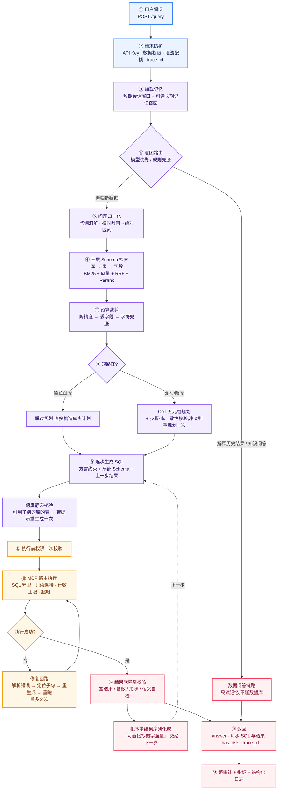
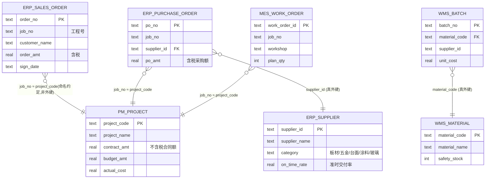
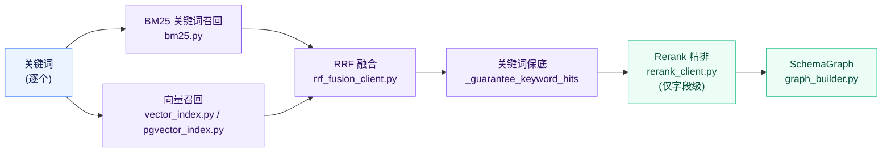
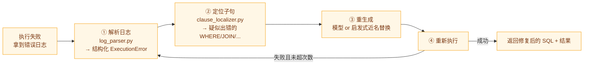
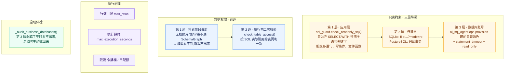
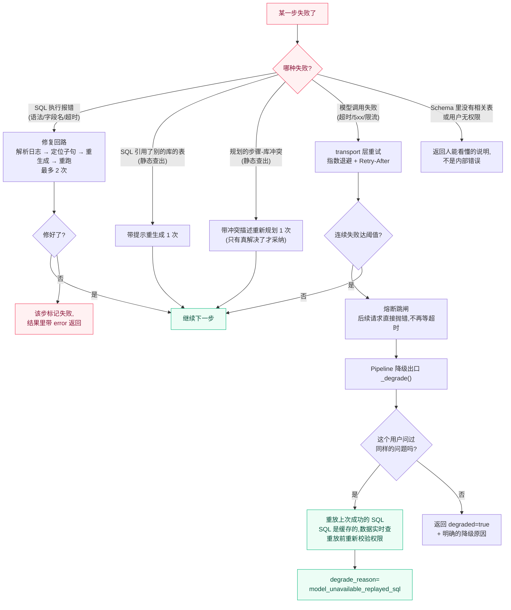

# AI SQL Agent · 项目详解手册

> 这份文档的目标只有一个:**让你从 0 把这个项目吃透,并且能对着它给别人讲 30 分钟。**
>
> 和 [README.md](../README.md) 的区别:README 回答「这是什么、怎么跑」,这份文档回答
> 「**为什么这么设计、每一行代码在防什么坑、讲的时候该怎么串**」。

| 项目速览 | |
| --- | --- |
| 代码量 | Python ≈ 28.4k 行(源码 ≈ 23k + 测试 5.3k) |
| 模块数 | 16 个顶层包 |
| 测试 | 357 个用例(无 pgvector 时跳过 16 个 pgvector 集成用例) |
| 评测 | 150 条评测集 + 40 条留出集 + 发布门禁 |
| 演示数据 | 4 个互不相干的业务库,15 张表,**无外键跨库** |
| 外部依赖 | FastAPI / uvicorn / pydantic / httpx / numpy / psycopg+pgvector / mcp |
| 离线可跑 | 是。没有模型 Key 时全链路走 Mock,Demo 和测试都能跑通 |

---

## 目录

**第一部分 · 先跑起来**
1. [这个项目在解决什么问题](#1-这个项目在解决什么问题)
2. [30 分钟上手路线](#2-30-分钟上手路线)
3. [一次请求的完整生命周期](#3-一次请求的完整生命周期)
4. [演示数据模型:四个业务库](#4-演示数据模型四个业务库)

**第二部分 · 逐模块拆解**
5. [ai_sql_agent.core — 地基](#5-ai_sql_agentcore--地基)
6. [ai_sql_agent.normalization — 问题归一化](#6-ai_sql_agentnormalization--问题归一化)
7. [ai_sql_agent.retrieval — 三层 Schema 检索](#7-ai_sql_agentretrieval--三层-schema-检索)
8. [token_budget / schema_budget — 预算裁剪](#8-token_budget--schema_budget--预算裁剪)
9. [routing / short_path — 两个路由决策](#9-routing--short_path--两个路由决策)
10. [ai_sql_agent.planning — 五元组规划](#10-ai_sql_agentplanning--五元组规划)
11. [ai_sql_agent.generation — SQL 生成](#11-ai_sql_agentgeneration--sql-生成)
12. [ai_sql_agent.execution — 只读执行](#12-ai_sql_agentexecution--只读执行)
13. [ai_sql_agent.repair — 失败修复回路](#13-ai_sql_agentrepair--失败修复回路)
14. [ai_sql_agent.validation — 软异常校验](#14-ai_sql_agentvalidation--软异常校验)
15. [ai_sql_agent.memory — 长短期记忆](#15-ai_sql_agentmemory--长短期记忆)
16. [ai_sql_agent.auth / audit / limits — 身份、审计、配额](#16-ai_sql_agentauth--audit--limits--身份审计配额)
17. [ai_sql_agent.api — 服务入口](#17-ai_sql_agentapi--服务入口)
18. [benchmark — 评测与发布门禁](#18-benchmark--评测与发布门禁)
19. [ai_sql_agent.ops / ai_sql_agent.mcp_server — 运维与对外工具](#19-ai_sql_agentops--ai_sql_agentmcp_server--运维与对外工具)

**第三部分 · 五条主线(讲解用)**
20. [主线 A:一个字段怎么走进 Prompt](#20-主线-a一个字段怎么走进-prompt)
21. [主线 B:跨库查询为什么难,项目用了 6 道防线](#21-主线-b跨库查询为什么难项目用了-6-道防线)
22. [主线 C:安全 —— 只读三层 + 权限两道](#22-主线-c安全--只读三层--权限两道)
23. [主线 D:可靠性 —— 失败了怎么办](#23-主线-d可靠性--失败了怎么办)
24. [主线 E:正确性 —— 「跑通」不等于「对」](#24-主线-e正确性--跑通不等于对)

**第四部分 · 讲解与自测**
25. [技术栈清单](#25-技术栈清单)
26. [30 分钟讲解脚本](#26-30-分钟讲解脚本)
27. [常见问题 Q&A](#27-常见问题-qa)
28. [动手练习](#28-动手练习)
29. [已知短板与踩坑记录](#29-已知短板与踩坑记录)

---

# 第一部分 · 先跑起来

## 1. 这个项目在解决什么问题

### 一句话

> 让不会写 SQL 的业务人员用大白话问数据,系统自己找表、写 SQL、跑出结果,
> **并且在结果可能是错的时候明确说出来**。

### 为什么这件事不是「把问题丢给 GPT 就行」

把 Text2SQL 当作「一次模型调用」来做,会撞上五堵墙。这个项目的每个模块,
基本都能对应到其中一堵:

| # | 墙 | 具体表现 | 本项目的应对 |
| --- | --- | --- | --- |
| 1 | **Schema 塞不进 Prompt** | 真实企业库几百张表、几千个字段,全塞进去既超上下文又稀释注意力 | 三层检索(库→表→字段)+ 预算感知裁剪 |
| 2 | **跨系统没有外键** | ERP 叫 `job_no`、项目系统叫 `project_code`,是同一个工程但库之间不能 JOIN | 显式声明跨库关联键 + CoT 拆步 + 字面量回填 |
| 3 | **模型会写错 SQL** | 字段名拼错、语法方言不对、聚合误用 | 日志驱动的修复回路(解析错误→定位子句→重生成→重跑) |
| 4 | **SQL 跑通了结果还是错的** | join 扇出导致重复计数、该出明细却聚合成一个数 | 结果软异常校验(空结果 / 基数 / 形状 / 语义自检) |
| 5 | **不能让 Agent 乱动生产库** | 模型某天生成一条 DELETE | 三层只读(应用层校验 / 连接层只读 / 数据库只读账号) |

**讲解要点**:第 4 堵墙是最值钱的一条。前三堵墙业界都在做,第 4 堵——
「静默错误」——才是这类工具在企业里被弃用的真正原因:一个错误的数字被
抄进周报,一次就够了。这个项目专门为它建了 `ai_sql_agent.validation` 模块,
并在评测里把「静默错误率」列为四大指标之一。

---

## 2. 30 分钟上手路线

### 2.1 环境准备

```bash
pip install -e ".[dev]"
```

依赖只有 8 个直接包,清单在 `pyproject.toml`。注意依赖段那句注释:原先是 `pip freeze`
全量导出,混进了一整套用不到的 GPU 训练栈,后来才收敛成「只列真正 import 的包」。
这本身就是个可以拿来讲的细节。

### 2.2 第一步:看端到端 Demo(最重要的一步)

```bash
python examples/end_to_end.py
```

**不用配任何 API Key。** 没有 Key 时模型层自动走 Mock,链路照样完整跑通。

这个 Demo 会把整条链路的中间产物全部打印出来,顺序正好就是本文档第 3 节的流程:

```
Demo 1:单库查询「查询准时率低于0.9的供应商名称」
  1. 用户 Query
  2. Schema 检索关键词 / 三层检索结果   ← 看它选了哪些库、哪些表
  3. Schema 图                          ← 看进 Prompt 的字段长什么样
     + 跨库约束段落                     ← 命中多库时才出现
  4. CoT 五元组                          ← 看规划模型拆了几步
  5.1 步骤 1 SQL                         ← 看生成的 SQL
  6.1 步骤 1 MCP 执行结果                ← 看真实执行结果

Demo 2:跨库两步查询(上一步结果回填)
  ... 同样的结构,但有 步骤1 / 步骤2,并且步骤 2 会用到步骤 1 的结果
```

> **建议**:把这段输出重定向到文件,对着它读第 3 节。这是理解本项目最快的路径——
> 所有抽象概念在这份输出里都有对应的、看得见的实体。
>
> ```bash
> python examples/end_to_end.py > /tmp/demo.txt 2>&1
> ```

### 2.3 第二步:跑测试,确认环境没问题

```bash
python -m unittest discover -s tests
```

预期:`Ran 357 tests ... OK (skipped=16)`。跳过的 16 个是 pgvector 集成用例
(本地没起 PostgreSQL 就自动跳过)。

> ⚠️ **本地坑**:如果项目根目录有 `.env` 文件且里面配了 `AI_SQL_*` 变量,
> 会有 3–4 个 settings 相关用例失败。原因是这些用例通过 `os.environ` 设置
> `OPENAI_API_KEY` 之类的通用名,而 `.env` 里的 `AI_SQL_` 前缀名在
> `AliasChoices` 里优先级更高,把测试设的值盖掉了。CI 环境没有 `.env`,所以是绿的。
> 详见第 29 节。

### 2.4 第三步:起服务,用网页问一句

```bash
./scripts/run_api.sh
```

打开 http://localhost:8000 ,内置查询界面有三个入口:业务查数、数据浏览、历史查询(原生 HTML/CSS/ES Module,无构建步骤;学习模式会按每次请求实际发生的步骤讲解)。
或者直接打接口:

```bash
curl -X POST http://localhost:8000/query -H 'Content-Type: application/json' -d '{"user_id":"u1","session_id":"s1","query":"查询准时率低于0.9的供应商名称"}'
```

留意返回体里的 `trace_id` / `has_risk` / `degraded` 三个字段,它们分别对应
本文档的主线 D(可靠性)和主线 E(正确性)。

### 2.5 第四步:读代码的推荐顺序

不要从 `README` 的模块表按字母序读。按**数据流**读:

```
1. src/ai_sql_agent/api/app.py          ── 入口,先看 query() 函数(约 423 行起)
2. src/ai_sql_agent/pipeline/dynamic_service.py ── 路由分叉:查库 还是 聊天
3. src/ai_sql_agent/pipeline/text2sql_pipeline.py ── 核心!先只读 run() 方法(189–630 行)
4. 然后按 run() 里出现的顺序,跳进各个子模块
```

`text2sql_pipeline.py` 的 `run()` 方法是整个项目的**主干**。它一共 440 行,
把 11 个阶段串成一条线。读懂它,项目就读懂 70% 了。

---

## 3. 一次请求的完整生命周期

### 3.1 全景图



### 3.2 每一步对应的代码位置

| 阶段 | 代码位置 | 关键函数 |
| --- | --- | --- |
| ① 入口 | `src/ai_sql_agent/api/app.py` | `query()` |
| ② 防护 | `src/ai_sql_agent/api/security.py`、`limits.py` | `AuthGuard.authenticate` / `RequestLimiter.check` |
| ③ 记忆 | `src/ai_sql_agent/memory/conversation.py` | `begin_user_turn()` |
| ④ 意图路由 | `src/ai_sql_agent/pipeline/routing.py` | `DynamicIntentRouter.route` |
| ⑤ 归一化 | `src/ai_sql_agent/normalization/normalizer.py` | `QueryNormalizer.normalize` |
| ⑥ 检索 | `src/ai_sql_agent/retrieval/hierarchical_service.py` | `ThreeTierSchemaRetrievalService.retrieve` |
| ⑦ 预算 | `src/ai_sql_agent/pipeline/schema_budget.py` | `fit_graphs_to_budget` |
| ⑧ 短路径 | `src/ai_sql_agent/pipeline/short_path.py` | `decide_short_path` |
| ⑧ 规划 | `src/ai_sql_agent/planning/cot_planner.py` | `CotPlanner.plan` |
| ⑨ 生成 | `src/ai_sql_agent/generation/sql_generator.py` | `SqlGenerator.generate` |
| ⑩ 权限 | `src/ai_sql_agent/pipeline/text2sql_pipeline.py` | `_check_table_access` |
| ⑪ 执行 | `src/ai_sql_agent/execution/router.py`、`sqlite_executor.py` | `MCPRouter.execute` |
| ⑫ 修复 | `src/ai_sql_agent/repair/repairer.py` | `SqlRepairService.repair` |
| ⑬ 校验 | `src/ai_sql_agent/validation/validator.py` | `ResultValidator.validate` |
| ⑭ 审计 | `src/ai_sql_agent/audit/store.py` | `SQLiteAuditStore.record` |

### 3.3 一个关键设计:阶段之间用 `stage()` 上下文管理器串起来

打开 `text2sql_pipeline.py` 你会看到大量:

```python
with stage("retrieval", _logger, keywords=resolved_keywords) as retrieval_stage:
    ...
    retrieval_stage.set(databases=[...], tables={...})
```

`stage()` 来自 `src/ai_sql_agent/core/trace.py`。它做三件事:
1. 自动计时,记录到 `STAGE_DURATION` 指标;
2. 出错时自动打一条 `stage.<name> status=error` 日志;
3. `set()` 把这一阶段的关键产物挂进日志字段。

**讲解要点**:这不是「加了点日志」,而是**把可观测性做成了链路的骨架**。
排查一次线上问题时,拿 `trace_id` 一搜,就能看到「检索选了哪几张表 →
规划拆了几步 → 每步 SQL 是什么 → 哪步失败了 → 修复了几次」的完整时间线。

---

## 4. 演示数据模型:四个业务库

讲解时这一节非常重要——**跨库能力的全部难点,都藏在这四个库的设计里**。



### 4.1 四个库分别是什么

| 库 | 业务域 | 表 |
| --- | --- | --- |
| `erp_db` | 订单与采购 | `sales_order` / `supplier` / `purchase_order` / `payment` |
| `pm_db` | 项目与工期 | `project` / `milestone` / `change_order` / `acceptance` |
| `mes_db` | 生产与工时 | `work_order` / `labor_hour` / `capacity_stat` / `quality_check` |
| `wms_db` | 库存与物料 | `material` / `batch` / `stock_snapshot` |

定义在 `sql/create_*.sql`,由 `src/ai_sql_agent/pipeline/demo_data.py` 建库并附上业务元数据。

### 4.2 三个刻意埋下的「坑」(这是设计,不是疏忽)

打开 `src/ai_sql_agent/resources/demo_sql/create_erp_demo.sql` 第一行注释就写着这件事:

**坑 1 · 同一实体、不同命名、无外键**

`pm_db.project.project_code` 和 `erp_db.sales_order.job_no` 指的是同一个工程,
但两个库之间**没有外键约束,连字段名都不一样**。这是真实企业的常态(ERP、
项目系统、MES 是三套采购来的系统)。

应对:`demo_data.get_cross_database_links()` 把关联关系**显式声明出来**注入 Prompt,
并标注 `confidence: "naming_convention"` —— 明确告诉模型「这是靠命名约定推断的,
不是数据库外键」。

**坑 2 · 同名近义指标,口径不同**

- 用户问「采购总金额」→ 正确答案是 `erp_db.purchase_order.po_amt`(含税)
- 模型很容易留在项目库用 `pm_db.project.contract_amt`(合同额、不含税)

两个字段名都合理,单看 Schema 无从判断。应对:`get_metric_disambiguation()`
把口径**写死**成 `term / correct / wrong` 三元组注入 Prompt。

**坑 3 · ERP 遗留缩写命名**

`job_no`、`po_amt` 这类字面无业务语义的缩写,**向量检索对它们表现很差**
(不是自然语言 token)。应对:业务元数据里为每个字段单独维护
`keyword_text`(给 BM25 用)、`vector_text`(给向量用)、`rerank_text`(给精排用)
三份不同的索引文本。

看一眼 `demo_data.py` 里 `job_no` 的元数据,这个设计一目了然:

```python
"job_no": {
    "description": "工程号,ERP 内部编码。与项目管理域的 project_code 指同一工程,但两库无外键约束。",
    "aliases": ["工程号", "工程编号", "项目号", "job号"],
    "semantic_role": "join_key",
    "keyword_text": "job_no 工程号 工程编号 项目号 job号 跨库关联 ERP编码",
    "vector_text": "字段名:job_no。所属表:sales_order。该字段是 ERP 的工程号编码,对应项目管理系统中的项目编号。",
    "rerank_text": "字段:sales_order.job_no。含义:工程号(ERP 缩写码)。角色:join_key,跨库关联到 project.project_code。",
}
```

> **讲解金句**:「**三路召回,就该有三份文本。** BM25 要的是关键词堆砌,
> 向量要的是通顺的自然语言句子,Rerank 要的是紧凑的结构化描述。
> 用同一份文本喂三路,等于三路都不好使。」

---

# 第二部分 · 逐模块拆解

每个模块按同一个模板讲:**干什么 → 关键文件 → 核心设计 → 讲解金句**。

---

## 5. ai_sql_agent.core — 地基

**干什么**:配置、模型传输、熔断、指标、日志、链路追踪、错误分类。所有模块都依赖它。

**关键文件**(1870 行)

| 文件 | 职责 |
| --- | --- |
| `settings.py` | 全局配置单例,统一收口原先散落各处的 `os.getenv` |
| `transport.py` | 模型调用统一传输层(**最值得读**) |
| `circuit.py` | 熔断器 |
| `metrics.py` | Prometheus 指标注册表(自己实现的,无第三方依赖) |
| `trace.py` | `trace_id` 上下文 + `stage()` 计时器 |
| `logging_setup.py` | 结构化日志(text / json 双格式) |
| `errors.py` | 错误分类(决定「能不能重试」「跳不跳闸」) |

### 5.1 settings.py:一个变量切换整个模型厂商

```python
model_provider: Provider = "openai"   # 或 "anthropic"
```

- `openai` → OpenAI 兼容协议(`/v1/chat/completions` + `Bearer`)。
  OpenAI 官方、中转站、阿里云百炼、vLLM、Ollama 全是这一套。
- `anthropic` → Anthropic Messages 协议(`/v1/messages` + `x-api-key`)。

**只改这一个变量,代码一行不用动。**

两个细节值得讲:

1. `AliasChoices` 让每个配置项同时认 `AI_SQL_OPENAI_API_KEY` 和通用的
   `OPENAI_API_KEY`,兼顾「项目专属」和「行业惯例」;
2. `build_endpoint()` 容忍 BASE_URL 带不带 `/v1` —— 因为 OpenAI 的
   BASE_URL 惯例带,Anthropic 的惯例不带,两种都得能用。

**Embedding 和 Rerank 的凭证是单独配置项**,原因写在注释里:主链路走 Anthropic 时,
Embedding 只能另找一家(Anthropic 不提供 embedding 接口)。

### 5.2 transport.py:一层把三件事收口

```
ModelTransport
  ├─ 协议差异     openai / anthropic 两种请求体与响应体格式
  ├─ 重试与退避   指数退避 + 尊重服务端的 Retry-After 头
  ├─ 熔断保护     请求前先查熔断器,断开就直接抛错不发请求
  └─ 用量记账     每次调用记 prompt_tokens / completion_tokens
```

**错误分类是关键**(`_classify_status`):

| 类别 | 例子 | 重试? | 跳闸? |
| --- | --- | --- | --- |
| `ModelTimeoutError` | 超时 | ✅ | ✅ |
| `ModelServerError` | 5xx | ✅ | ✅ |
| `ModelRateLimitError` | 429 | ✅ | ✅ |
| `ModelAuthError` | 401 | ❌ | ❌ |
| `ModelResponseError` | 返回不是合法 JSON | ❌ | ❌ |

**为什么鉴权失败不跳闸**:Key 配错了,重试一万次也还是错,而且它本来就是
立即返回的,不占用超时预算。跳闸只该保护「慢失败」。

### 5.3 circuit.py:熔断器解决的是什么问题

注释里写得很清楚:

> 模型服务整体挂掉时,每个请求都要等满超时(默认 60s)再重试两次,
> 一个人问一句话要卡三分钟,还把连接池占满。

状态机:

```
closed ──连续失败达阈值(默认5)──> open ──冷却结束(默认30s)──> half_open
   ↑                                                              │
   └────────────────── 试探成功 ────────────────────────────────────┘
                       试探失败 → 回到 open
```

跳闸后的行为不是「返回 500」,而是**让上层走降级链路**(见主线 D)。

### 5.4 metrics.py:自己实现的 Prometheus 注册表

没有引 `prometheus_client`。19 个指标,几个值得注意:

| 指标 | 为什么要它 |
| --- | --- |
| `CROSS_DB_VIOLATIONS` | 模型把两个库压进一条 SQL 的次数 |
| `PLAN_DB_CONFLICTS` | 规划阶段步骤-库冲突次数 |
| `SCHEMA_COLUMNS_DROPPED` | **被 Token 预算丢掉的字段数** |
| `RESULT_ANOMALIES` | 按异常类型 × 严重度分桶 |
| `DEGRADED_RESPONSES` | 按降级原因 × 失败阶段分桶 |

**讲解金句**:「指标不是给运维看的,是给**改进模型效果**用的。
`SCHEMA_COLUMNS_DROPPED` 一涨,就知道是预算太紧导致的召回损失,
而不是检索本身不行——这两件事的修法完全不同。」

---

## 6. ai_sql_agent.normalization — 问题归一化

**干什么**:链路的第一步。把口语化的问题变成确定的、可复现的问题。

**两件事**(共 344 行,是最小的模块,但位置极其关键):

### 6.1 代词消解(`coreference.py`)

```
上一轮:查询实际成本超过预算的项目名称
这一轮:它们的采购金额呢
        ↓
     实际成本超过预算的项目的采购金额呢
```

不消解会怎样?关键词抽取只会抽到「采购金额」,**上一轮的筛选条件整个丢了**,
检索方向完全跑偏。

实现是**规则式**的(正则抽取上一轮的「被查询对象」短语)。注释里明确写了取舍:

> 规则覆盖不到时保持原样——宁可不改,也不要改错,改错比不改危害大得多。

### 6.2 相对时间解析(`time_parser.py`)

```
上季度  →  上季度(2026-04-01 至 2026-06-30)
近三个月 →  近三个月(2026-06-01 至 2026-08-30)
```

注意它是**追加**而不是替换,保留原文 + 补上绝对区间。

**为什么必须做**(注释原文):

> 模型直接看到「上季度」会自己猜一个区间,猜得对不对不可控,而且同一个问题
> 在不同时间问会得到不同结果却无从察觉。

支持财年配置(`fiscal_year_start_month`),因为很多制造业企业财年不是自然年。

**讲解金句**:「这是整个项目里投入产出比最高的 344 行。它不调模型、不花钱、
不增加延迟,但直接决定了后面几千行代码在处理**哪个问题**。」

---

## 7. ai_sql_agent.retrieval — 三层 Schema 检索

**这是全项目最大的模块(6025 行),也是技术含量最高的部分。**

### 7.1 为什么要三层

一个企业库有 300 张表、3000 个字段。全塞进 Prompt:
- 超上下文;
- 就算不超,无关字段会成为**干扰项**——字段越多,模型选错的概率越高
  (这在 benchmark 里是有实测数据的)。

所以要**逐层收窄**:

```
Tier 1 库级   4 个库  →  最多 3 个
Tier 2 表级   15 张表 →  最多 8 张
Tier 3 字段级 86 个字段 → 最终约 20 个进 Prompt
```

### 7.2 每一层内部:三路召回 + 融合 + 精排



**RRF(Reciprocal Rank Fusion)** 的公式极简单:

```python
score_delta = route_weight / (rrf_k + rank)     # rrf_k 默认 60
```

融合的是**排名**不是分数。这一点很重要:BM25 分数和余弦相似度量纲完全不同,
直接加权求和没有意义;换成排名就可比了。

### 7.3 库级检索的一个特殊防护:关键词证据裁剪

`ThreeTierRetrievalConfig.database_keyword_guard`,注释写得很好:

> 分词器为提升字段级召回保留了中文单字 Token,副作用是几乎所有文档在 BM25 路
> 都会有弱命中。库级候选很少,单字噪声足以把无关库带进后续检索。

所以库级要求**更强的证据**:至少有一个关键词以 **bigram 及以上**长度字面命中。

**讲解金句**:「同一个分词策略,在字段级是优点(提高召回),在库级是缺点
(引入噪声)。**检索的每一层都该有自己的参数**,一套配置打天下必然在某一层吃亏。」

### 7.4 每表保底字段数

```python
min_columns_per_table=4,   # 每表保底 4 个字段
```

注释里有实测数据:

> 多表关联时避免一张表占满 top-15 配额、另一张表只剩 join key。
> 实测把 multi_join 召回从 14/25 拉到 17/25,再往上加(5/6)收益递减
> 但 Schema 图明显变胖。

**这是全项目注释风格的典型代表**:每个魔法数字背后都有一句「为什么是这个数,
不是更大或更小」。讲解时可以专门提这一点。

### 7.5 向量后端:内存 / pgvector 双实现

`vector_backend.py` 是个工厂:

- 配了 `AI_SQL_PGVECTOR_DSN` → 用 `PgVectorIndex`;
- 没配 / 依赖缺失 / 连不上 → **回退内存索引**,保证离线开发能跑。

离线时用的 embedding 是 `LocalHashEmbeddingClient`——把 token 哈希到固定维度上。
**它当然不如真 embedding**,但它让整个项目在没有任何 Key 的情况下可跑、可测。

### 7.6 权限在三层里都会生效

```python
def retrieve(self, query, keywords=None, access=None):
    # 库级:一张有权限的表都没有 → 这个库对当前用户不存在
    # 表级:access.allows_table 过滤
    # 字段级:filter_schema_graph(result.schema_graph, access) 兜底再裁一次
```

**核心思想**:模型看不到的东西,就写不出来。这是权限的第一道防线
(第二道在执行前,见主线 C)。

---

## 8. token_budget / schema_budget — 预算裁剪

**干什么**:让 Schema 上下文装进 Token 预算,并且**丢得聪明**。

### 8.1 预算怎么分

`PromptBudgetConfig`(单次查询约 8k):

| 项 | 预算 |
| --- | --- |
| 记忆上下文 | 2000 |
| Schema 上下文 | 3200 |
| CoT 规划 | 1400 |
| 生成预留 | 1400 |
| **合计** | **8000** |

### 8.2 三档降级(这是个精彩的设计)

`schema_budget.py` 的模块 docstring 值得整段读:

> 为什么需要这一层:`fit_schema` 是对渲染好的整段文本做**字符级截断**的。
> 超预算时它砍掉的是「排在后面的字符」,而不是「最不相关的字段」——
> 一张表可能被从中间切断,规划模型随后写出「Schema 未提供完整表结构」,
> 再生成 `SELECT project_code FROM project WHERE 0`。
>
> 实测这条路径造成的损失是可测的:5 条召回缺失里 4 条的 gold 字段是被预算切掉的
> (`retrieval_recall_hit=True` 而 `recall_hit=False`),不是检索没找到。

于是设计成三档:

```
1. 完整渲染装得下           →  原样用
2. 装不下                   →  切精简渲染(丢别名/语义角色/业务用途,
                               保留名称/类型/含义/取值域)
3. 还装不下                 →  按相关性从末尾丢字段
                               · 每张表保底 2 个字段
                               · join key 永不丢弃
4. 极端情况仍超预算          →  按库分配字符级裁剪(而不是整段头部截断,
                               否则会优先砍掉最后一个库,而跨库查询正依赖它)
```

### 8.3 相关性怎么算(没有分数时的巧思)

```python
def _relevance(column, position):
    """SchemaGraph 里的 ColumnSchema 不带检索分数(分数在 RetrievalHit 上),
    但**列表顺序就是检索排序**,所以位置本身是可用的相关性代理。"""
    score = getattr(column, "rerank_score", None) or getattr(column, "rrf_score", None)
    return (float(score) if score is not None else 0.0, -position)
```

### 8.4 跨库约束段落是在裁剪**之后**才追加的

```python
schema_context = self.prompt_budget.fit_schema_sections(sections)
# 跨库约束在预算裁剪**之后**追加:它比任何单个字段说明都重要,
# 不能因为 Schema 太长就被裁掉。
if retrieval_result.cross_database_notes:
    schema_context = f"{schema_context}\n\n{retrieval_result.cross_database_notes}"
```

**讲解金句**:「Prompt 里的内容**不是等价的**。字段说明少一条,可能只是少个备选;
跨库约束少一条,整条查询直接错。所以裁剪必须知道自己在裁什么。」

---

## 9. routing / short_path — 两个路由决策

项目里有**两个不同的路由**,别搞混:

| | 意图路由 `routing.py` | 短路径路由 `short_path.py` |
| --- | --- | --- |
| 决定什么 | 要不要查数据库 | 要不要调规划模型 |
| 在哪一步 | 最前面(进 pipeline 之前) | 检索之后、规划之前 |
| 怎么判 | 模型分类优先,规则兜底 | 纯规则,不调模型 |
| 省什么 | 省掉整条 Text2SQL 链路 | 省一次推理调用(约 -1.5k tokens、-2~3s) |

### 9.1 意图路由:两个路由目标

```
database_query  → 需要查实时业务数据
data_qa         → 解释历史结果 / 指标口径 / 业务知识,不该重复查库
```

`RuleBasedIntentClassifier` 用一组信号词表打分,优先级从高到低:

```
1. 时效词 + 查询词        → database_query (0.98)  「重新统计本月的...」
2. 有历史结果 + 结果指代   → data_qa       (0.97)  「这个结果什么意思」
3. 知识型问句             → data_qa       (0.96)  「什么是准时交付率」
4. 解释词 且 无查询词      → data_qa       (0.92)
5. 有查询词               → database_query (0.90)
6. 兜底                   → data_qa       (0.65)  「未发现必须访问数据库的明确意图」
```

**兜底选 data_qa 而不是 database_query**,理由是「默认使用低成本对话问答」——
不确定时选便宜的那条路。

`ModelIntentClassifier` 用模型做同样的二分类,`DynamicIntentRouter` 是门面:
**模型优先,任何异常(JSON 解析失败、字段缺失、模型挂了)一律回落规则**。

### 9.2 短路径:一个刻意保守的优化

```python
if any(signal in query for signal in _MULTI_STEP_SIGNALS):   # 跨库/对比/超过平均/占比/同比...
    return RoutingDecision(False, "命中多步信号,需要完整规划")
if len(databases) > 1:
    return RoutingDecision(False, f"检索命中 {len(databases)} 个库,需要跨库规划")
if total_tables > 3:
    return RoutingDecision(False, f"候选表 {total_tables} 张,关联关系复杂,走完整规划")
...
return RoutingDecision(False, "无法确认为简单查询,保守走完整规划")   # 默认退回
```

注释把取舍写死了:

> 判定是**保守**的——只有明确像单步查询才走短路径,任何多步信号或跨库迹象
> 都退回完整链路。**宁可多花一次调用,也不要答错。**

**讲解金句**:「所有性能优化都要问一句『退化时的代价是什么』。这里退化的代价是
答错一个数字,而收益只是省 2 秒——所以判定条件必须写得比直觉更严。」

---

## 10. ai_sql_agent.planning — 五元组规划

**干什么**:把一个自然语言问题,拆成若干个「一步一个库」的结构化步骤。

### 10.1 五元组是什么

```
步骤N:
(
  数据库: pm_db,
  处理对象: project.project_code, project.actual_cost, project.budget_amt,
  操作指令: 先从 project 表筛选 actual_cost > budget_amt 的记录;再输出 project_code,
  输出目标: project_code,
  预期输出量级: 数条
)
```

| 字段 | 作用 |
| --- | --- |
| 数据库 | **执行路由用**。一个步骤只能对应一个库 |
| 处理对象 | 涉及的表和**字段**(必须到字段级) |
| 操作指令 | **链式**处理过程,不是条件列表 |
| 输出目标 | 相当于 SQL 的 SELECT 部分 |
| 预期输出量级 | **给执行后的基数校验用** |

### 10.2 第五个字段是后来加的,专门为了抓静默错误

Prompt 里的原话:

> 预期输出量级从「单条 / 数条 / 数十条 / 数百条 / 数千条」中选一个,或直接写「约N条」。
> **这是给执行后的基数校验用的:实际行数远超预期通常意味着关联扇出导致重复计数,
> SQL 能跑通但结果是错的。**

**讲解要点**:让模型**先声明自己的预期**,再拿实际结果去对——这是一个通用的
「让模型自证」技巧,成本几乎为零,但能抓到 join 扇出这类最隐蔽的错误。

### 10.3 跨库拆步规则是硬写进 Prompt 的

```
4. 每个步骤只处理一个数据库中的查询任务,但一个数据库步骤中可以处理多张表。
   跨库查询必须拆步:不同数据库之间没有外键、也不允许 JOIN,
   前一步要把关联键(如项目编号)作为「输出目标」显式输出,
   后一步再拿这些取值当字面量条件用。
```

但**光写规则不够**——所以还有 `few_shots.py`:

```python
few_shots=few_shots_for(len(retrieval_result.selected_databases))
```

命中多个库时给一个**完整走通的跨库范例**。代码注释解释了为什么:

> 跨库拆步的规则此前只以文字指令存在,模型读懂了规则仍写不对格式
> (两个库压进一步 / 第一步不输出关联键)。

**讲解金句**:「**模型跟随格式示例远强于跟随文字指令。**这句话在这个项目里出现了两次
——一次在 few-shot,一次在下一步结果的字面量回填。这是 Prompt 工程最实用的一条经验。」

### 10.4 步骤-库一致性校验 + 重规划一次

规划完不是直接用,还有一道静态校验(`_plan_database_conflicts`):

> 找出「步骤声明的数据库里没有它处理对象所引用的表」的步骤。
> 这是跨库失败里最隐蔽的一种:计划看起来是两步,但第二步把第一步的表也
> 写进了处理对象,SQL 生成必然引用不存在的表。执行时报 no such table 还算好的,
> **更糟的是模型改用同库的同名近义字段硬凑——SQL 跑通、结果是错的。**

有冲突就带着**具体冲突描述**重新规划一次。而且:

```python
# 只有重新规划确实解决了冲突才采纳,否则保留原计划:
# 换一版同样错的计划只是白烧一次调用。
if replanned.steps and not self._plan_database_conflicts(replanned):
    cot_result = replanned
```

---

## 11. ai_sql_agent.generation — SQL 生成

**干什么**:拿单个 CoT 步骤 + 局部 Schema + 方言约束 + 上一步结果,生成一条 SQL。

### 11.1 关键设计:局部 Schema

```python
local_schema = schema_store.extract_local_schema(sql_cot_step)
```

SQL 生成阶段**不给整个 SchemaGraph**,只给这一步「处理对象」里点到名的表和字段。
理由同前:字段越少,选错概率越低。

> ⚠️ 这也解释了为什么短路径的处理对象必须写到**字段级**:
> ```python
> # 处理对象必须写到**字段级**:SQL 生成阶段按它裁剪局部 Schema,
> # 只给表名会把字段全裁掉,模型看不到可用字段,必然生成不出正确 SQL。
> ```

### 11.2 方言约束是显式建模的

`src/ai_sql_agent/execution/dialects.py` 把 SQLite 和 PostgreSQL 的差异写成数据:

```python
SQLITE = SqlDialect(
    current_date_expr="DATE('now')",
    date_diff_hint="用 DATE(col, '-7 day') 做日期偏移,JULIANDAY(a) - JULIANDAY(b) 求天数差",
    extra_rules=("没有 RIGHT JOIN / FULL JOIN,需要时改写为 LEFT JOIN",
                 "布尔值用 1/0,不要写 TRUE/FALSE"),
)
POSTGRES = SqlDialect(
    current_date_expr="CURRENT_DATE",
    date_diff_hint="用 col - INTERVAL '7 day' 做日期偏移,日期相减直接得到天数",
    extra_rules=("整数相除结果为整数,求比例时先 CAST(x AS numeric)",
                 "字符串比较区分大小写,忽略大小写用 ILIKE"),
)
```

然后 `to_prompt_rules()` 生成注入 Prompt 的段落。注释说明了动机:

> 生产库是 PostgreSQL,本地 Demo 用 SQLite——同一句「取最近 7 天」两边写法就不一样。
> 这里把方言差异显式建模,避免模型按「标准SQL」瞎猜。

### 11.3 Prompt 里两条反直觉的规则

```
7. **表名前不要加数据库名前缀**。执行时已经连到目标库,
   写 `pm_db.project` 会报「no such table」,直接写 `project`。
```

以及 `SqlPromptBuilder` 类注释:

```
- Prompt 中不放数据库名称,数据库名称只用于后续执行路由。
```

**讲解要点**:因为库名在 CoT 里已经标了,是**路由信息**不是**SQL 信息**。
把路由信息塞进生成 Prompt,只会诱导模型写出 `db.table` 这种在 SQLite/单库连接下
必然报错的形式。

### 11.4 上一步结果回填:把答案摆成「可直接抄的一行」

这是全项目我最喜欢的一个细节。`_serialize_step_result()`:

```python
sections = [f"共 {len(rows)} 行,字段:{', '.join(columns)}"]
sections.append("可直接用作本步骤的字面量筛选条件:")
sections.append("  project_code IN ('J24001', 'J24003', 'J24007')")   # ← 关键
sections.append("完整结果(JSON):")
sections.append(json.dumps({...}))
```

注释解释了为什么不只给 JSON:

> 跨库查询的第二步失败样本里,相当一部分是模型看着一段 JSON 自己又去写跨库子查询或 JOIN。
> **把答案以「直接抄这一行」的形式摆出来,比多写几句「请改写为字面量」的指令有效得多**
> ——模型跟随格式示例远强于跟随文字指令。

配套的 Prompt 段落也很讲究:

```
# 上一步结果(已在另一个数据库执行完毕)
下面是上一步的结果。**上一步的筛选条件已经生效,本步骤不要重复实现它**,
只需要把结果里的取值当成已知常量用掉。

用法:直接抄下面「可直接用作本步骤的字面量筛选条件」那一行放进 WHERE。
禁止:跨库 JOIN、跨库子查询、在本步骤重新推导上一步的筛选逻辑——
另一个库的表在这里不存在,写了必定报 no such table。
```

**「用法 / 禁止」这种写法,比一段散文式的指令有效得多。**

### 11.5 生成后的跨库静态校验

```python
foreign = [t for t in extract_referenced_tables(sql) if t not in available]
if foreign:
    # 带着「哪张表不在这个库」的提示重生成一次
```

只重试一次,理由写在注释里:

> 这是格式性错误,模型拿到明确提示通常一次就能改对;重试更多次的收益远低于延迟与成本。
> 改不对就放行,交给执行与修复回路。

---

## 12. ai_sql_agent.execution — 只读执行

**干什么**:按步骤的目标库路由到对应执行器,并落实执行治理。

### 12.1 结构

```
MCPRouter                      按 request.database 找执行器
 ├─ SQLiteMCPExecutor          进程内 SQLite
 ├─ PostgresMCPExecutor        进程内 PostgreSQL
 └─ MCPProtocolExecutor        真实 MCP stdio 协议(use_mcp_protocol=True 时)
```

### 12.2 SQL 守卫(`sql_guard.py`)

四类拒绝:

```python
1. 空语句
2. 首关键字不是 SELECT / WITH
3. 一次提交多条语句(分号拼接)
4. 语句中出现写操作关键字(insert/update/delete/drop/attach/pragma/...)
5. 调用可读写文件或加载扩展的函数(load_extension/writefile/pg_read_file/...)
```

有两个实现细节值得讲:

**① 为什么要扫描整条语句而不只看首关键字**

```python
# `WITH x AS (...) INSERT INTO ...` 在 SQLite / PostgreSQL 都是合法写法,
# 只看首关键字会漏,因此对整条语句做关键字扫描。
```

**② 为什么要先剥掉注释和字符串字面量**

```python
def strip_sql_noise(sql):
    """去掉注释与字符串字面量,只留下用于关键字判断的骨架。"""
```

否则 `WHERE name = 'delete me'` 会被误判为包含 `delete`。

### 12.3 执行治理三件套

```python
SQLiteMCPExecutor(readonly=True, max_rows=1000, max_execution_seconds=10.0)
```

| 治理项 | 实现 |
| --- | --- |
| 只读 | `sql_guard` 校验 **+** `file:...?mode=ro` URI 打开只读连接(双防线) |
| 行数上限 | `fetchmany(max_rows + 1)`,**多取一行**来区分「刚好取满」和「被截断」 |
| 超时 | `conn.set_progress_handler()` 每 10000 条虚拟机指令检查一次 deadline |

**`fetchmany(max_rows + 1)` 这个细节值得单独讲**:如果只取 `max_rows` 行,
返回正好 1000 行时你无法判断是「真的只有 1000 行」还是「被截断了」。
多取一行,`len(rows) > max_rows` 就是截断标志。返回体里的 `truncated` 字段
就是这么来的。

---

## 13. ai_sql_agent.repair — 失败修复回路

**干什么**:SQL 执行失败后,不是直接报错,而是尝试修好再跑。

### 13.1 四步回路



最多 2 次(`max_repair_attempts`)。

### 13.2 错误解析:七类模式

```python
("no_such_table",     r"no such table:\s*([\w.]+)"),
("no_such_column",    r"no such column:\s*([\w.]+)"),
("ambiguous_column",  r"ambiguous column name:\s*([\w.]+)"),
("syntax_error",      r'near "([^"]+)":\s*syntax error'),
("no_such_function",  r"no such function:\s*([\w.]+)"),
("timeout",           r"超时|interrupt"),
("misuse_aggregate",  r"misuse of aggregate..."),
```

解析出 `error_type` + `detail`(比如出错的具体字段名)。

### 13.3 子句定位

按顶层关键字(`SELECT/FROM/JOIN/WHERE/GROUP BY/HAVING/ORDER BY/LIMIT/WITH`)
切分 SQL 为带位置的子句序列,再根据错误类型定位。

一个细节:

```python
# text 保留原始切片(不 strip),保证 start/end 与 text 严格对应,
# 子句替换后可以按位置拼回原 SQL。
```

### 13.4 两条修复策略

| 策略 | 何时用 | 做法 |
| --- | --- | --- |
| 模型修复 | 配了模型 Key | 把错误 + 出错子句 + 局部 Schema + 方言约束一起给 Coder 模型 |
| 启发式修复 | 没有模型 | `difflib` 在 Schema 的表名/字段名里找**最近似**的名字替换 |

启发式那条保证了**离线环境下修复回路依然可测**——这是全项目的一致设计:
每个依赖模型的能力,都有一个不依赖模型的降级实现。

### 13.5 提前终止

```python
if not repaired_sql or repaired_sql.strip() == current_sql.strip():
    # 无法产生新的候选 SQL,提前终止
    break
```

生成不出**新的**候选就不要再重跑了,重跑同一条 SQL 只是浪费一次数据库往返。

---

## 14. ai_sql_agent.validation — 软异常校验

**这个模块是本项目最有辨识度的部分。讲解时应该重点讲。**

### 14.1 它解决什么问题

模块 docstring 开门见山:

> 处理「SQL 跑通了但结果可能是错的」这一类软异常。
> 硬错误(语法、未知字段)由 ai_sql_agent.repair 的日志解析回路负责,不在这里。
>
> **设计原则:`执行成功` ≠ `答案正确`。** 只校验执行是否成功会漏掉最危险的一类错误
> ——join 扇出导致聚合重复计数、过滤条件写反导致空结果,这些 SQL 都能正常返回,
> 只有结果是错的。

### 14.2 四道检查

| # | 检查 | 调模型? | 抓什么 |
| --- | --- | --- | --- |
| 1 | 空结果 | ❌ | 返回 0 行:可能真没数据,也可能过滤条件写错 |
| 2 | 基数校验 | ❌ | 实际行数 vs 规划声明的「预期输出量级」 |
| 3 | **形状检查** | ❌ | 该出明细却聚合成一个数 |
| 4 | 语义自检 | ✅ | SQL 实际算的东西 vs 用户问的东西 |

### 14.3 形状检查:静默错误的头号形态

`shape.py` 的 docstring:

> 实测静默错误的头号形态就是形状不符——问「台面类供应商的采购金额」,
> 模型答一个 `SUM(po_amt)`。数字本身算得没错,但用户以为看到的是每一单的金额,
> 拿到的是总额,而且全程没有任何迹象提示这一点。**21 条静默错误里 4 条是这一类。**
>
> 两条检查都是静态的(只看 SQL 的结构与计划文本),成本接近零,因此可以对每条查询都跑。

实现只有两个判断:

```python
def wants_aggregation(query):    # 问句里有没有「统计/合计/总额/平均/各/每个/占比...」
def is_structurally_single_row(sql):  # 最外层查询有聚合函数且没有 GROUP BY
```

用户没要求汇总 + SQL 结构上只返回一行 → 报异常。

「结构上只返回一行」只看**最外层查询**(用 sqlglot 解析,解析不了才退回按全文搜)。
聚合出现在别处并不折叠结果:「每种物料取最新一张快照」写成
`WHERE snapshot_date = (SELECT MAX(snapshot_date) …)`,全文有 MAX、没有 GROUP BY,
外层却一行不少。按全文搜会把它报成「只能返回 1 行」,而结果表里明明是 8 行——
一条和眼前结果自相矛盾的提示,比不提示更伤信任。

### 14.4 语义自检:两步走,而不是直接问「这条 SQL 对不对」

```
第 1 步:只让模型**复述** SQL 字面行为
        —— 不给它看用户的问题,避免它顺着问题脑补
第 2 步:把「复述」和「原问题」一起给模型,判一致性
```

Prompt 里明确写着:

```
只描述SQL字面执行的内容,不要推测意图,不要评价对错,不要输出SQL。
```

**讲解金句**:「直接问模型『这条 SQL 对不对』,它会看着问题去解释 SQL,
容易自圆其说。**先蒙住问题让它复述,再拿复述去比对**——这是把一个
容易受暗示的判断,拆成了两个不受暗示的判断。」

### 14.5 多步查询的特殊 Prompt(踩坑修复)

跨库查询的最后一步,SQL 里只有一串看不出来历的字面量。用普通 Prompt 判,
必然被判成「漏掉了问题里的筛选条件」。所以有专门的 `_MULTI_STEP_COMPARE_PROMPT`:

```
前面的步骤已经执行完毕,它们的筛选结果已经以字面量(如 IN ('A','B'))的形式
写进了最后一步的 SQL 里。

因此:最后一步的 SQL **本来就不会**再出现前置步骤的筛选条件和表,
这是正确的设计,不是遗漏。
```

代码注释里记了这个坑的代价:

```python
# 中间步骤拿**该步骤的目标**去比,不能拿用户原问题——
# 第一步只做前半段,拿整个问题去比必然判成「漏掉了后半段」,
# 那正是之前跨库误报 100% 的成因。
```

**误报率 100%** —— 这就是为什么校验器本身也需要被评测(见第 18 节的「误报率」护栏)。

### 14.6 结果必须回传给调用方

`src/ai_sql_agent/api/app.py` 里 `StepLogResponse.risk_findings` 的注释:

> 必须回传给调用方:这些错误 SQL 跑得通、有结果,不提示的话用户看不出异常,
> 会把错的数字当成事实。指标口径上,「答错且没有任何提示」才算静默错误——
> **如果提示只写进服务端日志,那对用户来说它依然是静默的。**

---

## 15. ai_sql_agent.memory — 长短期记忆

**干什么**:让多轮对话有上下文,并且让用户能把有价值的结果存进个人知识库。

### 15.1 两套记忆,完全不同的定位

| | 短期记忆 | 长期记忆 |
| --- | --- | --- |
| 范围 | 单个 `session_id` | 单个 `user_id` |
| 写入 | **自动**,每轮消息 | **用户主动**保存(`POST /memory/save`) |
| 读取 | 每次请求都带 | **默认关闭**,`enable_long_term=true` 才召回 |
| 机制 | 滑动窗口(12 条 = 6 轮)+ 增量摘要 | 向量召回 + 可选 Rerank |
| 存储 | SQLite | SQLite,向量可选 pgvector |

**长期记忆默认关闭**是个重要决定:它要花 embedding 调用和检索时间,
而大多数查询并不需要。让调用方按需开启。

### 15.2 短期记忆:非阻塞增量摘要

超出窗口的消息不是丢掉,而是压成摘要。关键是**异步**:

```python
self._executor = ThreadPoolExecutor(max_workers=2, thread_name_prefix="memory-summary")
```

摘要要调模型,是个慢操作。放在请求主路径上会拖慢每一轮对话,所以扔进线程池后台做。
`ConversationMemoryContext.short_term.summary_pending` 会告诉你摘要还没做完。

服务关闭时会等摘要线程收尾(`memory.close(wait=True)`)。

### 15.3 摘要器也有离线降级

```python
class ExtractiveMemorySummarizer:
    """无模型配置时的可运行降级实现,保留事实而非生成新结论。"""
```

**「保留事实而非生成新结论」** —— 抽取式摘要不会编造,这在记忆场景比生成式更安全。

### 15.4 向量后端三档选择

```python
vector_backend: str = "auto"
# "auto"    :配了 DSN 就用 pgvector,连不上则告警并回退 SQLite 全量打分
# "pgvector":强制使用,连不上直接失败(生产环境用,避免静默降级)
# "none"    :始终走 SQLite,用于离线开发与单测
```

**注意 `"pgvector"` 这一档的理由:「避免静默降级」。** 生产环境里,
向量库连不上却悄悄退回全表扫描,是个会一直没人发现的性能问题。

---

## 16. ai_sql_agent.auth / audit / limits — 身份、审计、配额

### 16.1 auth:表级 + 列级权限

`DataPolicy` 用 glob 匹配:

```python
allow_tables = ["erp_db.*", "mes_db.work_order"]
deny_tables  = ["hr_db.*"]
deny_columns = ["wms_db.batch.unit_cost", "*.*.id_card_no"]
# deny 优先于 allow
```

注释说明了场景定位:

> 内部自用场景下真正要拦的不是租户之间的越界,而是「**估价员不能看批次成本单价**」
> 这类表级/列级授权。

`Principal` 是一次请求的身份,包含:

| 字段 | 用途 |
| --- | --- |
| `caller` | 调用方标识(应用名或人名) |
| `user_id` | 记忆与配额的归属人 |
| `policy` | 合并后的数据权限 |
| `can_impersonate` | 能否代其他 `user_id` 发请求(BI 门户需要,个人脚本不该开) |
| `is_admin` | 能否调运维接口 |

**API Key 重复会直接抛异常**:

```python
# 静默覆盖意味着有人会拿到别人的身份与权限,必须显式失败
raise ValueError(f"API Key 重复:{...}")
```

### 16.2 audit:审计表 = 排查依据 + 配额口径 + 降级重放数据源

一张 SQLite 表(生产可切 PostgreSQL),字段包括
`trace_id / caller / user_id / query / route / databases / tables / sqls /
denied_tables / success / failed_steps / repaired_steps / duration_ms /
prompt_tokens / completion_tokens / degraded / error`。

**注意它有三个索引**:

```sql
idx_audit_user_time    (user_id, created_at)   -- 查历史 + 算日配额
idx_audit_trace        (trace_id)              -- 按链路 ID 排查
idx_audit_replay       (user_id, query, id)    -- 降级时重放上次成功的 SQL ★
```

第三个索引是为**降级重放**服务的(见主线 D)。这是个很好的例子:
审计表在这里不只是「记录」,它成了一个可用的能力来源。

**结果集不落审计**(`HistoryItem` 注释:「一条历史查询(不含结果集,结果不落审计)」)
—— 审计要记「谁查了什么」,不该把业务数据本身复制一份。

### 16.3 limits:令牌桶 + 日配额

```python
class TokenBucketLimiter:
    """内部单实例部署不引 Redis:一个 dict + 一把锁足够。"""
```

日配额从审计表算,缓存 15 秒:

```python
# 配额是成本控制不是安全边界,短暂的少量超发可以接受。
```

**讲解金句**:「工程决策要看**它到底在防什么**。配额防的是成本失控,
不是攻击,所以 15 秒缓存换掉每请求一次数据库查询是划算的。
如果它防的是攻击,这个取舍就是错的。」

---

## 17. ai_sql_agent.api — 服务入口

### 17.1 端点一览

| 端点 | 用途 | 鉴权 |
| --- | --- | --- |
| `GET /` | 内置查询界面(静态文件在 `/static` 下) | — |
| `GET /whoami` | 本次请求解析出的身份与服务能力(页面发问前靠它知道 user_id) | API Key |
| `GET /catalog` | 数据目录:当前身份可见的数据域、表、字段 | API Key |
| `POST /catalog/{库}/{表}/rows` | 只读分页预览(搜索/筛选/排序,不接受 SQL) | API Key |
| `POST /catalog/{库}/{表}/profile` | 表概况(只有聚合:行数、填充数、取值分布、按月的记录数) | API Key |
| `POST /query` | 自然语言查询入口 | API Key |
| `GET /history` | 查询历史(默认只看自己的) | API Key |
| `POST /memory/save` | 保存结果到个人长期记忆 | API Key |
| `GET /health` | 存活探针 | 无 |
| `GET /readyz` | 就绪探针 | 无 |
| `GET /metrics` | Prometheus 抓取 | 无(按内网设计) |
| `POST /admin/schema/reload` | 手动重建 Schema 索引 | **Admin** |
| `POST /admin/circuit/reset` | 手动复位熔断器 | **Admin** |
| `GET /admin/schema/status` | 查看 Schema 指纹与待生效变更 | **Admin** |

### 17.2 health vs readyz:一个经常被做错的区分

```python
@app.get("/health")
def health():
    """存活探针:只回答「进程还在不在」,不查任何外部依赖。

    依赖抖动不应该让编排系统重启进程,那是就绪探针的职责。"""
    return {"status": "ok"}
```

```python
@app.get("/readyz")
def readyz():
    """就绪探针:检查外部依赖,任一不可用就摘流量但不重启。"""
    # 检查:记忆库可读写、pgvector 可连、审计存储可写、模型凭证是否配置
```

**并且熔断状态刻意不算进 ready 判定**:

```python
# 熔断状态只做展示:模型挂了会走降级链路,服务本身仍然可用,
# 因此不把它算进 ready 判定,否则会被摘掉流量反而没法降级服务。
```

**讲解金句**:「探针设计的核心问题是『**这个失败该由谁修**』。
进程死了要重启(health);依赖挂了要摘流量等它自己好(readyz);
模型挂了我自己能降级,那就什么都不用做。」

### 17.3 启动时的只读账号体检

```python
def _audit_business_databases(pipeline):
    """启动时体检业务库账号是不是真的只读。

    只读约束有三层(应用层 SQL 校验、连接层只读事务、数据库账号权限),
    第三层配错了平时看不出来——直到某天模型生成了一条 DELETE。
    这里在启动时就把问题喊出来,而不是等出事。"""
```

**这是个非常好的设计**:纵深防御的最外层如果配错了,平时完全无感知
(因为内层挡住了),等到内层某天漏了才发现。所以要主动体检。

### 17.4 中间件:trace_id 贯穿

```python
@app.middleware("http")
async def trace_requests(request, call_next):
    incoming = request.headers.get("X-Trace-Id", "")
    with use_trace_id(incoming) as trace_id:
        ...
        response.headers["X-Trace-Id"] = trace_id
```

调用方可以透传上游链路 ID;响应头原样返回,前端能把用户看到的一次查询
和后端日志对上。

### 17.5 SchemaWatcher:业务库改了结构怎么办

`schema_watcher.py` 按 `AI_SQL_SCHEMA_REFRESH_SECONDS` 轮询,对比 **Schema 指纹**
(`src/ai_sql_agent/retrieval/schema_fingerprint.py`)判断有没有变化,变了就重建索引。
也可以通过 `POST /admin/schema/reload` 手动触发。

---

## 18. benchmark — 评测与发布门禁

**这一节是这个项目区别于「玩具 demo」的关键,讲解时值得花时间。**

### 18.1 四个头部指标,每个都对应一种「会被弃用」的失败模式

| # | 指标 | 门槛 | 护栏 | 不达标的代价 |
| --- | --- | --- | --- | --- |
| 1 | **字段召回率**(留出集 40 条) | ≥ 85% | 平均入图字段占比 ≤ 40% | 字段都没进 Schema 图,后面再准也答不出来 |
| 2 | **单库执行准确率** | ≥ 85% | — | 每条结果都要人工复核,复核时间吃掉省下的时间 |
| 3 | **跨库执行准确率** | ≥ 90% | — | 用户宁可自己查两次再拼,这个能力等于没有 |
| 4 | **静默错误率** | ≤ 3% | 风险提示误报率 ≤ 20% | 错数字被抄进周报,一次就够让工具被关掉 |

### 18.2 「护栏」这个设计是精髓

每个指标都配一个**堵死作弊路径**的护栏:

- 想让召回率 100%?把全部 86 个字段塞进 Schema 图就行了 —— 所以配
  「平均入图字段占比 ≤ 40%」;
- 想让静默错误率降到 0?对每条查询都报风险就行了 —— 所以配
  「风险提示误报率 ≤ 20%」。

**讲解金句**:「**任何单一指标都能被作弊,除非你把作弊路径也变成指标。**
这是评测设计里最重要的一条,比选什么指标本身更重要。」

### 18.3 为什么用留出集而不是评测集

README 里的原话(翻译):

> 门禁用留出集而不是评测集,因为短语表、字段别名和枚举词表都是对着评测集建的。
> 没法说清那 100% 里有多少是调出来的。留出集用完全不同的口语表述,不参与调参,
> 才是「真实用户来了会怎样」的估计。

**这是数据泄漏防护意识。** 讲解时可以特别提一句:很多项目的「95% 准确率」
就是这么来的——在自己调过参的集合上测。

### 18.4 单次运行的数字不算数

> **执行准确率指标的单次运行不算数。**同样的代码在同样的 25 条跨库用例上,
> 测出来的范围能从 16% 到 36%;一条用例就是 4 个百分点。

规则:

- 对外引用的数字必须是 `--repeat 3` 的均值,并附上范围;
- 判断一个改动有没有用,差异必须**超过范围的跨度**;
- 门禁跑 `python -m benchmark.gate --repeat 3`,单轮模式会警告;
- 均值过线但范围下界在线下 = 这一轮运气好,不是指标达标。

### 18.5 诚实地标注未达标项

README 里明确写着两项 ❌(2026-09-09 基线,150 条全量三轮):

- 跨库执行准确率:85.3%,距离 90% 门槛差 4.7pp;
- 静默错误率:5.3%,距离 3% 门槛差 2.3pp。

并且标注了数据的局限:

> ⚠️ 跑的是内置演示元数据,不是部署用的 `tools/sim_erp/semantic` 语义层,
> 量的是 pipeline 在标准夹具上的表现;主键规则现在这版措辞只有一轮全量数据。
> 引用时带上这两条,见 `benchmark/baseline/2026-09-09/README.md`。

**讲解要点**:这种「把自己没达标的指标写在 README 第一屏」的做法,
在求职/汇报场景反而是加分项——它证明你知道什么叫可信的度量。

### 18.6 怎么跑

```bash
python -m benchmark.run_benchmark --smoke    # 冒烟(小样本)
python -m benchmark.gate --repeat 3 --smoke  # 门禁(冒烟样本)
```

`benchmark/thresholds.json` 是门槛的**唯一真相源**,`gate.py` 直接读它。

---

## 19. ai_sql_agent.ops / ai_sql_agent.mcp_server — 运维与对外工具

### 19.1 ai_sql_agent.ops:一键生成只读账号

```bash
python -m ai_sql_agent.ops provision
```

生成一段 PostgreSQL DDL,建一个真正的只读角色。模板里有几处值得看:

```sql
-- 2. 明确收回写权限,避免继承 PUBLIC 上的历史授权
REVOKE ALL ON DATABASE {database} FROM {role};
REVOKE CREATE ON SCHEMA {schema} FROM PUBLIC;

-- 4. 以后新建的表也自动只给读(否则每加一张表都要再来一次)
ALTER DEFAULT PRIVILEGES IN SCHEMA {schema} GRANT SELECT ON TABLES TO {role};

-- 5. 兜底:单条语句超时由服务端强制,应用层配置失效时仍然生效
ALTER ROLE {role} SET statement_timeout = '{statement_timeout_ms}ms';
ALTER ROLE {role} SET default_transaction_read_only = on;
```

第 4 条和第 5 条是**运维经验的体现**:
- `ALTER DEFAULT PRIVILEGES` 省掉「每加一张表就要找 DBA」的循环;
- 数据库层的 `statement_timeout` 是应用层配置失效时的最后一道保险。

同模块的 `audit_business_databases()` 就是 API 启动时体检用的那个函数。

### 19.2 ai_sql_agent.mcp_server:把只读查询能力开放给外部 Agent

```bash
python -m ai_sql_agent.mcp_server.server   # stdio 协议
```

暴露两个 MCP 工具:

- `list_databases()` — 列出可查询的库
- `execute_sql(database, sql)` — 执行只读 SQL

**这是反向的:** 主链路里 `ai_sql_agent.execution` 是「我们去执行 SQL」;
`ai_sql_agent.mcp_server` 是「别的 Agent(比如 Claude Code)来用我们的只读执行能力」。
治理参数(行数上限、超时、只读)和主链路保持一致。

---

# 第三部分 · 五条主线(讲解用)

> 前面是「按模块」看,这一部分是「按问题」看。**给朋友讲的时候,用这五条线,
> 比按模块顺序讲清楚得多。**

---

## 20. 主线 A:一个字段怎么走进 Prompt

以「查询准时率低于0.9的供应商名称」为例,追踪 `supplier.on_time_rate` 这个字段:

```
① 建索引(启动时,一次)
   demo_data.get_erp_business_meta() 提供元数据
   → document_builder.py 为该字段生成三份文本:
       keyword_text : "on_time_rate 准时率 准时交付率 及时率 交付准时率"
       vector_text  : "字段名:on_time_rate。所属表:supplier。该字段是..."
       rerank_text  : "字段:supplier.on_time_rate。含义:准时交付率..."
   → BM25Index 吃 keyword_text,VectorIndex 吃 vector_text

② 关键词抽取
   "查询准时率低于0.9的供应商名称"
   → HybridKeywordExtractor(模型 + 业务术语表)
   → ["供应商名称", "供应商", "准时率"]

③ Tier 1 库级
   每个关键词跑 BM25 + 向量 → RRF 融合 → 关键词强证据裁剪
   → 选中 erp_db, wms_db, pm_db

④ Tier 2 表级
   同样的三路 → 选中 erp_db.supplier / erp_db.purchase_order / ...

⑤ Tier 3 字段级
   在候选表内检索 → RRF 融合 → 关键词保底 → Rerank 精排
   → on_time_rate 排在第 1(rerank_text 命中"准时交付率")

⑥ 权限过滤
   filter_schema_graph(graph, access) —— 无权字段在这里被裁掉

⑦ 构建 SchemaGraph
   graph_builder.py 把命中字段组装成带表关系的图

⑧ 预算裁剪
   fit_graphs_to_budget() —— on_time_rate 相关性高,不会被丢
   (join key 和每表前 2 个字段永远保留)

⑨ 渲染进 Prompt
   - 字段名:on_time_rate
     数据类型:REAL
     字段含义:准时交付率,0-1 之间的小数。
     字段别名:准时率, 准时交付率, 及时率, 交付准时率
     字段角色:metric_filter
     样例值:0.65, 0.88, 0.95
     取值范围:0-1
     业务用途:评估供应商交付表现,筛选准时率低的供应商。

⑩ 规划模型看到它 → 写进「处理对象」
⑪ 生成模型看到它 → 写进 WHERE on_time_rate < 0.9
```

**讲解时可以对着 `end_to_end_demo` 的输出走这一遍,每一步都能看到实物。**

---

## 21. 主线 B:跨库查询为什么难,项目用了 6 道防线

### 难在哪

问:「查询实际成本超过预算的项目,它们的采购总金额是多少」

- 「实际成本超过预算的项目」在 `pm_db.project`
- 「采购总金额」在 `erp_db.purchase_order.po_amt`
- **两个库之间没有外键,不能 JOIN,连字段名都不一样**(`project_code` vs `job_no`)

正确做法是拆两步:

```sql
-- 步骤 1(pm_db)
SELECT project_code FROM project WHERE actual_cost > budget_amt;
-- → ['J24001', 'J24003', 'J24007']

-- 步骤 2(erp_db),把上一步结果当字面量
SELECT SUM(po_amt) FROM purchase_order WHERE job_no IN ('J24001','J24003','J24007');
```

模型的典型错法有四种:

1. 把两个库压进一条 SQL(`... IN (SELECT project_code FROM project)`)→ `no such table`;
2. 干脆留在单库,用同名近义字段硬凑(`contract_amt` 代替 `po_amt`)→ **SQL 跑通,结果是错的**;
3. 拆了两步,但第一步不输出关联键 → 第二步没法用;
4. 拆了两步,但第二步又去重复实现第一步的筛选逻辑。

### 六道防线

| # | 防线 | 位置 | 防哪种错法 |
| --- | --- | --- | --- |
| 1 | **跨库关联键显式声明** | `demo_data.get_cross_database_links()` → 注入 Prompt | ③④ |
| 2 | **指标口径消歧** | `get_metric_disambiguation()` → 注入 Prompt | ② |
| 3 | **跨库 Few-shot** | `src/ai_sql_agent/planning/few_shots.py`,命中多库时给完整范例 | ①③ |
| 4 | **步骤-库一致性校验 + 重规划** | `_plan_database_conflicts()` | ① |
| 5 | **SQL 跨库静态校验 + 重生成** | `_enforce_step_database()` | ① |
| 6 | **字面量回填格式** | `_serialize_step_result()` 生成「可直接抄的一行」 | ①④ |

再加上**跨库约束段落在预算裁剪之后追加**(保证它绝不会被裁掉),
和**语义自检的多步专用 Prompt**(避免把「字面量」误判成「漏条件」)。

### 效果与代价

benchmark 记录:修掉度量缺陷和预算裁剪问题后,跨库准确率从 **56% → 76–80%**。
README 里的结论很值得引用:

> 这个差距**主要是工程缺陷,不是链路长度**。

原先的推导认为「跨库天然要打折」(4 步串联 × 94% ≈ 78%),
消融实验推翻了这个假设,于是把门槛从 78% 提到了 **90%(要求跨库不比单库差)**。

**讲解金句**:「一开始大家都会把准确率低归因于『任务本身就难』。
消融实验的价值就是告诉你,**有多少是任务难,有多少只是你写错了**。」

---

## 22. 主线 C:安全 —— 只读三层 + 权限两道



### 为什么权限要判两次

第一道(检索裁剪)已经很强了——模型压根看不到无权表。为什么还要第二道?

代码注释回答了:

> 第一道防线是检索阶段裁剪(模型看不到无权表),但**模型可能凭对话上下文
> 或先验知识写出表名**,所以在 SQL 打到数据库之前,按实际引用的表再判一次。

而且第二道在**降级重放**时也会跑:

```python
# 权限可能在上次查询之后收紧,重放前必须重新校验
denied = self._check_table_access(database=database, sql=sql, access=access)
if denied:
    return []
```

**讲解金句**:「安全设计的基本功是问『如果这一层被绕过会怎样』。
检索裁剪防的是模型**不知道**;执行前校验防的是模型**知道但不该用**。
这是两种不同的威胁,需要两道不同的门。」

### 拒绝信息也要对用户友好

```python
error=f"没有访问权限:{', '.join(denied)}。请联系管理员申请该表的查询权限。"
```

以及 Schema 不足时:

```python
message = ("当前可见的表不足以回答这个问题:...。"
           "可能是数据库里没有相关表,也可能是你没有相关表的访问权限,"
           "需要的话联系管理员申请。")
```

**不要把内部错误(「找不到执行器」)暴露给业务用户。**

---

## 23. 主线 D:可靠性 —— 失败了怎么办

这条线可以画成一棵「失败处理决策树」:



### 降级重放是这条线的亮点

```python
sql_history_lookup=audit_store.last_successful_sqls
```

模型挂了,但用户上周问过同样的问题、当时成功了 —— 那条 SQL 还躺在审计表里。
于是:

> 优先重放该用户同一问题上次成功的 SQL —— **SQL 是缓存的,数据仍然实时查**;
> 重放前照样过一遍数据权限(权限可能已经收紧)。
> 没有可重放的历史就返回明确的降级结果,而不是抛 5xx。

三个设计细节值得讲:

1. **缓存的是 SQL 不是结果**,所以数据是新的;
2. **重放前重新校验权限**,因为权限可能变了;
3. **依赖注入而不是直接依赖**:`Text2SQLPipeline` 不 import 审计模块,
   由 API 层把查询函数注进来(`sql_history_lookup` 参数)。

### 降级要让调用方知道

`QueryResponse` 里:

```python
degraded: bool = False
"""模型不可用时走了降级链路,结果可能来自历史 SQL 重放。"""
degrade_reason: str = ""
```

**「当它无法安全降级时,API 会明确返回降级原因。」** 静默降级是最坏的选择。

---

## 24. 主线 E:正确性 —— 「跑通」不等于「对」

这是全项目的**灵魂主线**,建议讲解时压轴讲。

### 24.1 三类错误,三种处理

```
硬错误       SQL 跑不起来      → ai_sql_agent.repair 修复回路
             (语法、未知字段)      可自动修好

软异常       SQL 跑通了,但      → ai_sql_agent.validation 校验
             结果可能是错的        提示用户核对,不阻断

静默错误     SQL 跑通了、有结果  → 这是最贵的一类
             结果是错的            **而且没有任何提示**
             ← 前两者的目标就是把这一类压到最小
```

### 24.2 静默错误的实测形态(来自 benchmark)

21 条静默错误里:

- **4 条是形状不符** —— 问明细,答了个聚合数字;
- 其余包括口径选错(`contract_amt` 当成 `po_amt`)、join 扇出重复计数、
  过滤条件写反导致空结果被当成「确实没有」。

### 24.3 静默错误的定义有一条容易被忽略的边界

`app.py` 里的注释:

> 指标口径上,「答错且没有任何提示」才算静默错误——
> **如果提示只写进服务端日志,那对用户来说它依然是静默的。**

所以 `risk_findings` 必须回传到 API 响应里,前端必须展示。
`has_risk` 字段就是给前端用的「这条结果需要核对」开关。

### 24.4 校验器自己也会犯错,所以有误报率护栏

跨库场景下语义自检曾经**误报率 100%**(把正确的字面量回填判成漏条件)。
所以 benchmark 里有一条护栏:**风险提示误报率 ≤ 20%**(实测 5.6%)。

**讲解金句**:「加一个校验器,你就多了一个会出错的东西。所以校验器必须
和被校验的东西一起被度量——否则你只是把『答错』换成了『天天报警,
没人再看警报』。」

### 24.5 成本是不对称的

benchmark README 的原话(翻译):

> 信任的代价是不对称的:查询失败时,用户自己去查;说「不确定,请核对」时,
> 用户会去核对。**只有那种跑通了、出了数、没有警告、而且是错的结果,
> 才会被直接抄进报告和决策。**

这句话解释了为什么四个指标里,静默错误率是唯一一个「越低越好」的,
也是门槛定得最严的(≤ 3%)。

---

# 第四部分 · 讲解与自测

## 25. 技术栈清单

### 25.1 直接依赖(只有 8 个)

| 层 | 技术 | 版本 | 干什么 |
| --- | --- | --- | --- |
| Web 框架 | FastAPI | 0.141.1 | 路由、依赖注入、OpenAPI |
| ASGI 服务器 | uvicorn[standard] | 0.32.1 | 跑服务 |
| 数据校验 | pydantic | 2.13.4 | 请求/响应模型 |
| 配置 | pydantic-settings | 2.1.0 | 环境变量 + `.env` |
| HTTP 客户端 | httpx | 0.28.1 | 调模型 API(含 SSE 流式) |
| 环境变量 | python-dotenv | 1.2.2 | `.env` 加载 |
| 数值计算 | numpy | 2.2.6 | 向量检索 |
| 向量存储 | psycopg[binary] + pgvector | 3.3.4 / 0.5.0 | pgvector 后端(可选) |
| MCP | mcp | 2.0.0 | MCP 服务端 |

> **注意没有的东西**:没有 LangChain、没有 LlamaIndex、没有 SQLAlchemy、
> 没有 prometheus_client、没有 Redis、没有 Celery。
> 检索、RRF、BM25、指标注册表、令牌桶限流、熔断器**全是自己实现的**。
>
> **讲解时这是一个加分点**:能说清楚「为什么不用框架」比「用了什么框架」更有说服力。
> 这里的理由是:这些组件的逻辑都在 100 行以内,自己写换来的是完全可控的行为
> 和零版本冲突,而框架带来的抽象层在这个场景里帮不上忙。

### 25.2 技术点清单(按面试/讲解分类)

**检索**
- BM25(自实现,k1=1.5 / b=0.75)
- 稠密向量检索(内存 numpy / PostgreSQL + pgvector 双后端)
- RRF 倒数排名融合(rrf_k=60)
- Rerank 精排(阿里云百炼 qwen3-rerank)
- 分层检索(库 → 表 → 字段)
- 一字段三份索引文本(keyword / vector / rerank)
- 关键词强证据裁剪(bigram 门槛)

**LLM 工程**
- 多厂商协议抽象(OpenAI 兼容 / Anthropic Messages)
- Prompt Token 预算分配与相关性感知裁剪
- Few-shot(按命中库数量动态选择)
- 结构化输出解析 + 容错(去 markdown 围栏、正则兜底提取 JSON)
- CoT 五元组规划
- 模型自检(复述-比对两步法)
- 全链路 Mock 降级(无 Key 可跑)

**后端工程**
- FastAPI 依赖注入、lifespan、中间件
- 熔断器(closed/open/half_open)
- 指数退避重试 + Retry-After
- 令牌桶限流
- 结构化日志 + trace_id 上下文传播
- Prometheus 指标(自实现注册表)
- 存活/就绪探针分离
- 线程池异步任务(记忆摘要)
- 优雅关闭

**数据与安全**
- 多方言 SQL 抽象(SQLite / PostgreSQL)
- 只读 SQL 静态校验(AST 级关键字扫描)
- 三层只读纵深防御
- 表级 + 列级数据权限(glob 匹配,deny 优先)
- API Key 鉴权 + 角色策略合并
- 审计日志 + 日配额
- PostgreSQL 只读角色 provisioning

**评测**
- 执行准确率评测集 + 留出集
- 指标护栏设计(防作弊)
- 多轮运行取均值 + 范围
- 消融实验
- 发布门禁(CI 可跑)

**部署**
- Docker + docker-compose(pgvector / vLLM / 生产三套编排)
- GitHub Actions CI(带 pgvector service container)
- MCP 服务端(对外暴露只读查询工具)

---

## 26. 30 分钟讲解脚本

> 直接照着讲。括号里是时间和「该展示什么」。

### 开场 · 问题定义(3 分钟)

> 「先说一个场景:老板问『上季度实际成本超预算的项目,采购花了多少钱』。
> 这个问题的答案分散在两个系统里:项目管理系统知道哪些项目超预算,
> ERP 知道采购花了多少。而这两个系统之间**没有外键,连字段名都不一样**。
>
> 这个项目做的就是:让人用大白话问,系统自己找表、写 SQL、跑出结果。
> 但它真正花力气的地方不是『能不能答出来』,而是『**答错的时候能不能说出来**』。」

**展示**:README 的架构图。

### 第一段 · 跑一遍(5 分钟)

**展示**:终端跑 `python examples/end_to_end.py`,滚动看输出。

> 「不需要任何 API Key,模型层自动走 Mock。这一点很重要——
> 整个项目 357 个测试用例都能离线跑,CI 里也不需要配 Key。」

指着输出说:「关键词 → 候选库 → 候选表 → Schema 图 → CoT 五元组 → SQL → 执行结果。
这就是整条链路,后面我讲的每一块,在这份输出里都有对应的实物。」

### 第二段 · 三层检索(6 分钟)

**展示**:Demo 输出里的「候选数据库 / 候选表」那两行,再翻到 Schema 图。

> 「第一个真问题:企业库有几百张表、几千个字段,塞不进 Prompt。
> 而且就算塞得进,无关字段会成为干扰项——字段越多模型选错越多,这是有实测数据的。
>
> 所以做三层收窄:4 个库选 3 个,15 张表选 8 张,86 个字段最后进 Prompt 约 20 个。
> 每一层内部都是 **BM25 + 向量 + RRF 融合**,字段级再加一层 Rerank。」

**亮点讲这个**:

> 「有个细节我觉得挺有意思:同一个字段维护了**三份**索引文本。
> BM25 那份是关键词堆砌,向量那份是通顺的自然语言句子,Rerank 那份是紧凑的结构化描述。
> 因为三路召回吃的东西根本不一样,用同一份文本喂三路,三路都不好使。」

### 第三段 · 跨库(6 分钟)

**展示**:Demo 2 的输出,指着「跨库约束」段落和步骤 1 / 步骤 2。

> 「跨库是这个项目最难的部分。两个库不能 JOIN,只能拆成两步:
> 第一步在 pm_db 查出项目编号,第二步把这些编号**当成字面量**带到 erp_db 去。
>
> 模型有四种典型错法……(讲主线 B 的四种错法)
>
> 项目为此建了六道防线……(讲六道防线表)」

**亮点讲这个**:

> 「最有意思的是第六道。上一步的结果不是直接给 JSON,而是额外拼一行:
> `project_code IN ('J24001','J24003','J24007')`,再配一句『直接抄这一行放进 WHERE』。
>
> 原因是:给 JSON 的时候,模型看着数据自己又去写跨库子查询了。
> **模型跟随格式示例,远强于跟随文字指令。**」

### 第四段 · 安全(4 分钟)

**展示**:画三层只读 + 两道权限。

> 「Agent 要连生产库,只读是底线。这里做了三层:
> 应用层扫 SQL 关键字、连接层用只读连接、数据库层用只读账号。
>
> 权限做了两道:检索的时候无权表就不进 Schema 图,模型看不到就写不出来;
> 但模型可能凭上下文猜出表名,所以执行前按 SQL 实际引用的表再判一次。」

**亮点讲这个**:

> 「有个设计我特别喜欢:**服务启动时会主动体检业务库账号是不是真的只读**。
> 因为只读三层里,数据库账号那一层如果配错了,平时完全看不出来——
> 内层挡住了嘛。等到内层某天漏了才发现就晚了。所以启动时就喊出来。」

### 第五段 · 正确性(压轴,6 分钟)

> 「最后讲我认为这个项目最值钱的部分。
>
> 大多数 Text2SQL 项目的成功标准是『SQL 跑通了』。但**跑通不等于对**。
> join 扇出会导致重复计数,过滤条件写反会返回空结果——这些 SQL 都能正常返回,
> 只有结果是错的。这叫**静默错误**。
>
> 静默错误为什么最贵?因为查询失败时用户会自己去查,说『不确定』时用户会去核对。
> **只有跑通了、出了数、没有警告、而且是错的结果,才会被直接抄进周报。**
> 一次就够让这个工具被关掉。」

**展示**:`ai_sql_agent.validation` 的四道检查表。

> 「所以有四道检查:空结果、基数、形状、语义自检。
> 前三道是静态的,不调模型,成本接近零,每条查询都跑。
>
> 形状检查抓的是最常见的一类:问『台面类供应商的采购金额』,模型答一个 `SUM(po_amt)`。
> 数字本身没算错,但用户以为看到的是每一单,拿到的是总额。21 条静默错误里 4 条是这个。
>
> 语义自检不是直接问模型『这条 SQL 对不对』,而是两步:
> **先蒙住问题让它复述 SQL 干了什么,再拿复述去和问题比对。**
> 直接问它会看着问题解释 SQL,容易自圆其说。」

**展示**:benchmark 的四指标表。

> 「而且这些都被度量了。四个头部指标,每个都配一个**护栏**堵死作弊路径:
> 想让召回率 100%?把全部字段都塞进去就行——所以配『入图字段占比 ≤ 40%』。
> 想让静默错误率降到 0?每条都报风险就行——所以配『误报率 ≤ 20%』。
>
> **任何单一指标都能被作弊,除非你把作弊路径也变成指标。**」

### 收尾(2 分钟)

> 「最后说两个我觉得能体现这个项目态度的地方:
>
> 一是 README 里有两个指标是**打红叉的**——跨库准确率 85.3% 差 4.7 个点,
> 静默错误率 5.3% 超了 2.3 个点,都明明白白写在第一屏。
>
> 二是它明确写了『**单次运行的执行准确率不算数**』:同样的代码测三次
> 能从 16% 到 36%,一条用例就是 4 个百分点。所以对外的数字必须是三轮均值加范围。
>
> 我觉得这比准确率本身更能说明问题——**知道自己的数字有多可信,是工程能力的一部分。**」

---

## 27. 常见问题 Q&A

> 讲完之后大概率会被问到的问题,以及答案在哪。

**Q1:为什么不直接把整个 Schema 丢给长上下文模型?**

两个原因:成本(每次查询几万 token)和准确率(无关字段是干扰项——
benchmark 里专门设了「入图字段占比 ≤ 40%」这条护栏,就是因为字段越多选错越多)。
另外企业库真实规模远超长上下文窗口。

**Q2:为什么是 CoT 五元组,不是让模型直接写 SQL?**

三个理由:
1. 跨库必须拆步,而拆步这件事需要一个显式的中间表示;
2. 「数据库」字段是**执行路由**的依据;
3. 「预期输出量级」字段让模型先声明预期,给执行后的基数校验用。

简单单库查询确实不需要,所以有 `short_path` 跳过规划调用。

**Q3:短路径判错了会怎样?**

会掉准确率。所以判定刻意保守——命中任何多步信号、检索命中多个库、
候选表超过 3 张,一律退回完整规划;默认分支也是退回。
`decide_short_path` 的最后一行是 `RoutingDecision(False, "无法确认为简单查询,保守走完整规划")`。

**Q4:RRF 为什么用排名而不是分数?**

BM25 分数和余弦相似度量纲完全不同,直接加权求和没有意义。排名是可比的。
公式 `score = weight / (k + rank)`,k=60 是业界常用值(越大排名差异越平滑)。

**Q5:没有 API Key 怎么还能跑通?**

每个依赖模型的能力都有一个不依赖模型的降级实现:
- 意图路由 → `RuleBasedIntentClassifier`
- 关键词抽取 → 规则抽取
- Embedding → `LocalHashEmbeddingClient`(token 哈希到固定维度)
- 记忆摘要 → `ExtractiveMemorySummarizer`(抽取式)
- SQL 修复 → `difflib` 近名替换
- 数据问答 → `RuleBasedDataQAClient`

**Q6:那 Mock 跑出来的准确率有意义吗?**

没有。Mock 是为了让**链路**可测、可 Demo,不是为了测**效果**。
效果必须配真模型跑 benchmark,而且要 `--repeat 3`。

**Q7:为什么熔断器只对基础设施类失败计数?**

因为鉴权失败(401)、参数错误、返回体不是 JSON 这些是**确定性错误**,
重试一万次也一样,而且它们本来就是立即返回的,不占超时预算。
熔断器保护的是「慢失败」——超时、5xx、限流。

**Q8:降级重放会不会给出过期数据?**

不会。缓存的是 **SQL 不是结果**,数据仍然实时查。而且重放前会重新校验权限
(权限可能在上次查询之后收紧了)。

**Q9:审计表为什么不记结果集?**

审计要记「谁查了什么」,不该把业务数据本身复制一份存到另一个地方——
那既是存储浪费,也是新的数据泄漏面。

**Q10:健康检查为什么分 health 和 readyz?**

回答的问题不同:
- `health` 回答「进程还在不在」→ 失败要**重启**;
- `readyz` 回答「依赖能不能用」→ 失败要**摘流量**,不该重启。

依赖抖动导致进程被反复重启,是个很常见的线上事故。
另外熔断状态**刻意不算进 ready**——模型挂了服务还能降级,摘掉流量反而没法降级了。

**Q11:表级/列级权限用 glob 而不是 RBAC 表,是不是太简陋?**

定位问题。注释里写了:内部自用场景要拦的不是租户越界,而是
「估价员不能看批次成本单价」这类授权。glob + deny 优先足够表达,
而且配置文件可以直接挂成 K8s Secret,改权限不用重建镜像。

**Q12:静默错误率 5.3% 没达标,这个项目算失败吗?**

不算,反而是它诚实的地方。更重要的是它**知道自己是 5.3%**,
知道这 5.3% 主要是形状不符和口径选错,也知道改进方向。
对比「不知道自己准确率是多少」的项目,这是完全不同的成熟度。

**Q13:这套设计能迁移到别的场景吗?**

能。可复用的部分:
- 三层检索 + RRF + 预算裁剪 → 任何需要在大规模结构化元数据里做召回的场景;
- 「规划-生成-执行-校验-修复」回路 → 任何 Agent 生成可执行产物的场景;
- 「跑通 ≠ 对」的软异常校验思路 → 任何 Agent 输出会被当成事实使用的场景。

**Q14:最大的技术债是什么?**

见第 29 节。主要是:跨库准确率和静默错误率两项未达门槛;
基线跑的是演示元数据而不是部署语义层;`hierarchical_service` / `text2sql_pipeline`
两个文件偏大(各 500+ 和 1300+ 行)。

**Q15:如果让你继续做,下一步做什么?**

按 benchmark 的诊断:
1. 按 `tools/sim_erp/semantic` 重写 gold SQL,拿到部署口径的基线(现在的基线是演示夹具口径);
2. 攻静默错误里占比最高的「形状不符」和「口径选错」——前者已有静态检查,
   可以从「提示」升级为「反问用户」;后者要扩 `metric_disambiguation` 词表;
3. 跨库剩下的 4.7pp:JOIN 基数标注已把「漏 DISTINCT」清掉,剩下的主要是投影缺列,
   先看规则 9(输出主键)扩写版补齐三轮之后还剩多少。

---

## 28. 动手练习

> 想真正掌握,光读不够。这几个练习按难度排序,做完基本就吃透了。

### 练习 1 · 加一个业务库(⭐)

在 `sql/` 下加一个 `create_hr_demo.sql`(比如员工与考勤域),然后:

1. `demo_data.py` 里加 `create_hr_demo_database()` 和 `get_hr_business_meta()`;
2. 在 `get_database_catalog()` 里加它的描述和别名;
3. `text2sql_pipeline._resolve_databases()` 和 `_resolve_business_metas()` 里注册;
4. 跑 Demo,看看它能不能被检索到。

**学到什么**:业务元数据的每个字段分别喂给了谁。

### 练习 2 · 故意让 SQL 报错,观察修复回路(⭐)

改 `src/ai_sql_agent/generation/prompt_builder.py`,在 Prompt 里加一句
「表名统一加 `tbl_` 前缀」,然后跑 Demo。

观察日志里的 `repair.attempt` 事件:错误怎么被解析成 `no_such_table`,
子句怎么被定位,`difflib` 怎么找到最近似的表名。

**学到什么**:修复回路的四步,以及启发式修复的边界。

### 练习 3 · 把 Schema 预算调到 500,看会发生什么(⭐⭐)

改 `PromptBudgetConfig.schema_budget = 500`,跑 Demo。

观察:
- 日志里的 `retrieval.schema_budget_applied` 事件,`dropped_columns` 列出了谁被丢了;
- `SCHEMA_COLUMNS_DROPPED` 指标涨了多少;
- 生成的 SQL 有没有变差。

**学到什么**:三档降级的实际行为,以及为什么 join key 要永不丢弃。

### 练习 4 · 写一个会触发形状检查的查询(⭐⭐)

构造一个问题,让模型倾向于写 `SUM(...)` 但用户其实要明细,
看 `risk_findings` 里是不是出现了 `unrequested_aggregation`。

然后反过来:构造一个用户确实要汇总的问题,确认它**不**误报。

**学到什么**:软异常校验的判定逻辑,以及误报率为什么需要护栏。

### 练习 5 · 加一种 SQL 方言(⭐⭐⭐)

在 `src/ai_sql_agent/execution/dialects.py` 加一个 `MYSQL = SqlDialect(...)`,
再写一个 `MySQLMCPExecutor`,在 `_build_mcp_router()` 里注册。

**学到什么**:方言抽象的边界在哪——哪些差异是「注入 Prompt 的规则」,
哪些是「执行器要处理的连接细节」。

### 练习 6 · 加一道新的软异常检查(⭐⭐⭐)

比如:检测 `SELECT *`(用户问具体指标,SQL 却拉了全表所有列),
或者检测 `LIMIT` 缺失导致的潜在大结果集。

在 `src/ai_sql_agent/validation/` 加一个新文件,在 `ResultValidator.validate()` 里接进去,
在 `objects.AnomalyType` 里加枚举,写测试。

**学到什么**:这个模块的扩展点设计,以及「新增校验必须同时考虑误报」。

### 练习 7 · 跑一次真实模型的 benchmark(⭐⭐⭐⭐)

配好 Key,跑:

```bash
python -m benchmark.run_benchmark          # 完整 150 条
python -m benchmark.gate --repeat 3        # 门禁,三轮
```

对比你跑出来的数字和 README 里的数字。注意范围有多宽。

**学到什么**:为什么「单次运行不算数」不是一句客套话。

---

## 29. 已知短板与踩坑记录

> 讲解时主动说出这些,比被问出来强。

### 29.1 指标未达标(项目自己承认的)

| 项 | 门槛 | 实测 | 差距 |
| --- | --- | --- | --- |
| 跨库执行准确率 | ≥ 90% | 85.3% [84.0, 88.0] | −4.7pp |
| 静默错误率 | ≤ 3% | 5.3% | +2.3pp |

数字来自 2026-09-09 基线(150 条全量三轮,`claude-sonnet-5`)。前一天是
73.3% / 10.0%,JOIN 基数标注一处改动补上了大部分差距。但**基线跑的是内置演示
元数据,不是部署语义层**,README 里用了 ⚠️ 明确标注。

### 29.2 本地跑测试的 `.env` 污染(实测确认)

**现象**:项目根目录有 `.env` 时,`python -m unittest discover -s tests`
会有 3–4 个用例失败,报错形如:

```
AssertionError: 'https://<你的 base url>/v1/messages' != 'https://relay.example.com/v1/messages'
AssertionError: '' != 'Bearer sk-local-vllm'
```

**原因**:这些用例通过 `os.environ` 设置 `OPENAI_API_KEY` / `ANTHROPIC_BASE_URL`
这类通用名,但 `.env` 里配的是 `AI_SQL_` 前缀名,在
`AliasChoices("AI_SQL_XXX", "XXX")` 里前缀名优先级更高,把用例设的值盖掉了。
CI 环境没有 `.env`,所以是绿的。

**验证方法**:在一个不含 `.env` 的目录下跑,357 个用例全绿:

```bash
cd /tmp && PYTHONPATH=/path/to/ai-sql-agent python -c "
import sys, unittest
sys.path[:0] = ['/path/to/ai-sql-agent', '/path/to/ai-sql-agent/tests']
unittest.TextTestRunner().run(
    unittest.defaultTestLoader.discover('/path/to/ai-sql-agent/tests',
                                        top_level_dir='/path/to/ai-sql-agent/tests'))"
# Ran 357 tests — OK (skipped=16)
```

**根因**:测试没有隔离 `.env`。修法是在 `tests/conftest.py` 里
把 `SettingsConfigDict(env_file=...)` 在测试期置空,或者用
`monkeypatch.delenv` 清掉所有 `AI_SQL_*` 变量。

### 29.3 离线 Mock 的向量索引会告警

跑 Demo 时会看到:

```
src/ai_sql_agent/retrieval/vector_index.py:50: RuntimeWarning: divide by zero encountered in matmul
```

原因是 `LocalHashEmbeddingClient` 对某些文本会产出零向量,归一化时除零。
不影响功能(结果是 NaN 会被排序丢到末尾),但属于应该修掉的噪声。

### 29.4 两个文件偏大

- `src/ai_sql_agent/pipeline/text2sql_pipeline.py` — 1335 行
- `src/ai_sql_agent/retrieval/hierarchical_service.py` — 593 行
- `src/ai_sql_agent/retrieval/hybrid_schema_retrieval_service.py` — 803 行

`run()` 方法本身 440 行。可读性靠注释撑住了,但阶段拆成独立对象会更好。

### 29.5 设计上的取舍(不是 bug,但要能说清)

| 取舍 | 现在的选择 | 代价 |
| --- | --- | --- |
| 代词消解 | 规则式 | 覆盖有限,复杂指代解不出(但不会解错) |
| 限流 | 进程内令牌桶 | 多实例部署时配额是每实例的 |
| 日配额 | 缓存 15 秒 | 短暂少量超发 |
| 审计存储 | 默认 SQLite | 单实例够用,多实例要切 PostgreSQL |
| 表重名 | `_table_owner()` 只保留先出现的 | 四个 demo 库不重名,真重名时**不猜** |
| 子句定位 | 顶层关键字扫描 | 深度嵌套子查询会并入外层子句 |
| 错误日志解析 | 只覆盖 SQLite 错误族 | PostgreSQL 错误模式要另加 |

---

## 附:文件速查表

```
src/ai_sql_agent/api/          1051 行   API 服务与内置控制台
  app.py                       11 个端点 + lifespan + trace 中间件
  security.py                  API Key 鉴权、Admin 依赖
  limits.py                    令牌桶限流 + 日配额
  schema_watcher.py            Schema 指纹轮询

src/ai_sql_agent/core/         1870 行   地基
  settings.py                  全局配置单例(一个变量切厂商)
  transport.py                 模型传输层(协议/重试/熔断/记账)
  circuit.py                   熔断器
  metrics.py                   Prometheus 指标(自实现)
  trace.py                     trace_id + stage() 计时器
  logging_setup.py             结构化日志
  errors.py                    错误分类

src/ai_sql_agent/pipeline/     4152 行   编排层 ★核心
  text2sql_pipeline.py         主干,run() 串起 11 个阶段
  dynamic_service.py           意图路由入口
  routing.py                   意图分类(模型 + 规则)
  short_path.py                短路径判定
  schema_budget.py             Schema 三档降级裁剪
  token_budget.py              Token 估算与预算分配
  conversation_service.py      记忆感知的 pipeline 包装
  data_qa.py                   数据问答链路
  demo_data.py                 4 库业务元数据 + 跨库关联 + 口径消歧
  (examples/end_to_end.py)     ★ 从这里开始读

src/ai_sql_agent/retrieval/    6025 行   三层检索 ★最大模块
  hierarchical_service.py      三层编排(库→表→字段)
  hybrid_schema_retrieval_service.py  字段级混合检索
  bm25.py / vector_index.py / pgvector_index.py   三路召回
  rrf_fusion_client.py         RRF 融合
  rerank_client.py             精排
  document_builder.py          一字段三份索引文本
  graph_builder.py             SchemaGraph 构建
  access.py                    权限过滤
  schema_fingerprint.py        Schema 指纹

src/ai_sql_agent/planning/         760 行   五元组规划
src/ai_sql_agent/generation/       916 行   SQL 生成 + 局部 Schema
src/ai_sql_agent/execution/           698 行   只读执行(guard / dialects / executors)
src/ai_sql_agent/repair/           505 行   修复回路(日志解析 / 子句定位 / 重生成)
src/ai_sql_agent/validation/    540 行   软异常校验 ★灵魂模块
src/ai_sql_agent/normalization/  344 行   代词消解 + 时间归一化
src/ai_sql_agent/memory/       1591 行   长短期记忆
src/ai_sql_agent/auth/          408 行   身份与数据权限
src/ai_sql_agent/audit/         515 行   审计与用量
src/ai_sql_agent/ops/           309 行   只读账号 provisioning + 体检
src/ai_sql_agent/mcp_server/            82 行   对外 MCP 只读查询工具
benchmark/           1744 行   评测集 + 四指标 + 发布门禁
tests/               5270 行   357 个用例
```

---

## 延伸阅读

- [README.md](../README.md) / [README.zh-CN.md](../README.zh-CN.md) — 项目总览与快速上手
- [benchmark/README.zh-CN.md](../benchmark/README.zh-CN.md) — 四大指标怎么定的、护栏怎么设计的(**强烈建议完整读一遍**)
- [docs/deployment.zh-CN.md](deployment.zh-CN.md) — Docker 编排、权限配置、模型接入、监控排障
- [docs/modules/retrieval.md](modules/retrieval.md) — 混合召回与 SchemaGraph
- [docs/modules/execution.md](modules/execution.md) — 只读 SQL、方言与执行器
- [docs/modules/pipeline.md](modules/pipeline.md) — 动态路由与记忆示例
